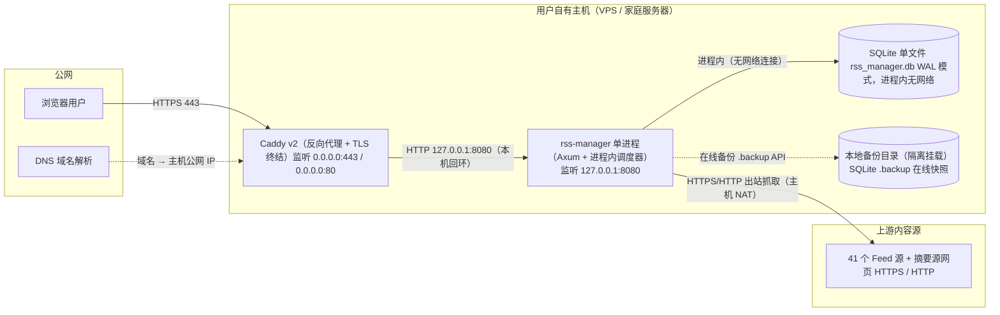

# Phase 5 交叉转交材料（中间产物，非交付物）

> 本文件为 team-lead 在 Phase 5.2 中段交接时落盘的交叉转交载体，承载两方骨架草稿原文 + 用户裁决结果。
> 下游消费：platform-architect 与 security-architect 各自 Read 本文件后，基于对方骨架完成完整正式稿。
> 完成后本文件不再作为交付物。

---

## 一、用户裁决记录（访问控制 · 中间确认已裁决）

- 论题：公网暴露的 rss-manager，反向代理层是否默认叠加第二道访问控制（与应用层单用户登录 F12 形成双重防护）？
- **用户裁决：方案 A —— 仅应用层登录 + 可选 IP 白名单开关**。反代层不默认叠加第二道认证（不默认 Basic Auth、不默认强制 IP 白名单）；提供"可选 IP 白名单"开关，用户按需自启。
- 落地要求：security-architect 按方案 A 定稿 §5.1 反向代理访问控制职责；platform-architect 按方案 A 配置反代（不默认加 basic_auth / 不默认加 IP 白名单，仅预留可选开关位）。

---

## 二、platform-architect 网络拓扑骨架（转交 security-architect 消费）

> 权威方：platform-architect。本节网络拓扑骨架（反代选型 / CIDR / 端口 / 链路）归 platform-architect 决策；security-architect 按此落实 WAF / 访问控制 / 运行时防护。

### 3.1 物理拓扑

#### 3.1.1 物理拓扑图

#### 3.1.2 拓扑要素清单

| 要素 | 取值 |
| --- | --- |
| 跨 Region / Region 数量 | 否 / 0（单主机自托管） |
| 跨 AZ / AZ 数量 | 否 / 0（单主机） |
| 流量入口路径 | 浏览器 → DNS → Caddy（公网 443，TLS 终结）→ rss-manager（127.0.0.1:8080，HTTP 本机回环） |
| 内部调用路径 | 单进程内模块直调（Axum 路由 → 业务模块 → 进程内调度器，无跨进程网络调用） |
| 数据库访问路径 | 进程内 SQLite 连接池（rusqlite，WAL），无网络、无主从、无 ProxySQL |

### 3.2 流量与网络链路

#### 3.2.1 流量入口链路

| 组件 | 协议 - 端口 | TLS 终结 | 作用 |
| --- | --- | --- | --- |
| DNS | DNS - 53（UDP/TCP） | — | 域名 → 主机公网 IP |
| 浏览器用户 | HTTPS - 443 | 客户端发起 TLS，对端 Caddy | 访问 SPA 静态资源（rust-embed 内嵌）+ 调用全 POST RPC /api/rpc/* |
| Caddy v2（反向代理） | HTTPS 443（0.0.0.0）+ HTTP 80（0.0.0.0，301→443） | ✅ Caddy 终结 TLS（内建 ACME 自动签发/续期） | TLS 终结 + 转发 + 自动注入 X-Forwarded-For |
| rss-manager 进程 | HTTP 127.0.0.1:8080（仅回环，环境变量可配） | ❌ 不终结 | 业务逻辑 / /api/rpc/* / /healthz / /readyz / 静态资源 |

#### 3.2.2 内部互联链路

| 项 | 说明 |
| --- | --- |
| 服务发现 | 不适用（单进程模块间直调） |
| 服务间协议 | 不适用（单进程函数调用） |
| mTLS | 不启用（反代→应用为本机回环明文 http） |
| 数据库连接 | 进程内 SQLite 连接池（rusqlite，WAL），无网络 |
| 缓存连接 | 不适用（无 Redis） |
| MQ 连接 | 不适用（进程内异步任务） |

#### 3.2.3 跨网络互联

| 互联类型 | 通道 | 带宽 | 加密 | 用途 |
| --- | --- | --- | --- | --- |
| 跨 VPC / 跨账号 / 跨 Region | 不适用（单主机） | — | — | — |
| 出站到上游 Feed 源 | 主机 NAT 直接出站（reqwest 直连） | 主机公网带宽 | 源站 HTTPS 用 HTTPS；HTTP 明文源按安全基线处理 | 定时抓取 / Readability 全文抓取 |
| 备份异地同步（可选） | rsync/scp（SSH）或对象存储 API | 主机公网带宽 | SSH / TLS | SQLite 备份异地归档 |

### 关键决策固化

| 决策项 | 唯一结论 |
| --- | --- |
| 反向代理选型 | Caddy v2（最新稳定版 2.x），唯一推荐 |
| 反向代理监听 | 公网 0.0.0.0:443（TLS）+ 0.0.0.0:80（HTTP→HTTPS 301） |
| 应用进程监听 | 127.0.0.1:8080（仅回环，环境变量 RSS_MANAGER_LISTEN_ADDR 可配） |
| TLS 终结位置 | 反向代理 Caddy 443；应用与反代间本机回环明文 http |
| SQLite 访问路径 | 进程内（rusqlite 连接池，WAL），无网络 |
| 健康检查 | /healthz（Liveness）+ /readyz（Readiness），监听 127.0.0.1:8080，不对公网开放 |

反向代理选型理由（Caddy v2）：①内建 ACME 自动 HTTPS 零运维；②单一二进制与"单文件运维"哲学同构；③默认 HTTP/2+TLS1.3+80→443 重定向，reverse_proxy 自动注入 X-Forwarded-For；④单用户场景内存占用与 Nginx 同量级。Nginx 的成熟度/并发/模块优势在本单用户自托管场景无收益。

最小 Caddyfile 示例：`rss.example.com { reverse_proxy 127.0.0.1:8080 }`（Caddy 自动 HTTPS + 80→443）。

备份路径固化：应用调度器调用 SQLite .backup API（在线快照，非裸 cp）→ 本地备份目录（与数据目录物理隔离）→ 可选异地同步。生产数据默认 /var/lib/rss-manager/data/rss_manager.db；备份目录 /var/lib/rss-manager/backups/；每日全量+每小时快照；全量保留 30 天；RPO≤60min / RTO≤10min。

---

## 三、security-architect 信任域骨架（转交 platform-architect 消费）

> 权威方：security-architect。安全组规则 / WAF / 密钥分级 / 审计字段与保留期归 security-architect 决策；platform-architect 按此配置资源。

### 1.1 安全总体架构图（单机自托管裁剪）

四信任域：TD-0 公网（不可信）/ TD-1 反向代理边界（半可信）/ TD-2 应用进程本机回环（可信）/ TD-3 SQLite 本地文件（可信静态数据）。

安全组件裁剪结论：抗 DDoS 不适用（可选 Cloudflare 用户自担）；云 WAF 不适用（可选反代基础规则）；云防火墙/安全组映射为主机防火墙（ufw/firewalld 仅放行 443/80）；主机安全用户自维护；KMS 不适用（密钥=环境变量+文件权限）；堡垒机不适用；SOC 不适用；数据安全审计启用（审计日志独立输出）。

### 5.1 网络分区（四信任域）

| 信任域 | 边界 | 信任等级 | 入站 | 出站 |
| --- | --- | --- | --- | --- |
| TD-0 公网 | 主机之外 | 不可信 | 浏览器 HTTPS 443/80 | — |
| TD-1 反向代理边界 | 反代进程 | 半可信 | 公网 HTTPS 443 | 转发 HTTP → 127.0.0.1:8080 |
| TD-2 应用进程回环 | rss-manager 进程 | 可信 | 反代转发（仅 localhost） | SQLite 写读 + 出站抓取 |
| TD-3 SQLite 本地文件 | 文件系统 | 可信静态数据 | 应用 SQLite 进程内连接 | — |

信任边界穿越规则（写死）：
- 边界 A（公网→反代）：仅 443，80 强制 301，TLS 1.2 最低，禁用 TLS1.0/1.1/SSLv3
- 边界 B（反代→应用）：仅 HTTP 127.0.0.1:8080（应用不监听 0.0.0.0），透传 X-Forwarded-For/Proto/Host
- 边界 C（应用→SQLite）：仅进程内连接，文件权限 0600/0700
- 边界 D（应用→公网出站）：仅 HTTPS GET 抓取，SSRF 防护（动态出口白名单）

### 反向代理安全职责（security 权威方结论）

| 职责 | 结论（写死） |
| --- | --- |
| ① TLS 终结 | 反代托管证书终结 TLS，仅 443，80 强制 301，TLS 1.2 最低，禁用 TLS1.0/1.1/SSLv3；Caddy 可选 ACME 自动续期 |
| ② 请求体大小限制 | 10 MB（对齐应用层 OPML/JSON body ≤10MB） |
| ③ 请求方法/头限制 | 仅允许 GET（静态资源）+ POST（RPC 接口）；限制请求头大小与 URL 长度 |
| ④ 基本访问控制 | 【已裁决：方案 A】仅应用层登录 + 可选 IP 白名单开关；反代层不默认叠加第二道认证，仅预留可选开关位 |
| ⑤ 可选基础 WAF 规则 | 默认不强制（系统设计 §7.1 已冻结）；可选：拒绝恶意 UA（sqlmap/nikto）、单 IP 连接数上限、单 IP 请求速率上限 |
| ⑥ 真实客户端 IP 透传 | 设置 X-Forwarded-For/Proto/Host；应用信任 X-Forwarded-For |
| ⑦ 不引入云安全产品 | 不引入云 WAF/DDoS/云防火墙；Cloudflare 兜底为用户自担可选项 |

### 应用进程与 SQLite 本机保护（写死）

- 进程运行用户：专用非特权用户 rss-manager，禁止 root，无登录 shell
- 数据目录 /var/lib/rss-manager/ 权限 0700，属主 rss-manager:rss-manager
- SQLite 文件 rss_manager.db（含 -wal/-shm）权限 0600，属主 rss-manager
- 配置/密钥文件权限 0600，禁止入库/入代码/入日志明文
- 备份目录权限 0700，与数据目录物理隔离，全量保留 30 天
- 反代绑定 443：root 启动仅用于绑定特权端口后 worker 降权，或 setcap cap_net_bind_service 授权非 root 绑定（Caddy 原生支持）

### 对外暴露面收敛（写死）

- 公网入站：仅反向代理 443 对外（80 可选跳转），其余端口一律不开放
- 应用监听：仅 127.0.0.1:8080（不监听 0.0.0.0），不直接暴露公网
- 主机防火墙：默认拒绝入站，仅放行 443/80；SSH 22 仅限可信 IP + 禁 root 密码登录（密钥优先）；应用 8080 不对公网放行
- SQLite 暴露面：无网络服务，仅文件系统访问

---

## 四、交叉一致性检查项（team-lead 在 G5 校验时逐项核对）

| 检查项 | 部署侧来源 | 安全侧来源 | 一致性要求 |
| --- | --- | --- | --- |
| 反向代理监听端口/协议 | 部署 §3.2.1（Caddy 443/80） | 安全 §5.1（边界 A 仅 443，80→301） | 完全一致 |
| 应用监听地址 | 部署 §3.2.1（127.0.0.1:8080） | 安全 §5.1（边界 B 仅 localhost 8080） | 完全一致 |
| TLS 终结位置 | 部署（Caddy 443） | 安全（反代终结，TLS 1.2+） | 完全一致 |
| 请求体大小限制 | 部署（按安全侧 10MB 配置） | 安全（10MB，权威） | 完全一致 |
| 访问控制 | 部署（按方案 A 预留可选开关） | 安全（方案 A，权威） | 完全一致 |
| 日志/审计保留期 | 部署（日志管道存储） | 安全（审计保留 ≥1 年，权威） | 部署 ≥ 安全规定 |
| WAF | 部署（按安全侧可选规则） | 安全（默认不强制，权威） | 完全一致 |
