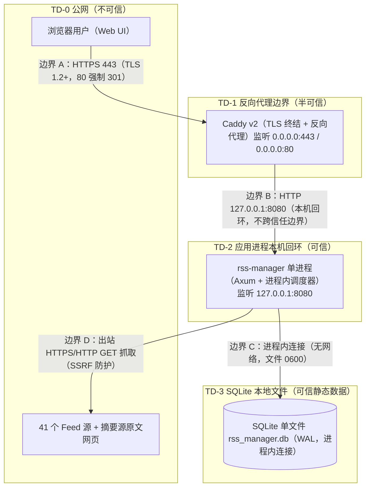

# AICoding 架构设计 · 安全设计

> 本文档为《AICoding 架构设计》核心产物之一，对应**安全架构设计模版**。
> 上游输入：《系统设计》（G4 已通过，网络架构 §6 / 安全 §7 / 可观测 §8 为唯一安全基线）、《UserStory》（§6.4 安全需求基线）、《高层架构设计》（G3 已通过）。
> 下游输出：驱动《部署设计》的资源加固配置与开发实现的安全控制点。
> 本文档由 security-architect（严守正）产出，待 G5 人工审核通过后由主理人归档。

---

## 0. 元信息：修订记录

| 文档版本 | 发布日期 | 修订人 | 修订说明 |
| --- | --- | --- | --- |
| v0.1 | 2026-08-25 | security-architect（严守正） | 完整正式稿：四信任域安全架构 + STRIDE 威胁模型 + IAM + 数据安全 + 应用安全（OWASP）+ 网络与基础设施安全 + 密钥管理 + 运行时安全；承接 Phase 5.1 信任域骨架与交叉转交（Caddy v2 + 访问控制方案 A 已裁决） |
| v0.2 | 2026-08-25 | security-architect（严守正） | G5 定点返工：①去除强制非特权用户 rss-manager（改容器非 root 推荐 / 二进制建议非 root 非强制）；②数据目录 `/var/lib/rss-manager/` 改为 `/data/`（数据文件 `/data/rss_manager.db`、备份 `/data/backups`），属主改为由部署方式决定 |

**按需裁剪登记**（保证编号连续）：

> 本项目为**单用户自托管、单一可执行文件、SQLite 单文件、无多租户、无容器集群**的轻量个人应用。依据模板顶部「使用说明」执行大幅裁剪，删除以下企业级不适用章节，并同步重新整理章节序号与交叉引用。

| 裁剪章节（模板原编号） | 裁剪理由 | 本设计承接方式 |
| --- | --- | --- |
| §2.1.1 多种登录方式（手机号/邮箱验证码/OAuth/扫码） | 单用户自托管，无注册、无第三方身份提供方（系统设计 §7.2.1 冻结「登录方式：账号密码，无验证码/SSO/扫码」） | §2.1 保留「账号密码 + argon2id」，可选 IP 白名单为网络层补充（非认证方式） |
| §2.1.2 MFA/2FA 管理端强制 | 单用户个人工具，MFA 不启用（系统设计 §7.2.1 冻结） | §2.1 密码策略 + 失败锁定 + 限流替代 |
| §2.2.1 RBAC0/ABAC 权限模型 | 单用户无 RBAC（系统设计 §7.2.5 冻结「权限模型：单用户，无 RBAC」） | §2.2 改为「全接口登录鉴权 + user_id 预留隔离」 |
| §2.2.3 多租户隔离（物理/逻辑） | 经中间确认 U-01：单用户，仅预留 user 维度 | §2.2 明确「单用户 + 预留 user 维度」 |
| §2.3 云账号与云资源访问（子账号/MFA/权限分离） | 自托管无云账号 | 整节删除 |
| §3.2.2 内部 mTLS / §3.2.3 数据库 SSL | 单进程内函数调用，无跨进程流量；SQLite 进程内无网络 | §3.2 改为「仅公网 TLS + 本机回环明文（不跨信任边界）」 |
| §3.2.4 接口签名（HMAC 防重放） | 无对外开放 API、无服务间调用 | 整节删除（防重放由全 POST + 幂等键 + 会话鉴权承担） |
| §3.3.4 文件存储安全（SSE/预签名 URL） | 无对象存储文件上传/外链；SQLite 单文件本地 | 整节删除 |
| §3.3.7 隐私合规（GDPR/个保法/数据出境） | 无个人敏感信息采集（无手机号/身份证/银行卡），数据完全自持于用户主机，无出境 | 整节删除（§3.4 保留数据自控说明） |
| §4.1 文件上传 / 反序列化（Java 系） | 无文件上传接口（OPML 以 JSON body 传递）；Rust serde 类型安全反序列化 | §4.1 声明「不适用」并给出对应控制点 |
| §5.1 DMZ/业务/DevOps VPC 分区 | 单机自托管，无 VPC | §5.1 改为「四信任域」 |
| §5.2.1 DDoS 高防 / CLB / §5.2.2 云防火墙 / §5.2.4 堡垒机 | 无云产品、无运维通道 | 映射为「主机防火墙 + 可选 Cloudflare（用户自担）」 |
| §5.3.2 容器/K8s 安全 / §5.4 中间件安全（Redis/MQ） | 单二进制可选单容器、无中间件 | §5.3 保留「主机安全」，容器仅一句最小权限声明 |
| §6.2 AKSK 泄露防护（KMS 白盒/CAM） | 无云 KMS、无云 AKSK | 整节删除（§6.1 保留本地密钥分级 + §6.2 红线） |
| §7.2 审计日志五维度（云资源/堡垒机/WAF） | 无云资源、无堡垒机、WAF 可选不强制 | §7.2 裁剪为「业务操作审计 + 抓取日志 + 可选反代访问日志」 |

---

## 1. 安全总体架构

### 1.1 安全总体架构图（四信任域）

> **总览**：1 张图，展示单机自托管形态下的四个信任域与四条信任边界穿越规则。本项目无云 VPC/DMZ/云防火墙/KMS/堡垒机/SOC，安全组件全部映射为单机可落地项。

**四信任域与边界穿越规则（写死）**：

| 信任域 | 边界 | 信任等级 | 入站 | 出站 | 边界穿越规则 |
| --- | --- | --- | --- | --- | --- |
| TD-0 公网 | 主机之外 | 不可信 | 浏览器 HTTPS 443/80 | — | 边界 A：仅 443，80 强制 301，TLS 1.2 最低，禁用 SSLv3 / TLS 1.0 / 1.1 |
| TD-1 反向代理边界 | Caddy v2 进程 | 半可信 | 公网 HTTPS 443 | 转发 HTTP → 127.0.0.1:8080 | 边界 B：仅 HTTP 127.0.0.1:8080（应用不监听 0.0.0.0），透传 X-Forwarded-For/Proto/Host |
| TD-2 应用进程回环 | rss-manager 进程 | 可信 | 反代转发（仅 localhost） | SQLite 写读 + 出站抓取 | 边界 C：仅进程内连接，文件权限 0600 / 目录 0700 |
| TD-3 SQLite 本地文件 | 文件系统 | 可信静态数据 | 应用 SQLite 进程内连接 | — | 边界 D：仅 HTTPS/HTTP GET 抓取，SSRF 防护（动态出口白名单） |

**安全组件裁剪结论**（对齐系统设计 §7.1，与 platform-architect 拓扑一致）：

| 组件 | 企业级形态 | 本项目结论 |
| --- | --- | --- |
| 抗 DDoS | DDoS 高防 | 不适用（可选 Cloudflare 兜底，用户自担） |
| WAF | 云 WAF | 不适用（可选反代基础规则，默认不强制） |
| 防火墙/安全组 | 云防火墙 + 安全组 | 映射为主机防火墙（ufw/firewalld 仅放行 443/80） |
| 主机安全 | 主机安全组件 | 用户自维护（SSH 加固 + 系统补丁） |
| KMS | 云 KMS | 不适用（密钥 = 环境变量 + 文件权限 0600） |
| 堡垒机 | 运维通道堡垒机 | 不适用（单机自托管，SSH 密钥登录直连） |
| SOC | 安全运营中心 | 不适用（个人项目） |
| 数据安全审计 | 数据库审计 | 启用（审计日志独立输出，见 §7.2） |

### 1.2 威胁模型（STRIDE）

> **方法**：采用 STRIDE 识别威胁，每条威胁映射到 §2~§7 的缓解措施，形成「威胁—缓解措施映射表」。威胁识别基线 = 系统设计的模块边界（M1~M7）、数据流（公网入口 / 本机回环 / 进程内 / 出站抓取）、接口契约（全 POST RPC `/api/rpc/*`）、身份边界（单用户会话）与运行形态（单机自托管）。

**威胁清单（本项目具体化）**：

| 威胁编号 | 类别 | 威胁描述 | 受影响资产 |
| --- | --- | --- | --- |
| S-1 | 仿冒 | 攻击者对单用户账号爆破/撞库，冒充合法用户登录 | 登录凭据、会话 |
| S-2 | 仿冒 | 会话令牌被窃取（XSS/中间人）或猜测，冒充已登录会话 | t_session、Cookie |
| S-3 | 仿冒 | 诱导系统抓取伪造上游源站，投递恶意内容 | 出站抓取通道 |
| T-1 | 篡改 | 篡改 RPC 请求参数（资源 id / 筛选条件）实现越权或注入 | `/api/rpc/*` 接口 |
| T-2 | 篡改 | 直接篡改 SQLite 数据文件或备份文件 | rss_manager.db、备份目录 |
| T-3 | 篡改 | 篡改配置文件 / 环境变量中的密钥与会话密钥 | 配置、Secret |
| R-1 | 否认 | 关键操作（登录/源管理/导入导出/改密）无审计，事后无法定位 | 审计日志 |
| R-2 | 否认 | 抓取行为无记录，无法追溯异常抓取 | t_fetch_log |
| I-1 | 信息泄露 | 密码哈希/会话令牌明文泄露（日志/错误/导出） | 敏感字段 |
| I-2 | 信息泄露 | 公网明文传输被窃听（未启用 TLS） | 传输链路 |
| I-3 | 信息泄露 | 错误堆栈/SQL/内部路径暴露于响应 | 错误响应 |
| I-4 | 信息泄露 | SQLite 文件被非授权进程读取 | rss_manager.db |
| D-1 | 拒绝服务 | 登录爆破耗尽资源 / 触发锁定 | 登录接口 |
| D-2 | 拒绝服务 | 请求体超大导致内存/解析耗尽 | 反代、JSON 解析 |
| D-3 | 拒绝服务 | 高频请求/CC 攻击导致进程不可用 | 全量接口 |
| D-4 | 拒绝服务 | 恶意 Feed 超大响应/慢速响应拖垮抓取调度 | 出站抓取 |
| E-1 | 权限提升 | 未登录访问受保护接口（垂直越权） | 全部业务接口 |
| E-2 | 权限提升 | 水平越权（IDOR）访问他人数据（预留 user 维度场景） | 数据查询 |
| E-3 | 权限提升 | 应用以 root 运行被攻破后主机提权 | 进程、主机 |
| E-4 | 权限提升 | SSRF 利用抓取任意 URL 探测内网/云元数据（本项目最高危项） | 出站抓取通道 |

**威胁—缓解措施映射表**：

| 威胁编号 | STRIDE 类别 | 缓解措施 | 缓解章节 |
| --- | --- | --- | --- |
| S-1 | 仿冒 | argon2id 加盐哈希（禁 MD5/SHA1）+ 连续 5 次失败锁定 15 分钟 + 登录限流 5 次/分钟 + 可选 IP 白名单 | §2.1、§4.3 |
| S-2 | 仿冒 | 不透明 256bit 随机令牌 + SHA-256 哈希存库 + HttpOnly/Secure/SameSite=Lax Cookie + 7 天滑动过期 + 改密全量失效 + 主动注销 | §2.1 |
| S-3 | 仿冒 | 出站 scheme 白名单（仅 http/https）+ 端口白名单（80/443）+ 内网 IP 段黑名单 + 重定向逐跳校验 | §4.1 |
| T-1 | 篡改 | 鉴权中间件统一拦截 + SQL 参数化（sqlx 编译期校验）+ 资源 id 走 JSON body 并校验归属 | §2.2、§4.1 |
| T-2 | 篡改 | SQLite 文件 0600 + 数据目录 0700 + 备份目录隔离 + 容器非 root（推荐）/ 二进制建议非 root + 文件权限保护 | §3.3、§5.3 |
| T-3 | 篡改 | 密钥/配置环境变量 + 文件权限 0600，属主由部署方式决定（Docker 卷属主为容器用户，二进制为运行用户），禁止入代码/日志 | §6.1、§6.2 |
| R-1 | 否认 | 审计日志（登录/源管理/导入导出/改密）含 traceId+tenantId+userId+来源 IP，保留 ≥1 年 | §7.2 |
| R-2 | 否认 | 抓取日志 t_fetch_log 结构化落库（含 traceId），保留 30 天 | §7.2 |
| I-1 | 信息泄露 | argon2id/SHA-256 单向哈希存储，禁止明文；日志脱敏（禁 password/token） | §3.3、§7.2 |
| I-2 | 信息泄露 | 公网 TLS 1.2+（Caddy 443 终结，80 强制 301），禁用 SSLv3/TLS 1.0/1.1 | §3.2 |
| I-3 | 信息泄露 | 统一异常处理，禁止暴露堆栈/SQL/内部路径，调试信息不出生产 | §4.2 |
| I-4 | 信息泄露 | SQLite 文件 0600 + 目录 0700 + 容器非 root（推荐）/ 二进制建议非 root + 无网络暴露面 | §3.3、§5.3 |
| D-1 | 拒绝服务 | 登录失败锁定 5 次/15min + 登录限流 5 次/分钟（重保接口） | §4.3 |
| D-2 | 拒绝服务 | 请求体大小限制 10MB（反代 + 应用双层）+ JSON 解析前体积校验 | §5.2、§4.3 |
| D-3 | 拒绝服务 | 全局 100 / 单 IP 50 / 单用户 50 / 写接口 20 QPS 限流 + 可选反代单 IP 连接数/速率上限 | §4.3、§5.2 |
| D-4 | 拒绝服务 | 抓取超时 ≤30s + 逐源并发上限 5 + 指数退避（系统设计冻结） | §5.2 |
| E-1 | 权限提升 | 鉴权中间件拦截全部业务接口（除 `/api/rpc/auth_login` 与静态资源） | §2.2 |
| E-2 | 权限提升 | 查询强制带 user_id（预留维度），单用户无横向越权 | §2.2 |
| E-3 | 权限提升 | 容器非 root（推荐，镜像定义）/ 二进制建议非 root（非强制，用户自行决定运行方式）+ 最小权限 | §5.3 |
| E-4 | 权限提升 | SSRF 防护：内网 IP 黑名单 + DNS rebinding 防护 + 重定向逐跳重校验 + 禁 file/ftp/gopher 等非 http 协议 | §4.1 |

> STRIDE 六类全覆盖（仿冒/篡改/否认/信息泄露/拒绝服务/权限提升），共 20 条威胁，每条均映射到 §2~§7 具体缓解措施，无空行、无泛化表述。

---

## 2. 身份与访问管理（IAM）

### 2.1 身份认证（Authentication）

> 单用户自托管，无注册、无多用户、无第三方身份提供方。认证目标：公网暴露下确保未授权者无法读取订阅、阅读历史与搜索索引。

#### 2.1.1 用户登录

- **登录方式**：账号密码单一方式（系统设计 §7.2.1 冻结「无验证码/SSO/扫码」；MFA 不启用，可选 TOTP 为 P2 增强）。
- **登录接口**：`POST /api/rpc/auth_login`（唯一公开 RPC 接口，其余接口一律需会话）。
- **凭据校验**：密码以 argon2id 加盐哈希比对（禁止 MD5/SHA1/明文/可逆加密）；比对采用常量时间比较。
- **失败处理**：返回统一 A700001「用户名或密码错误」，不区分用户名不存在与密码错误（防枚举）。

#### 2.1.2 密码策略（量化阈值）

| 项 | 基线值 | 说明 |
| --- | --- | --- |
| 最小长度 | ≥ 12 位 | 以系统设计 §7.2.1 安全基线为准（UserStory §6.4.1 的 8 位为较低值，见附录待确认点） |
| 复杂度 | 同时包含大写字母 + 小写字母 + 数字 + 特殊字符 | 改密时校验 |
| 加密存储 | argon2id 加盐哈希（内存/迭代参数取 OWASP 推荐档） | 禁止 MD5/SHA1 明文 |
| 首次部署 | 初始密码经环境变量或首次设置向导配置，首次登录后强制修改 | 系统设计 §7.2.3 |
| 改密校验 | 需原密码验证（`auth_change_password` 校验 old_password） | 关键操作二次验证 |
| 失败锁定 | 连续失败 5 次锁定 15 分钟 | 系统设计 §7.2.1 冻结 |

#### 2.1.3 会话管理

| 项 | 取值 | 说明 |
| --- | --- | --- |
| Token 类型 | 不透明随机令牌（256bit，CSPRNG 生成） | 禁止 URL 携带 token |
| 存储 | SHA-256 哈希存 `t_session.token_hash`，浏览器仅存 Cookie | 不存明文令牌 |
| Cookie 属性 | HttpOnly + Secure + SameSite=Lax | 防 XSS 窃取、防跨站携带 |
| 有效期 | 7 天滑动过期（每次请求续期滚动 `expires_at`） | 系统设计 §7.2.1 冻结 |
| 续期 | 滑动过期：鉴权通过后刷新 `expires_at` | 长期在线的活跃会话不中断 |
| 注销 | `POST /api/rpc/auth_logout` 删除对应 `t_session` 记录 | 主动失效 |
| 改密失效 | 修改密码后删除该用户全部 `t_session` 记录 | 全量失效，防旧会话残留 |
| 过期清理 | 清理任务按 `expires_at` 定期物理删除过期会话 | 系统设计 §4.2 |

### 2.2 授权与访问控制（Authorization）

#### 2.2.1 权限模型

单用户，无 RBAC（系统设计 §7.2.5 冻结）。授权简化为「是否持有有效会话」的二元判定，由 `AuthLayer` 鉴权中间件统一拦截。

#### 2.2.2 权限维度

- **接口级**：除 `/api/rpc/auth_login` 与静态资源（rust-embed）外，全部 `/api/rpc/*` 接口需登录，未登录返回 C401001。
- **数据级**：所有查询/写入强制带 `user_id`（预留 user 维度），当前单用户恒为固定值。
- **功能级**：不适用（单用户无菜单/按钮细粒度控制，全功能对唯一用户开放）。

#### 2.2.3 多租户隔离

经中间确认 U-01：**单用户实现，数据模型预留 user 维度**（`user_id` 隔离字段 + 查询必带）。不做多租户 UI、不做物理/逻辑隔离选择。

#### 2.2.4 越权防护

- **垂直越权**：鉴权中间件拦截，无会话访问受保护接口 → 401。
- **水平越权（IDOR）**：单用户无横向越权面；查询/写入强制带 `user_id`（预留扩展），防止未来多用户化时产生 IDOR 漏洞。

#### 2.2.5 访问控制方案（经中间确认）

**方案 A（用户已裁决）**：仅应用层登录 + 可选 IP 白名单开关，反代层不默认叠加第二道认证。

| 层 | 访问控制 | 默认状态 |
| --- | --- | --- |
| 应用层 | 账号密码登录 + 会话鉴权（全接口） | 默认启用 |
| 反代层 | 不默认 Basic Auth、不默认强制 IP 白名单 | 默认关闭 |
| 可选 | IP 白名单开关（用户按需自启，如仅家庭网段访问） | 预留开关位 |

---

## 3. 数据安全

### 3.1 数据分级

> 单用户自托管无个人敏感信息（无手机号/身份证/银行卡），数据分级裁剪为 L1~L3（模板 L4 高敏「手机号/身份证/AKSK」不适用）。

| 等级 | 类别 | 本项目示例 | 处理策略 |
| --- | --- | --- | --- |
| L1 | 公开 | 公开 Feed 源内容（导入前的 RSS/Atom 原始内容，外部已公开） | 无特殊管控，正常展示 |
| L2 | 敏感 | 订阅配置（OPML 清单/xmlUrl/htmlUrl/分组/抓取配置）、文章全文与阅读记录、收藏夹、已读状态 | 需登录鉴权访问；OPML 导出由用户主动触发；SQLite 文件权限保护 |
| L3 | 高敏 | 用户密码哈希（argon2id）、会话令牌哈希（SHA-256） | 单向哈希存储，禁止明文/展示/导出；日志脱敏 |

**敏感字段处理策略表**：

| 字段 | 分级 | 存储策略 | 展示策略 | 导出策略 |
| --- | --- | --- | --- | --- |
| password_hash | L3 | argon2id 加盐哈希 | 不展示 | 禁止导出 |
| token_hash | L3 | SHA-256 哈希 | 不展示 | 禁止导出 |
| 订阅清单/文章全文 | L2 | 明文（个人数据） | 正常展示 | OPML 导出（用户主动触发） |

### 3.2 数据传输安全

| 场景 | 方案 | 说明 |
| --- | --- | --- |
| 公网访问（浏览器 → 反代） | TLS 1.2+（最低），禁用 SSLv3 / TLS 1.0 / 1.1 | Caddy v2 在 443 终结 TLS（内建 ACME 自动签发/续期），80 强制 301 跳 443 |
| 反代 → 应用 | 本机回环明文 HTTP（127.0.0.1:8080） | 不跨信任边界（边界 B 为单机本机），无外部窃听面；应用不监听 0.0.0.0 |
| 应用 → SQLite | 进程内连接，无网络 | SQLite 进程内连接池（无 SSL 需求） |
| 应用 → 上游 Feed/网页 | 源站 HTTPS 用 HTTPS；HTTP 明文源按安全基线处理 | 出站抓取，SSRF 防护见 §4.1 |

> **传参禁忌**：全部 RPC 参数走 JSON body（系统设计 §3.5.5 冻结）；禁止 URL/query/path 携带 token、密码、AKSK 等敏感信息；Cookie 承载会话令牌且仅 HttpOnly。

### 3.3 数据存储安全

| 项 | 方案 | 说明 |
| --- | --- | --- |
| 数据库 | SQLite 单文件 `/data/rss_manager.db`（WAL，用户可配置） | 进程内连接，无网络暴露面 |
| 文件权限 | 数据目录 `/data/` 权限 0700；SQLite 文件（含 -wal/-shm）权限 0600；属主由部署方式决定（Docker 卷属主为容器用户，二进制为运行用户） | 边界 C 写死 |
| 密码字段 | argon2id 加盐哈希（不可逆） | 禁止明文，禁止 MD5/SHA1 |
| 会话令牌 | SHA-256 哈希存 `t_session`，不存明文令牌 | 泄漏令牌哈希不导致直接会话劫持 |
| 落盘加密 | 可选全盘加密（用户自担） | 无云 KMS；个人自托管由用户决定是否启用 LUKS/文件系统加密 |
| 密钥管理 | 环境变量 + 文件权限 0600，禁止硬编码 | 见 §6 |

### 3.4 数据使用安全与备份

- **展示脱敏**：L3 字段（密码/令牌哈希）永不展示；L2 订阅/文章数据仅登录后展示。
- **数据导出**：OPML 导出（F10）由用户主动触发，无审批流（单用户，无审批角色）。
- **数据销毁**：源/分组/收藏夹删除采用软删除（`deleted=1`）；文章按 `created_time` 保留 180 天由清理任务物理删除并同步 FTS 索引（系统设计 §4.2）；过期会话按 `expires_at` 定期物理删除。
- **备份与容灾**：

| 项 | 取值 |
| --- | --- |
| 备份方式 | SQLite `.backup` 在线快照（写时快照，不断服务）+ WAL 检查点 |
| 备份位置 | `/data/backups`（默认，用户可配置；可选异地同步 rsync/SSH 或对象存储） |
| 保留策略 | 全量保留 30 天 |
| RPO | ≤ 60 分钟（备份频率） |
| RTO | ≤ 10 分钟（停进程 → 复制回备份 → 重启） |
| 恢复演练 | 每月一次，负责人 = 维护者（用户本人） |

---

## 4. 应用安全（OWASP）

> 以 OWASP Top 10 为风险场景，逐项给出本项目落地防护（非泛化）。本项目**最高危项 = SSRF**（系统可被诱导抓取任意 URL）。

### 4.1 输入安全

| 风险 | 本项目暴露面 | 防护措施（落地机制） |
| --- | --- | --- |
| SSRF（最高危） | 用户可提交任意 xmlUrl/htmlUrl（feed_create/feed_test/OPML 导入），系统出站抓取该 URL；Readability 抓取 htmlUrl | ① scheme 白名单：仅允许 http/https，拒绝 file/ftp/gopher/dict 等协议；② 端口白名单：仅 80/443；③ 内网 IP 段黑名单：DNS 解析后校验目标 IP，拒绝 IPv4 私网（10.0.0.0/8、172.16.0.0/12、192.168.0.0/16）、回环（127.0.0.0/8、::1）、链路本地/云元数据（169.254.0.0/16，含 169.254.169.254）、组播/保留（224.0.0.0/4、0.0.0.0/8、100.64.0.0/10 CGN）、IPv6 等价段（::ffff:0:0/96 映射、fc00::/7、fe80::/10）；④ DNS rebinding 防护：校验解析出的全部 IP 且连接时固定使用已校验 IP；⑤ 重定向逐跳重校验：跟随 30x 时对每跳目标重新执行 scheme/端口/IP 校验；⑥ 统一出口函数：定时抓取、手动测试、Readability 全文抓取三条出站路径共用同一 SSRF 校验 |
| XSS（存储型） | 文章正文/标题来自外部不可信 Feed，渲染于详情页；Readability 全文内嵌 | ① 输出净化：正文/标题渲染前经白名单 HTML 净化，剥离 script/iframe/事件处理器（on*）/javascript: 伪协议；后端 feed-rs 解析时 sanitize（feed-rs 内建），前端渲染走 DOMPurify（仅净化后内容走 dangerouslySetInnerHTML）；② React 默认转义普通文本；③ CSP：Content-Security-Policy 限制 script-src 'self'（禁内联脚本）、object-src 'none'、frame-ancestors 'none'；④ Cookie HttpOnly 防会话窃取；⑤ 链接 href 白名单（仅 http/https，防 javascript: URL） |
| SQL 注入 | 全部查询/写入经 sqlx；搜索关键词进 FTS5 | ① 强制参数化查询（sqlx 参数绑定 + 编译期 SQL 校验）；② 动态字段（排序/筛选字段名）白名单校验，禁止拼接；③ FTS5 MATCH 关键词作为绑定参数传入，不使用字符串拼接 |
| CSRF | 会话 Cookie 承载鉴权，全 POST 状态变更接口 | ① SameSite=Lax Cookie（跨站 POST 不携带）；② 全 POST RPC + 校验 Content-Type: application/json（跨站表单无法构造 application/json，阻断基于表单的 CSRF）；③ 无 CORS 开放（不返回 Access-Control-Allow-Origin），跨源 JS 无法读取响应；④ 改密需原密码（关键操作二次验证） |
| 命令注入 | Rust 单二进制，无 shell/动态命令执行 | 不适用：系统无系统调用命令执行路径（不调用 shell）；出站抓取走 reqwest 类型安全客户端，非 shell 拼命令 |
| 反序列化 | JSON 反序列化（serde_json） | Rust serde 为类型安全反序列化（无 Java fastjson/Jackson 任意类加载风险）；DTO 字段类型强约束 + 字段长度/格式校验，拒绝未知超大字段 |
| 文件上传 | 无文件上传接口（OPML 以 JSON body `content` 字段传递 XML 文本） | 不适用：无 multipart 文件上传；OPML 导入受请求体 10MB 限制 + quick-xml 解析 |
| XXE | OPML（XML）解析用 quick-xml | 关闭/不解析 DTD 与外部实体（quick-xml 流式解析不处理外部实体）；导入前校验 XML 结构 + 体积（10MB 上限） |
| 开放重定向 | 原文跳转（F11）为新窗口打开 htmlUrl（浏览器侧）；前端路由 History | ① 无服务端 302 开放重定向接口；② 原文跳转 href 白名单（仅 http/https）；③ 前端路由守卫：未登录跳固定 `/login`（目标白名单，不接受外部 redirect 参数） |
| 登录爆破 | 单用户登录接口公网暴露 | ① 连续失败 5 次锁定 15 分钟；② 登录接口限流 5 次/分钟；③ 统一错误文案防枚举；④ 可选 IP 白名单（方案 A） |

### 4.2 输出安全

#### 4.2.1 统一异常处理

- 统一 `Result(code/msg/data/traceId/timestamp)` 包裹；错误码映射 HTTP 状态（系统设计 §3.5.1）。
- **禁止**在响应中暴露堆栈、SQL、内部路径、内部类名；系统错误（B 类）对外统一返回 `B999001 系统繁忙`，内部详情仅入 ERROR 日志。

#### 4.2.2 调试信息

- 生产环境关闭 debug/backtrace 输出；`RUST_LOG` 生产默认 INFO，ERROR 堆栈仅入本地日志不出响应；前端生产构建无 source map 泄露。

### 4.3 业务逻辑安全

| 风险 | 防护措施 |
| --- | --- |
| 越权防护 | 鉴权中间件拦截 + 查询强制 user_id（见 §2.2.4） |
| 防刷防爬 | 限流：全局 100 QPS / 单 IP 50 / 单用户 50 / 写接口 20 / 登录 5 次每分钟（系统设计 §3.5.3 冻结）；触发返回 C429001 + Retry-After |
| 幂等 | 创建/批量接口 `idempotency_key`（JSON body，UUID）+ DB 唯一约束兜底（xml_url/name/user+article）；重复请求返回相同结果（系统设计 §3.5.2） |
| 请求体上限 | 请求体 10MB（反代 Caddy + 应用 JSON 解析前双层校验） |
| 关键操作二次验证 | 改密需原密码；删除源/分组/收藏夹前端二次确认 |
| 抓取礼貌性 | 单源间隔 ≥30min + 逐源并发上限 5 + 超时 ≤30s + 指数退避（系统设计 §3.2.M2 冻结，防触犯源站封禁） |

### 4.4 第三方与供应链安全

| 项 | 措施 |
| --- | --- |
| 依赖漏洞扫描 | Rust 侧 `cargo audit`（依赖锁定 Cargo.lock）；前端 `npm audit`（package-lock.json）；纳入 CICD 门禁 |
| 开源协议合规 | feed-rs（MIT）、readabilityrs（Apache-2.0）、SQLite（公有领域）、rust-embed、Axum/Tokio/reqwest/sqlx（MIT/Apache-2.0）——均无 GPL/AGPL 传染风险，可合规自托管分发 |
| 年轻库风险 | readabilityrs 0.1.x（R-06）逐源开关 + 失败降级跳转原文；MVP 上线前完成 41 源全文抓取冒烟测试 |
| 版本锁定 | Cargo.lock 与 package-lock.json 提交仓库，禁止浮动版本；依赖升级走 `cargo update` 评审 |
| 供应链投毒 | crates.io/npm 固定版本 + 锁定 hash；禁止直接引用未审查的第三方二进制 |

---

## 5. 网络与基础设施安全

### 5.1 网络分区（四信任域）

> 单机自托管无 VPC/DMZ，网络分区 = 四信任域（详见 §1.1）。本节给出与 platform-architect 拓扑一致的落地方案。

| 信任域 | 构成 | 信任等级 | 防护要点 |
| --- | --- | --- | --- |
| TD-0 公网 | 主机之外 | 不可信 | 仅反代 443/80 入站，其余端口一律关闭 |
| TD-1 反向代理边界 | Caddy v2 进程 | 半可信 | TLS 终结 + 转发，仅 443 对外；反代安全职责见 §5.2 |
| TD-2 应用进程回环 | rss-manager 进程 | 可信 | 仅监听 127.0.0.1:8080（不监听 0.0.0.0），不直接暴露公网 |
| TD-3 SQLite 本地文件 | 文件系统 | 可信静态数据 | 文件 0600/目录 0700，无网络服务 |

**对外暴露面收敛（写死）**：

- 公网入站：仅 Caddy 443（80 可选 301），其余端口一律不开放。
- 应用监听：仅 127.0.0.1:8080（环境变量 `RSS_MANAGER_LISTEN_ADDR` 可配，禁止配置为 0.0.0.0）。
- 主机防火墙：默认拒绝入站，仅放行 443/80；SSH 22 仅限可信 IP + 禁 root 密码登录（密钥优先）；应用 8080 不对公网放行。
- SQLite 暴露面：无网络服务，仅文件系统访问。

### 5.2 流量管控（反向代理安全职责）

> 反向代理 = Caddy v2（platform-architect 权威，已锁定）。以下为 security-architect 权威的安全职责结论，platform-architect 按此配置。

| 职责 | 结论（写死） |
| --- | --- |
| ① TLS 终结 | Caddy 443 终结 TLS（内建 ACME 自动签发/续期），80 强制 301；TLS 1.2 最低，禁用 SSLv3 / TLS 1.0 / 1.1 |
| ② 请求体大小限制 | 10MB（对齐应用层 OPML/JSON body 上限） |
| ③ 请求方法/头限制 | 仅允许 GET（静态资源）+ POST（RPC 接口）；限制请求头大小与 URL 长度 |
| ④ 基本访问控制 | 【经中间确认：方案 A】仅应用层登录 + 可选 IP 白名单开关；反代层不默认叠加第二道认证，仅预留可选开关位 |
| ⑤ 可选基础 WAF 规则 | 默认不强制（系统设计 §7.1 已冻结）；可选：拒绝恶意 UA（sqlmap/nikto）、单 IP 连接数上限、单 IP 请求速率上限 |
| ⑥ 真实客户端 IP 透传 | 设置 X-Forwarded-For/Proto/Host；应用信任 X-Forwarded-For 获取真实 IP |
| ⑦ 不引入云安全产品 | 不引入云 WAF/DDoS/云防火墙；Cloudflare 兜底为用户自担可选项 |

**应用层限流**（§4.3 红线，与系统设计 §3.5.3 一致）：全局 100 / 单 IP 50 / 单用户 50 / 写 20 QPS，登录重保 5 次/分钟锁定 15 分钟。

### 5.3 主机安全

| 项 | 方案 |
| --- | --- |
| 进程运行用户 | Docker：容器内非 root（镜像定义，推荐）；二进制：建议非 root（非强制，用户自行决定运行方式） |
| 最小化安装 | 最小化系统包、关闭非必要服务、定期系统补丁 |
| SSH 登录 | 优先 SSH 密钥登录（密钥对），禁止 root 密码登录，密码登录仅兜底；SSH 22 仅限可信 IP |
| 主机防火墙 | 默认拒绝入站，仅放行 443/80；应用 8080 不对公网放行 |
| 反代降权 | Caddy 绑定 443：root 启动仅用于绑定特权端口后 worker 降权，或 setcap cap_net_bind_service 授权非 root 绑定（Caddy 原生支持） |
| 文件权限 | 数据目录 `/data/` 0700、备份目录 `/data/backups` 0700、配置目录 0700；SQLite 与密钥文件 0600；属主由部署方式决定（Docker 卷属主为容器用户，二进制为运行用户） |
| 容器（可选） | 单容器形态下镜像最小化、非 root 运行、只读根文件系统（可选）、不打包密钥（环境变量运行时注入） |

---

## 6. 密钥与凭证管理

> 无云 KMS/Vault，密钥 = 环境变量 + 文件权限 0600 本地管理（系统设计 §7.2.3 冻结）。

### 6.1 密钥分级与存储

| 密钥类型 | 本项目取值 | 存储/管理方式 | 轮换策略 |
| --- | --- | --- | --- |
| 用户密码 | 单用户登录密码 | argon2id 加盐哈希存 `t_user.password_hash`（不可逆） | 首次登录后强制修改；改密需原密码 |
| 会话令牌 | 不透明 256bit 随机令牌 | SHA-256 哈希存 `t_session.token_hash`，浏览器仅存 HttpOnly Cookie | 7 天滑动过期；改密全量失效 |
| TLS 证书私钥 | Caddy 托管证书 | Caddy ACME 自动签发/续期，私钥由 Caddy 以受限权限保存 | ACME 自动续期（默认 90 天） |
| 会话签名密钥（可选增强） | 无（不透明令牌存库，无需签名密钥） | 不适用 | 不适用 |
| 可选对象存储 AK（备份异地同步） | 备份同步到对象存储时使用 | 环境变量 + 文件权限 0600，属主由部署方式决定（Docker 卷属主为容器用户，二进制为运行用户） | 建议 90 天轮换；泄露立即禁用并轮换 |

> 说明：SQLite 进程内无网络连接，无「数据库密码」；单进程无「服务间通信密钥」；无对外开放 API，无「API Key」。模板五类密钥裁剪为上述本地四类。

### 6.2 密钥使用红线

- **严禁**密码/令牌/AK 出现在源码、Git 仓库、前端代码、日志、错误堆栈、URL、配置文件明文。
- **严禁**硬编码密钥；统一经环境变量或 0600 权限配置文件注入，启动 fail-fast（系统设计 §5.1 L3/L4 Secret 层）。
- **严禁**多环境共用密钥；会话令牌与对象存储 AK 按用途/环境隔离。
- 上线前必须通过密钥扫描（cargo 侧 grep/密钥扫描工具 + 前端构建产物扫描）识别硬编码密钥，纳入 CICD 红线。
- 密钥一旦疑似泄露，立即轮换（改密 + 全量会话失效 / 禁用并轮换对象存储 AK），并排查审计日志确认影响面。

---

## 7. 运行时安全：监控、审计、应急

### 7.1 安全事件监控

| 监控维度 | 具体事件 | 告警去向 |
| --- | --- | --- |
| 登录异常 | 连续登录失败（≥5 次触发锁定）、锁定事件、异常来源 IP 登录成功 | 审计日志 + 告警（§8.4 AL 体系，维护者） |
| 越权请求 | 未登录访问受保护接口（401 高频）、非法资源 id 访问（403） | 审计日志 + 告警 |
| SSRF 尝试 | 出站抓取被内网 IP 黑名单拦截的请求（记录目标 IP/域名/触发源） | 审计日志 + 告警（最高危，优先告警） |
| 敏感操作 | 修改密码、删除源/分组/收藏夹、OPML 导入导出、手动触发抓取 | 审计日志 |
| 资源异常 | 抓取失败率/全文抓取成功率（对齐系统设计 §8.4 AL-03/AL-06） | 监控大盘 + 告警 |

> 自托管无 SOC/IDS，监控以「结构化日志 + 关键事件埋点 + 可选告警」落地，告警体系对齐系统设计 §8.4（P0~P3 含 Owner + Runbook）。

### 7.2 审计日志

> 单机自托管裁剪：无云资源/堡垒机/WAF 强制审计，审计日志聚焦业务操作 + 抓取日志 + 可选反代访问日志。

**审计范围与字段**：

| 审计维度 | 记录内容 | 字段 |
| --- | --- | --- |
| 业务操作审计 | 登录/登出、修改密码、源管理（增删改）、分组管理、OPML 导入导出、收藏夹操作 | `traceId` + `tenantId` + `userId` + 操作时间 + 事件名 + 资源 id + 结果 + 来源 IP |
| 抓取日志 | 单源单次抓取结果（含 traceId） | `traceId` + feed_id + 结果 + 错误类型 + 耗时（系统设计 `t_fetch_log`） |
| 可选反代访问日志 | Caddy 访问日志（含真实客户端 IP，由 X-Forwarded-For 透传） | 时间 + 来源 IP + 路径 + 状态码（platform-architect 日志管道权威） |

**审计要求**：

- **不可篡改**：审计日志结构化独立输出（本地文件/可选远程日志组件），与业务库分离，禁止业务代码回写审计日志。
- **字段硬性要求**：所有日志必含 `traceId` + `tenantId`；禁止打印密码/token 明文（脱敏）。
- **保留期**：审计日志保留 ≥ 1 年（与系统设计 §8.2.1 一致；日志收集与存储归 platform-architect，本项为安全侧权威要求）。

### 7.3 应急响应

| 事件类型 | 触发场景 | 响应流程 | 恢复目标 |
| --- | --- | --- | --- |
| 漏洞响应 | 依赖组件 CVE / 自身高危漏洞披露 | 评估影响面（cargo audit / 披露公告）→ 热修或升级依赖 → 重新部署单二进制 → 回归验证 | 高危漏洞响应 ≤ 24h |
| 密钥泄露 | 密码/会话密钥/对象存储 AK 泄露 | 立即改密 + 全量会话失效 / 禁用并轮换 AK → 排查审计日志确认影响面 → 加固（限流/IP 白名单） | 第一时间止损 |
| 被攻击 | 公网 Web 入口被入侵 / SSRF 滥用 | 立即下线（关闭公网 443 或断网）→ 取证（审计日志 + 抓取日志）→ 清理后门/重置凭据 → 从备份恢复 → 复盘加固 | RTO ≤ 10min（备份恢复） |
| 备份与恢复 | 数据丢失/损坏/磁盘故障 | 停进程 → 从隔离备份目录复制回 SQLite 文件 → 重启 → 校验完整性 | RPO ≤ 60min / RTO ≤ 10min |

> 恢复演练频率：每月一次（备份恢复演练），负责人 = 维护者（用户本人）。

---

## 附录 A：中间确认自检报告（协议 §2.4 强制）

> 本报告按公共协议 `intermediate_confirmation.md` §2.1 + §2.3 执行。Phase 5.1 已发起 1 项中间确认（反代第二道访问控制，用户裁决方案 A，已回注落地）。本阶段（完整正式稿）在 §1/§2/§3/§6 完成后各执行一次自检，结论：**全部未命中新触发标准，未新增 [中间确认]**。

### A.1 §1 威胁模型与 SSRF 缓解路径自检

- §2.1 判定：未命中。SSRF 缓解路径（scheme 白名单 + 内网 IP 黑名单 + 重定向逐跳校验）为单机自托管形态下的唯一合理方案，不存在「mTLS vs 网关签名」等分歧（本机回环无跨信任边界，mTLS 不适用）。
- Q1（返工成本）：若改 SSRF 缓解方案，返工范围 = §4.1 SSRF 行 + 出站抓取统一出口函数（M2/M4 抓取模块），不足 30% 阶段产物，低于 0.2 人月，可控。
- Q2（可感知方）：用户不可感知（SSRF 为内部防护，不改变功能/交互）；感知方为开发者与潜在攻击者。
- Q3（与原始诉求一致）：用户诉求「开发一个 rss 的管理器」未显式提及 SSRF 细节；该方案忠实承接系统设计 §6.2.2「出口白名单：运行时动态，非静态白名单」。

### A.2 §2 IAM 自检

- §2.1 判定：未命中。权限模型（单用户无 RBAC）、多租户（单用户预留 user 维度）、访问控制（方案 A）均为上游已冻结决策（系统设计 §7.2.5、U-01、Phase 5.1 用户裁决），非本阶段新决策。
- Q1（返工成本）：若改权限模型为 RBAC，返工范围 = §2.2 + 鉴权中间件 + 数据模型（users/roles 表），约 20% 阶段产物，0.5 人月；但该决策已被 U-01 冻结（单用户），非我单方裁决，不重复发起。
- Q2（可感知方）：用户已感知并裁决（U-01 单用户、Phase 5.1 方案 A），无需再次确认。
- Q3（与原始诉求一致）：引用 U-01 裁决「单用户实现 + 数据模型预留 user 维度」与系统设计 §7.2.5「权限模型：单用户，无 RBAC」逐字一致。

### A.3 §3 数据分级自检

- §2.1 判定：未命中。数据分级 L1/L2/L3 为模板 L1~L4 的项目裁剪（无手机号/身份证/银行卡/AKSK），与系统设计 §7.2.2（L2 订阅数据 / L3 密码哈希）一致，无分级归属分歧。
- Q1（返工成本）：若调整某字段分级，返工范围 = §3.1 分级表 + §3.3 存储策略，不足 10% 阶段产物，低于 0.05 人月，可控。
- Q2（可感知方）：用户不可感知（分级为内部安全策略，不改变功能）；监管不可感知（无个人敏感信息采集、无数据出境）。
- Q3（与原始诉求一致）：用户诉求未显式提及数据分级；与系统设计 §7.2.2 数据分级冻结项一致。

### A.4 §6 密钥管理自检

- §2.1 判定：未命中。密钥方案（环境变量 + 文件权限 0600 本地管理）为「无云 KMS/Vault」下的唯一合理方案（系统设计 §7.2.3 冻结），不存在「KMS 白盒 vs Vault」分歧。
- Q1（返工成本）：若未来引入 KMS/Vault，返工范围 = §6.1 密钥分级表 + 配置注入层，约 10% 阶段产物，低于 0.2 人月；但当前自托管形态无此需求，不触发。
- Q2（可感知方）：用户不可感知（密钥管理为内部实现）；维护者（用户本人）可感知运维方式（自托管密钥自管）。
- Q3（与原始诉求一致）：用户 G2 冻结「单一可执行文件/单容器」形态天然排斥云 KMS，密钥本地管理与之自洽。

### A.5 待人工审核确认点（不构成中间确认，提请 G5 审核关注）

| 编号 | 内容 | 说明 |
| --- | --- | --- |
| P-1 | 密码最小长度 | 系统设计 §7.2.1 为「≥12 位」，UserStory §6.4.1 为「8 位以上」，两上游文档不一致；本设计以系统设计安全基线 12 位为准，建议 G5 审核统一 |
| P-2 | 认证方式数量 | 单用户自托管仅账号密码一种登录方式（系统设计 §7.2.1 冻结），模板「认证方式 ≥2 种」不适用；补偿控制 = 失败锁定 + 限流 + 可选 IP 白名单 |

---

> 结论：《安全设计》已完成（v0.2，G5 定点返工稿），覆盖七章（安全总体架构 / IAM / 数据安全 / 应用安全 / 网络与基础设施安全 / 密钥管理 / 运行时安全）+ 威胁—缓解映射表 + 中间确认自检报告。全文无占位符残留，日期 2026-08-25，与 platform-architect 重叠项（数据目录 /data、非特权用户不强制、Caddy v2、请求体 10MB、访问控制方案 A、日志保留 ≥1 年）均已对齐。
