# AICoding 架构设计 · 系统设计

> 本文档为《AICoding 架构设计》核心产物之一，对应**系统架构设计模版**。
> 上游输入：《高层架构设计》（G3 已通过）产出的业务架构、系统定位、能力盘点；
> 下游输出：用于驱动《部署设计》《安全设计》《UserStory》的实施。

> **模版使用约定（按需裁剪）**：本系统为单用户自托管、单进程单二进制、SQLite 单文件的轻量个人应用，无独立缓存组件、无存量数据迁移、无跨服务横切 SDK。按需裁剪说明见 §0，裁剪后章节编号已保证连续。

---

## 0. 元信息：修订记录

> 记录文档版本、变更内容、修订人、修订时间，确保设计文档的可追溯。

| 文档版本 | 发布日期 | 修订人 | 修订说明 |
| --- | --- | --- | --- |
| v0.1 | 2026-08-25 | system-architect（高见远） | 文档初始版本：§1~§8 全量设计，7 模块五段式、8 表五段式、接口契约、可观测设计 |
| v0.2 | 2026-08-25 | system-architect（高见远） | G4 返工：①消除校验器技术符号误判（Rust 泛型尖括号改圆括号、mermaid 换行标签删除、URL 与表名占位符改花括号、正文小于号改中文表述、示例前缀改中文表述）；②前端框架落地 React 18（经中间确认 C-06 用户裁决方案 B，替代方案 Vue 3 未采用） |
| v0.3 | 2026-08-25 | system-architect（高见远） | G4 返工二轮：①接口契约 REST→RPC 全 POST（用户显式决策）；②前端构建 Vite→rspack；③per-feed 抓取间隔对齐上游 F4；④应用 http + 反向代理 https 统一表述；⑤新增收藏夹（F14）数据模型与模块接口，功能编号顺延；⑥Rust 格式化规范（.rustfmt.toml）；⑦rust-embed 用途说明 |

**按需裁剪登记**（保证编号连续）：
- 未启用 §4.4 缓存与 Key 规范——理由：单进程单实例 + SQLite 单文件，无 Redis/Memcached 等独立缓存组件；无跨进程缓存 Key 需管理，全量数据经 SQLite 直查（详见 §4.1 与 §4.3）。
- 未启用 §4.5 数据迁移与兼容性——理由：全新系统，无存量数据迁移；唯一「迁移」是 OPML 导入（F1，属功能而非数据迁移）。
- §3.4 跨模块公共能力为「轻量保留」——理由：单进程内横切能力以 Axum 中间件 / tower Layer / Extractor 形态提供，无独立 SDK/AOP/共享 Bean，已按 Rust 生态术语适配登记（非删除）。

---

## 1. 引言

### 1.1 文档目标

- **一句话定位**：本文档定义 **rss-manager（RSS 管理器）** 在交付物中的所有架构设计相关产物。
- **读者对象**：架构师 / 开发 / 运维 / 安全 / 评审委员会。
- **设计范围**：业务架构 + 应用架构 + 数据库设计 + 部署架构 + 网络架构 + 安全设计 + 可观测设计。

### 1.2 关联文档清单

| 输入类型 | 内容要点 | 在本文档中的用途 | 形式（外部文档 / 本文档自带） |
| --- | --- | --- | --- |
| 业务需求 | 产品形态（自托管 Web）、角色、痛点 P1–P4、量化目标 V1–V4、功能清单 F1–F14 | 第 2 章业务架构、§3.2 模块设计 | 外部文档：《高层架构设计》§1/§2/§6 |
| 非功能性需求 | 抓取礼貌性（单源间隔 ≥30min、超时 ≤30s、指数退避）、搜索 P95 ≤3s、全文抓取冒烟 | 第 3.5 / 5 / 7 / 8 章 | 外部文档：《高层架构设计》§1.3/§5.2 |
| 系统定位与边界 | 单用户 + 预留 user 维度、仅响应式 Web、不做 Fever/Google Reader API、MVP 即含 Readability | 第 2.4 / 3.1 / 4.1 / 7 章 | 外部文档：《高层架构设计》§4/§6 |
| 外部系统 API | 41 个外部 Feed 源（RSS/Atom/JSON Feed）、OPML 文件、readabilityrs/feed-rs 库 | 第 3.1.3 / 3.2 模块 | 外部文档：《material_digest.md》D1、《research_report.md》§4.3/§6 |
| 云组件 / 中间件清单 | SQLite（FTS5）、rust-embed（前端嵌入）、进程内调度器 | 第 3.1.3 / 4.3 / 5 / 8 章 | 外部文档：《research_report.md》§4.3 |
| 团队 / 行业规范 | 命名、数据库、安全、部署规范（Miniflux 架构理念 + FreshRSS 功能基线） | 第 4.1 / 5 / 7 章 | 外部文档：《research_report.md》§3 |

### 1.3 名词与术语表

> 本表是 **业务名 ↔ 代码对象 ↔ 数据表** 三层映射的唯一索引。

| 业务术语 | 业务定义（≤ 30 字） | 应用层核心对象（§3.3 O-xx） | 数据库表名（§4.2） |
| --- | --- | --- | --- |
| 用户（单用户） | 自托管实例的唯一账号，预留多用户维度 | `User`（O-01） | `t_user` |
| 分组 | 订阅源的分类容器（Blogs/杂志资讯等 4 组） | `FeedGroup`（O-02） | `t_feed_group` |
| 订阅源 | 一个 RSS/Atom Feed 的订阅与抓取配置 | `Feed`（O-03） | `t_feed` |
| 文章 | 一次抓取解析得到的单篇内容条目 | `Article`（O-04） | `t_article` |
| 已读状态 | 用户对单篇文章的已读/未读标记（按用户隔离） | `ArticleRead`（O-05） | `t_article_read` |
| 抓取任务/日志 | 单源单次抓取的执行记录与结果 | `FetchLog`（O-06） | `t_fetch_log` |
| 登录会话 | 单用户登录态（不透明令牌 + 过期） | `Session`（O-07） | `t_session` |
| 全文索引 | 文章标题+正文的 FTS5 检索索引 | `ArticleFts`（O-08，值对象） | `t_article_fts` |
| 收藏夹 | 用户自建的收藏分类容器（F14） | `Folder`（O-09） | `t_folder` |
| 文章收藏 | 文章归入某收藏夹的关联关系（F14） | `ArticleFolder`（O-10） | `t_article_folder` |

---

## 2. 业务架构

> **本章回答**：系统服务什么业务、业务由哪些场景构成、业务的关键流程长什么样。
> **本章不回答**：用什么技术、怎么部署、表怎么建。

### 2.1 业务架构概览

#### 2.1.1 业务全景图

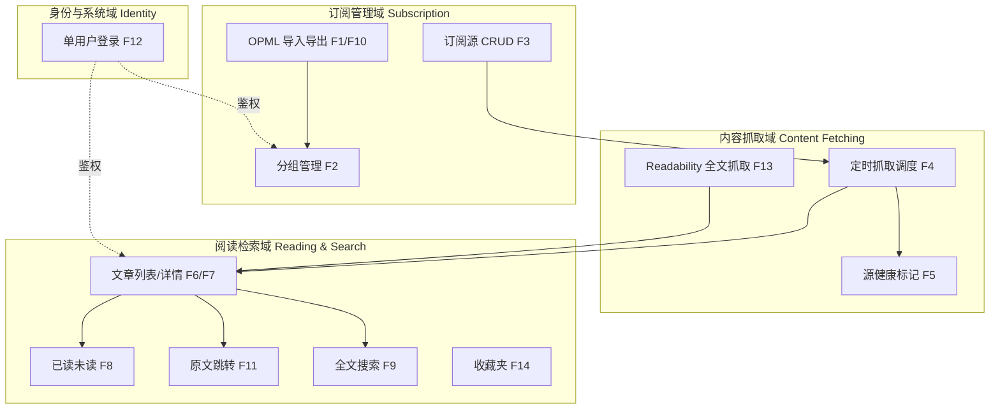

**业务域清单**（业务域 3~7 个，与 §3 模块、§4 数据库分组一致）：

| 业务域 | 核心场景 | 涉及角色 | 与其他业务域的关系 |
| --- | --- | --- | --- |
| 订阅管理域 | 分组管理 / 订阅源增删改查 / OPML 导入导出 | 最终用户（阅读者）/ 维护者 | 下游 内容抓取域；被 身份域鉴权 |
| 内容抓取域 | 定时抓取 / 源健康标记 / 全文抓取 | 维护者 / 上游源站点 | 上游 订阅管理域；下游 阅读检索域 |
| 阅读检索域 | 文章列表详情 / 已读未读 / 原文跳转 / 全文搜索 / 收藏夹 | 最终用户（阅读者） | 上游 内容抓取域；被 身份域鉴权 |
| 身份与系统域 | 单用户登录 / 会话管理 | 维护者（用户本人） | 支撑全部业务域（横切鉴权） |

### 2.2 领域关系映射

#### 2.2.1 限界上下文清单

| 限界上下文 | 对应业务域 | 域类型 | 覆盖的核心业务实体 | 上下文边界（属于本域 vs 不属于） |
| --- | --- | --- | --- | --- |
| BC1 订阅管理上下文 | 订阅管理域 | 核心域 | FeedGroup / Feed | 属于：分组、订阅源配置、OPML 解析；不属于：抓取执行、阅读状态 |
| BC2 内容抓取上下文 | 内容抓取域 | 核心域 | FetchLog / 抓取调度状态 | 属于：调度、HTTP 抓取、Feed 解析、全文抓取；不属于：订阅配置、阅读状态 |
| BC3 阅读检索上下文 | 阅读检索域 | 核心域 | Article / ArticleRead | 属于：文章、已读状态、搜索索引；不属于：抓取执行、源健康计数 |
| BC4 身份会话上下文 | 身份与系统域 | 通用域 | User / Session | 属于：账号、会话、鉴权；不属于：订阅、抓取、阅读业务 |

**域类型说明**：

| 域类型 | 含义 | 投入策略 |
| --- | --- | --- |
| 核心域（Core） | 业务护城河，差异化竞争力所在 | 投入最多资源自研 |
| 支撑域（Supporting） | 必要但非差异化 | 可自研可外采 |
| 通用域（Generic） | 通用能力（如用户中心、消息中心） | 优先复用 / 外采 |

#### 2.2.2 上下文映射（Context Mapping）

> 本系统为单二进制单进程，各上下文为「进程内逻辑模块」，映射关系体现为同步进程内调用或进程内事件；对外部 Feed 源/库采用防腐层隔离。

| 关系编号 | 上游上下文 | 下游上下文 | 关系模式 | 同步方式 | 选择理由 |
| --- | --- | --- | --- | --- | --- |
| C-01 | BC1 订阅管理 | BC2 内容抓取 | Customer/Supplier | 进程内同步调用 | 上游的源/分组配置驱动下游抓取节奏，源增删改实时影响抓取任务 |
| C-02 | 外部 Feed 源（41 源） | BC2 内容抓取 | ACL 防腐层 | HTTP GET + feed-rs 适配 | 外部 RSS/Atom/JSON Feed 格式与站点变化不污染本域（feed-rs 统一模型） |
| C-03 | BC2 内容抓取 | BC3 阅读检索 | Published Language | 进程内事件 + 统一 Article 数据契约 | 抓取产出以统一 Article 结构发布，阅读侧消费，解耦抓取与展示 |
| C-04 | BC3 阅读检索 | BC4 身份会话 | Conformist | 进程内同步调用 | 阅读域顺从身份域的用户标识与已读隔离模型，不自建用户模型 |
| C-05 | BC1 订阅管理 | BC3 阅读检索 | Shared Kernel | 共享标识约定 | 共享「feed_id / group_id」稳定标识，用于文章按源/分组聚合 |

**关系模式说明**：

| 关系模式 | 适用场景 |
| --- | --- |
| Customer/Supplier | 上下游强协作，下游能影响上游迭代节奏（如：订单 → 支付） |
| Conformist | 顺从者，下游完全遵循上游模型（如：对接微信开放平台） |
| ACL（Anticorruption Layer） | 在本域和外部域之间建一层适配，外部模型变化不影响本域（对接外部强势平台时必用） |
| Shared Kernel | 共享内核，多个上下文共享一小块代码 / 模型；维护成本高，慎用 |
| Published Language | 上游以标准协议（事件 / Schema）对外暴露，多下游消费 |

#### 2.2.3 跨域协作原则

| 原则编号 | 原则 |
| --- | --- |
| P-01 | 核心域 → 支撑域 / 通用域：禁止反向依赖（身份域不依赖任何业务域的内部模型） |
| P-02 | 核心域之间：禁止直接耦合，通过统一 Article 数据契约 / 事件解耦 |
| P-03 | 对接外部不可控系统（41 个 Feed 源 / 三方库）：必须建 ACL 防腐层，禁止把外部 RSS/HTML 模型贯穿到本域 |

### 2.3 详细业务架构

#### 2.3.1 用例图

**用例图清单**：

| 编号 | 用例图标题 | 涉及业务域 | 源文件位置 |
| --- | --- | --- | --- |
| UC-01 | 订阅管理用例（分组/源/OPML） | 订阅管理域 | 本文档内嵌（Mermaid） |
| UC-02 | 抓取与源健康用例 | 内容抓取域 | 本文档内嵌（Mermaid） |
| UC-03 | 阅读与搜索用例 | 阅读检索域 | 本文档内嵌（Mermaid） |

**UC-01 订阅管理用例图**：

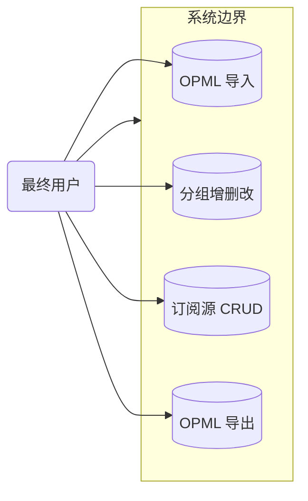

**UC-02 抓取与源健康用例图**：

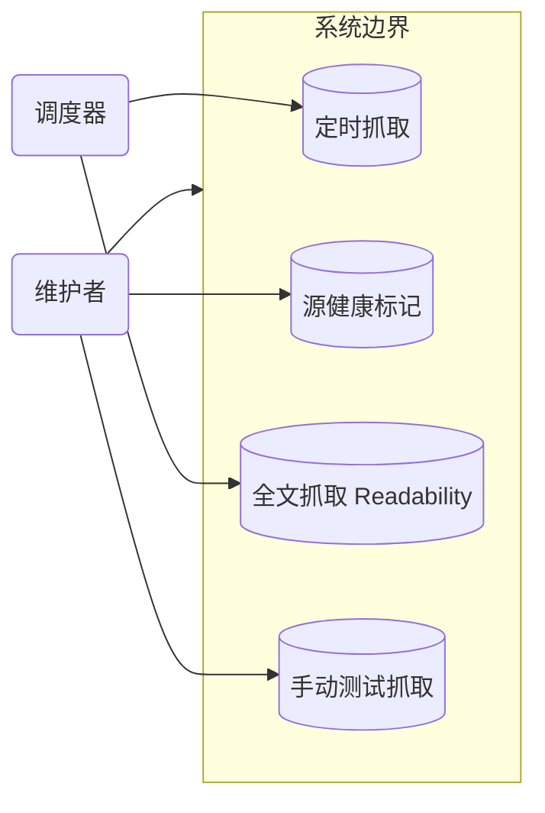

**UC-03 阅读与搜索用例图**：

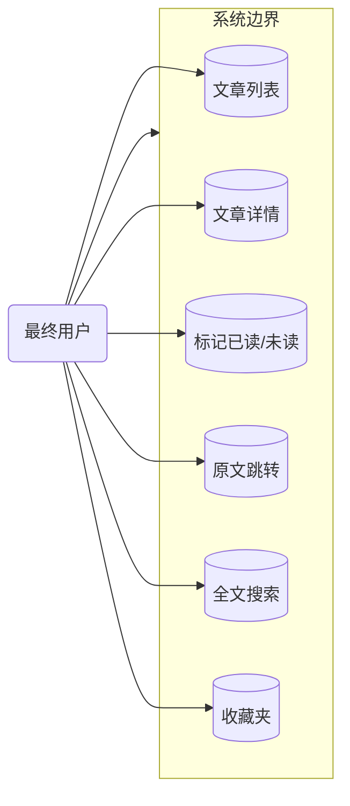

#### 2.3.2 业务流程图

**关键流程清单**（核心业务覆盖度 ≥ 80%，覆盖 F1–F14 中的 8 条主链路）：

| 流程编号 | 流程名 | 起点 | 终点 | 涉及业务域 | 源文件位置 |
| --- | --- | --- | --- | --- | --- |
| BF-01 | OPML 导入规范化 | 用户上传 OPML | 分组/源入库 + 导入报告 | 订阅管理域 | 本文档内嵌 |
| BF-02 | 定时抓取（单源） | 调度器触发 | 新文章入库 | 内容抓取域 | 本文档内嵌 |
| BF-03 | 阅读与标记已读 | 打开文章列表 | 已读状态落库 | 阅读检索域 | 本文档内嵌 |
| BF-04 | 全文抓取与降级 | 打开摘要源文章 | 内嵌全文或跳转原文 | 内容抓取域/阅读检索域 | 本文档内嵌 |

**BF-01 OPML 导入规范化（角色泳道图）**：

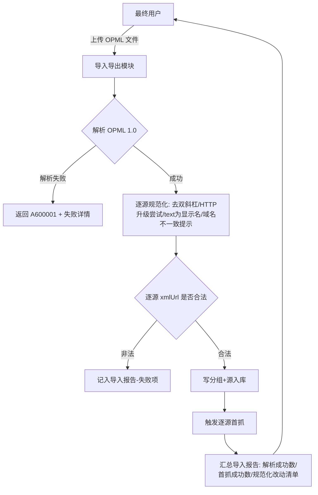

**BF-02 定时抓取（单源）角色泳道图**：

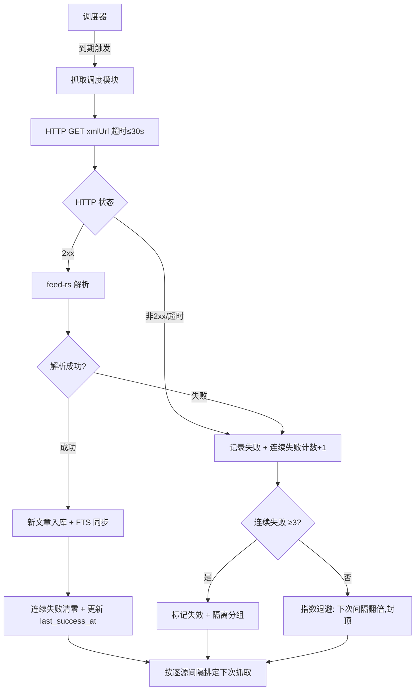

**BF-03 阅读与标记已读**：

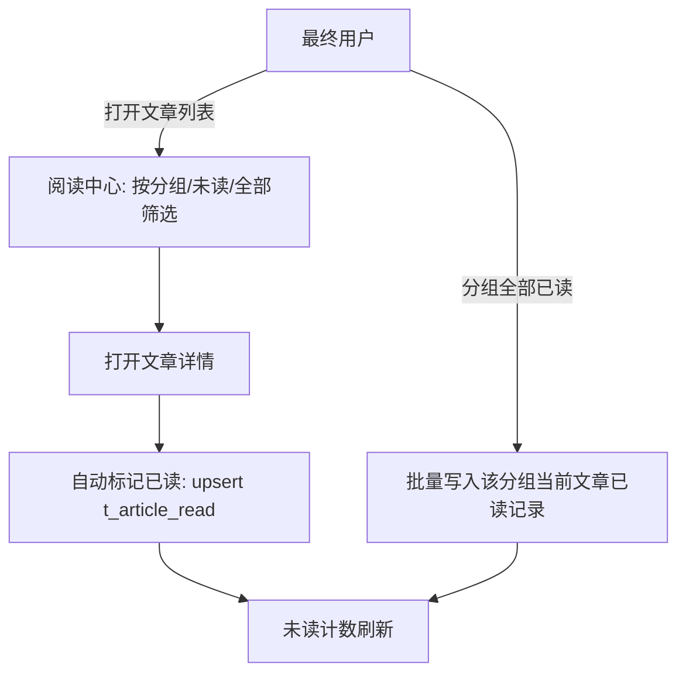

**BF-04 全文抓取与降级**：

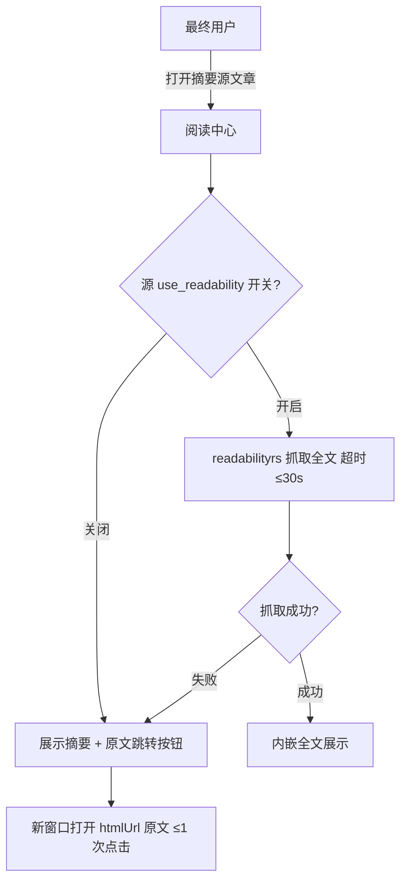

### 2.4 业务范围与边界

#### 2.4.1 功能模块清单

> 功能编号与《高层架构设计》§6.3 完全对齐（F1–F14 MVP，F15–F18 完整版）。此处按「一级功能名 → 子功能」组织并标注实现状态。

| 编号 | 一级功能名 | 子功能描述 | 对应业务域 | 实现状态 |
| --- | --- | --- | --- | --- |
| F1 | OPML 导入 | 解析 OPML 1.0（4 分组 41 源）+ 数据质量规范化（http→https 升级尝试、双斜杠修复、text 为显示名、域名不一致提示）+ 导入报告 | 订阅管理域 | 完整实现 |
| F2 | 分组管理 | 4 分组增删改、源分组归属调整 | 订阅管理域 | 完整实现 |
| F3 | 订阅源增删改查 | 源列表、手动添加、编辑 xmlUrl/htmlUrl/显示名、删除 | 订阅管理域 | 完整实现 |
| F4 | 定时抓取调度 | 进程内调度器，每源可单独设置抓取间隔（覆盖全局默认；全局默认与单源下限均 ≥30min）+ 指数退避 | 内容抓取域 | 完整实现 |
| F5 | 源健康标记 | 连续 3 次失败标记失效 + 隔离分组，错误 UI 展示 | 内容抓取域 | 完整实现 |
| F6 | 文章列表 | 按分组/未读/全部筛选，标题/源/发布时间 | 阅读检索域 | 完整实现 |
| F7 | 文章详情 | 标题/正文（摘要源内嵌全文）/原文链接/时间 | 阅读检索域 | 完整实现 |
| F8 | 已读/未读管理 | 单篇标记、分组全部已读、未读计数（按 user_id 隔离） | 阅读检索域 | 完整实现 |
| F9 | 全文搜索 | SQLite FTS5 检索标题+正文，关键词高亮，相关度/时间排序 | 阅读检索域 | 完整实现 |
| F10 | OPML 导出 | 按当前分组导出 OPML，可被 Feedbro/FreshRSS 重导入 | 订阅管理域 | 完整实现 |
| F11 | 原文跳转 | 全文抓取失败源一键新窗口打开 htmlUrl | 阅读检索域 | 完整实现 |
| F12 | 单用户登录 | 账号密码 + 会话管理（自托管公网暴露安全基线） | 身份与系统域 | 完整实现 |
| F13 | Readability 全文抓取 | 摘要源抓正文内嵌展示，逐源开关，失败降级跳转原文 | 内容抓取域 | 完整实现 |
| F14 | 收藏夹 | 创建/重命名/删除收藏夹 + 文章收藏/取消收藏 + 按收藏夹翻阅（不做收藏夹内排序/嵌套） | 阅读检索域 | 完整实现 |
| F15 | 过滤规则 | 条件→动作规则引擎 | 订阅管理域 | 延后 P2（完整版） |
| F16 | WebSub 实时推送 | 支持 WebSub 的源实时推送（保留轮询兜底） | 内容抓取域 | 延后 P2（完整版） |
| F17 | 发布频率统计 | 逐源发布频率，辅助识别低质/失效源 | 内容抓取域 | 延后 P2（完整版） |
| F18 | 自动 OPML 备份 | 周期自动备份 OPML 到本地目录 | 订阅管理域 | 延后 P2（完整版） |

**In-Scope（本期范围内）**：

| 编号 | 本期必做的事项 |
| --- | --- |
| F1 | OPML 导入（4 分组 41 源，含数据质量规范化） |
| F2 | 分组管理（4 分组增删改、源分组归属调整） |
| F3 | 订阅源增删改查（含手动添加、编辑 xmlUrl/htmlUrl） |
| F4 | 定时抓取调度（逐源间隔 ≥30min + 指数退避） |
| F5 | 源健康检查/失效标记（连续失败计数、失效隔离） |
| F6 | 文章列表（按分组/未读/全部筛选） |
| F7 | 文章详情（标题、正文、原文链接、发布时间） |
| F8 | 已读/未读管理（单篇、分组全部已读） |
| F9 | 全文搜索（SQLite FTS5 简化版） |
| F10 | OPML 导出（备份/迁移，保留分组） |
| F11 | 原文跳转（失败源降级兜底） |
| F12 | 单用户登录与会话 |
| F13 | 摘要源全文抓取（Readability 逐源开关） |
| F14 | 收藏夹（创建/重命名/删除收藏夹 + 文章收藏/取消收藏 + 按收藏夹翻阅） |
| N1 | 非功能基线（体验/运维）：响应式 Web 适配移动端浏览器 + 数据备份 = 复制 SQLite 单文件 |

**Out-of-Scope（本期不做）**：

| 编号 | 不做的事项 | 不做的原因 | 未来归属 |
| --- | --- | --- | --- |
| O1 | 过滤规则/用户查询（F15） | 41 源规模信息密度低，过滤收益小 | 完整版 P2 |
| O2 | WebSub 实时推送（F16） | 支持源比例未知，轮询对 41 源够用 | 完整版 P2 |
| O3 | 发布频率统计/自动 OPML 备份（F17/F18） | 增强型运营能力，MVP 先以手动导出覆盖 | 完整版 P2 |
| O4 | 移动客户端同步 API（Fever/Google Reader） | 经中间确认 U-02：仅响应式 Web | 不做（可增量叠加） |
| O5 | 多用户/共享实例 | 经中间确认 U-01：个人单用户，预留 user 维度 | 数据模型预留，不做 UI |
| O6 | 原生移动 App（iOS/Android） | 与自托管单文件形态冲突，响应式 Web 已覆盖 | 不做 |
| O7 | AI 摘要/降噪 | SaaS 独有能力，成本远超 41 源规模收益 | 远期评估 BYO API key |
| O8 | 无 RSS 站点监控（Web feeds）、社交/分享/团队协作 | 偏离个人 RSS 管理器核心诉求 | 不做 |

### 2.5 质量与柔性可用

#### 2.5.1 服务质量目标

**质量目标 Top 3-5**：

| 优先级 | 质量目标 | 业务驱动 | 受影响的关键章节 |
| --- | --- | --- | --- |
| Q1 | 数据不丢失（单文件可备份、RPO 有保障） | 用户数据自控（订阅+阅读历史+索引） | §4.3 / §5.3 / §5.2 |
| Q2 | 抓取礼貌性（不触犯源站封禁） | 上游源站点约束 | §3.5.4 / §3.2.M2 / §2.5.2 |
| Q3 | 低延迟阅读与搜索（搜索 P95 ≤3s） | 用户体验阈值 V4 | §4.2 / §4.3 / §8 |
| Q4 | 可维护性（单人、单二进制、单文件运维） | 个人项目团队规模 | §3.1 / §3.2 / §5 |
| Q5 | 公网暴露安全基线（不被入侵） | 自托管公网暴露 | §7 |

**可验证质量场景**：

| 场景编号 | 关联目标 | 触发源 | 触发条件 | 期望响应 | 度量指标 |
| --- | --- | --- | --- | --- | --- |
| QS-01 | Q1 | 进程崩溃/磁盘故障 | SQLite 写入中途断电 | 重启后数据完整、无损坏 | WAL + 定时备份；RPO ≤ 60min（备份频率） |
| QS-02 | Q2 | 源站反爬/限流 | 单源抓取间隔低于 30 分钟或并发过高 | 不触发封禁 | 单源间隔 ≥30min；全局并发 ≤5；连续失败指数退避 |
| QS-03 | Q3 | 用户搜索 | 41 源全量文章 FTS5 检索 | 正常返回 | P95 ≤ 3s |
| QS-04 | Q4 | 版本升级 | 发布新版本 | 替换单二进制即完成升级 | 升级操作 ≤ 1 步；回滚 = 替换回旧二进制 + 原 SQLite 文件 |

#### 2.5.2 业务柔性可用策略

**业务功能优先级分层**（§2.4.1 每个一级功能 F-x 显式标注层级）：

| 层级 | 含义 | 故障态下的处置方向 | 用户感知 |
| --- | --- | --- | --- |
| L0 核心业务 | 系统的生命线，挂掉等于业务停摆 | 不降级；优先消耗所有资源保障 | 无 / 极轻微 |
| L1 重要业务 | 不影响主链路但用户高频使用 | 限流 + 排队 + 异步化 | 变慢 / 排队提示 |
| L2 辅助业务 | 提升体验但非必要 | 关闭 / 返回兜底数据 | 部分功能不可用 + 友好提示 |
| L3 附加业务 | 长尾 / 数据类 / 统计类 | 直接关闭 + 异步补偿 | 通常无感 |

**功能分层对照**（L0 数量 ≤ 总功能数 30%，共 14 项 MVP 功能，L0 = 3 项）：

| 层级 | 关联功能（F-xx） |
| --- | --- |
| L0 核心业务 | F4 定时抓取、F6 文章列表、F7 文章详情 |
| L1 重要业务 | F1 OPML 导入、F3 源 CRUD、F8 已读管理、F9 全文搜索、F12 登录 |
| L2 辅助业务 | F2 分组管理、F5 源健康标记、F10 OPML 导出、F11 原文跳转、F13 全文抓取、F14 收藏夹 |

**业务降级清单**：

| 编号 | 关联功能（F-xx） | 触发条件 | 降级动作 | 用户感知 | 决策类型 |
| --- | --- | --- | --- | --- | --- |
| BD-01 | F13 全文抓取 | readabilityrs 抓取失败（超时/解析失败）或逐源关闭 | 返回摘要 + 展示「原文跳转」按钮 | 文章页内只看到摘要，一键可跳原文 | 自动 |
| BD-02 | F9 全文搜索 | FTS5 索引重建中或 DB 只读 | 降级为标题 LIKE 模糊查询（结果较少） | 搜索结果变少但仍可用 | 自动 |
| BD-03 | F5 源健康标记 | 源连续 3 次失败 | 标记失效 + 移入隔离分组（不删历史文章） | 源在侧边栏标红、文章停止更新 | 自动 |
| BD-04 | F4 定时抓取 | 全局并发打满 / 目标源限流 | 逐源排队 + 指数退避延后 | 个别源文章更新延迟（≤ 数小时） | 自动 |

---

## 3. 应用架构

> **本章回答**：系统由哪些模块组成、模块与外部系统怎么集成、每个模块的内部交互链路是什么。

### 3.1 应用架构概览

#### 3.1.1 系统上下文

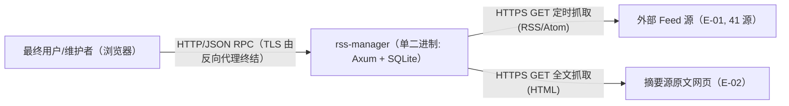

**系统上下文要素清单**：

| 节点类型 | 节点名 | 与本系统的关系 | 关系语义 |
| --- | --- | --- | --- |
| 角色 | 最终用户（阅读者） | 使用 | Web UI 阅读 / 标记已读 / 搜索 |
| 角色 | 维护者（用户本人） | 使用 | 源管理 / 健康监控 / 备份 |
| 上游平台 | E-01 外部 Feed 源（41 源） | 本系统 → 调用 | 定时抓取 RSS/Atom/JSON Feed |
| 外部业务系统 | E-02 摘要源原文网页 | 本系统 → 调用 | Readability 全文抓取（HTML） |

#### 3.1.2 系统模块图

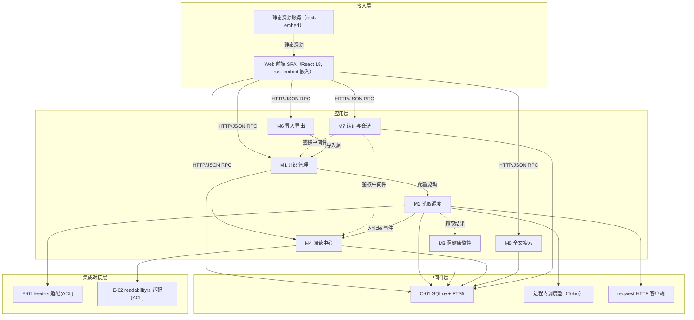

**分层组件清单**：

| 层次 | 内容 | 数据来源 |
| --- | --- | --- |
| 接入层 | Web 前端 SPA + 静态资源服务（rust-embed） | §2.3 用例图角色（最终用户/维护者） |
| 应用层 | 7 个后端业务模块（M1~M7，与 §3.2 一一对应） | §2.1 / §3.2 |
| 中间件层 | SQLite+FTS5（C-01）、进程内调度器（Tokio）、reqwest HTTP 客户端 | §3.1.3 云组件清单 |
| 集成对接层 | feed-rs（E-01 防腐层）、readabilityrs（E-02 防腐层） | §3.1.3 外部依赖清单 |

#### 3.1.3 集成架构

##### 外部依赖清单

| ID | 外部系统 | 归属团队 / 供应商 | 类别 | 使用方式 | 集成方式 | 协议 / 版本 | 功能定位（≤ 30 字） | 联系人 |
| --- | --- | --- | --- | --- | --- | --- | --- | --- |
| E-01 | 外部 Feed 源（41 个 RSS/Atom 站点） | 各源站点（36kr、阮一峰、个人博客等） | 第三方业务平台 | 消费 | HTTP GET（reqwest + feed-rs） | RSS 2.0 / Atom 0.3/1.0 / JSON Feed | 定时抓取订阅内容入库 | 无（公网公开源） |
| E-02 | 摘要源原文网页（Readability 抓取对象） | 各源站点文章页 | 第三方业务平台 | 消费 | HTTP GET（reqwest + readabilityrs） | HTTPS/HTTP + HTML | 摘要源正文全文抓取 | 无（公网公开页） |

##### 云组件 / 基础设施清单

> 本系统为单二进制自托管，除 SQLite（进程内嵌）外无独立中间件。进程内调度器、HTTP 客户端、feed-rs、readabilityrs、rust-embed 均为**进程内复用底座**（见 §2.4 基线复用），不列为云组件。

| ID | 组件类别 | 选型 | 部署形态 | 规格量级 | 容量预估 | 提供方 / SLA | 用途 |
| --- | --- | --- | --- | --- | --- | --- | --- |
| C-01 | 关系型数据库 | SQLite 3.4x（含 FTS5） | 单文件（进程内嵌） | 无需独立规格 | 41 源 / 万级文章 / 单用户 | SQLite 公有领域（无商业 SLA，自托管自保障） | 业务主数据 + 全文索引 |

##### 组件依赖关系

| 业务模块（§3.2） | 依赖的外部系统（E-xx） | 依赖的云组件（C-xx） | 故障传导风险 |
| --- | --- | --- | --- |
| M1 订阅管理 | — | C-01 | C-01 不可用 → 源/分组不可管理 |
| M2 抓取调度 | E-01 | C-01 | E-01 超时/失败 → 逐源指数退避（不阻塞其他源） |
| M3 源健康监控 | — | C-01 | C-01 不可用 → 健康面板不可用 |
| M4 阅读中心 | E-02 | C-01 | E-02 失败 → 降级跳转原文（不阻塞阅读） |
| M5 全文搜索 | — | C-01 | C-01/FTS5 不可用 → 降级 LIKE 查询（BD-02） |
| M6 导入导出 | — | C-01 | C-01 不可用 → 导入/导出不可用 |
| M7 认证与会话 | — | C-01 | C-01 不可用 → 登录不可用 |

#### 3.1.4 工程结构

```
rss-manager/
├── backend/                    # 后端工程根（Rust workspace）
│   ├── common/                 # 公共：DTO/VO/Enum/Error/Config/Constants
│   ├── src/
│   │   ├── domain/             # 领域模型（聚合根/实体/值对象）
│   │   │   ├── subscription/   # BC1 订阅管理
│   │   │   ├── fetching/       # BC2 内容抓取
│   │   │   ├── reading/        # BC3 阅读检索
│   │   │   └── identity/       # BC4 身份会话
│   │   ├── api/                # Axum 路由 + Handler（对应 §3.2 接口清单）
│   │   │   ├── groups.rs / feeds.rs / articles.rs / search.rs
│   │   │   ├── opml.rs / auth.rs / health.rs
│   │   ├── infra/              # 基础设施：SQLite(池)/FTS5/reqwest/调度器
│   │   ├── acl/                # 防腐层：feed-rs 适配 / readabilityrs 适配
│   │   ├── scheduler/          # 进程内抓取调度器
│   │   ├── middleware/         # 鉴权/日志/错误处理/幂等/限流
│   │   └── main.rs             # 入口：装配路由 + 静态资源 + 调度器
│   ├── migrations/             # SQL 迁移脚本（建表 + FTS5 + 触发器）
│   └── Cargo.toml
└── frontend/                   # 前端工程根（SPA）
    ├── src/
    │   ├── api/                # 接口封装（与 §3.2 接口清单对齐）
    │   ├── store/              # 全局状态（Zustand）
    │   ├── pages/              # 页面（订阅列表/文章流/详情/搜索/源管理/导入导出/设置/健康）
    │   ├── components/         # 跨页面通用组件
    │   ├── hooks/              # 自定义 Hook
    │   ├── types/              # TS 类型（与后端 DTO/VO 对齐）
    │   ├── utils/              # 工具函数
    │   └── router.ts           # 路由配置
    ├── rspack.config.ts
    └── package.json
```

> 说明：`frontend/` 子树与前端技术选型（框架/状态）为**经中间确认 C-06** 决策（用户裁决方案 B：React 18 + Zustand，已落地；替代方案 Vue 3 未采用，仅作对照）；构建工具采用 rspack（经 G4 用户显式决策，见 §3.1.5）。

#### 3.1.5 技术选型（版本约束）

| 技术分类 | 选型 | 版本 | 备注 / 选型理由 |
| --- | --- | --- | --- |
| 后端语言 | Rust | 1.8x（stable，2026-08） | G2 用户冻结；静态编译单二进制，契合单文件部署 |
| 后端框架 | Axum | 0.8.x | Tokio 官方生态主流 Web 框架；tower 中间件生态成熟（选 Axum 不选 Actix-web：Axum 更贴近 Tokio 原生、API 更简洁） |
| 异步运行时 | Tokio | 1.x | Axum 底层；进程内调度器依赖 |
| HTTP 客户端 | reqwest | 0.12.x | Rust 主流 HTTP 客户端，rustls TLS；抓取 Feed/网页统一入口 |
| 数据库访问 | sqlx | 0.8.x | 异步 SQLite + 编译期 SQL 校验 + SqlitePool（选 sqlx 不选 rusqlite：异步原生契合 Axum/Tokio，池化与编译期校验降低运行时错误） |
| 关系型存储 | SQLite | 3.4x | G2 用户冻结；单文件零运维；WAL 模式 |
| 全文搜索 | SQLite FTS5 | 内建（3.4x） | 41 源个人规模无需独立搜索引擎（选 FTS5 不选 PostgreSQL tsvector：数据库已冻结为 SQLite） |
| Feed 解析 | feed-rs | 2.4.0 | 统一 RSS 0.x/1.0/2.0 + Atom + JSON Feed 模型；MIT；宽松解析对非规范 Feed 容错好（选 feed-rs 不选 rss+atom_syndication 组合：统一模型 + sanitize 内建） |
| 全文抓取 | readabilityrs | 0.1.x（0.1.4） | Mozilla Readability.js 的 Rust 移植；逐源开关 + 失败降级跳转原文（R-06 年轻库风险，MVP 上线前 41 源冒烟测试） |
| 前端嵌入 | rust-embed | 8.x | 编译期把 SPA 产物嵌入二进制，满足「前后端分离 + 单二进制」双约束 |
| 序列化 | serde + serde_json | 1.x | Rust 标准序列化，DTO 契约载体 |
| XML 解析 | quick-xml | 0.3x | OPML 1.0 解析；feed-rs 底层复用 |
| 时间处理 | chrono | 0.4 | RFC3339 UTC 时间戳（毫秒精度，见 §4.1） |
| 唯一标识 | uuid | 1.x | 文章 guid 归一化 / 幂等键 |
| 日志/追踪 | tracing + tracing-subscriber | 0.1.x | 结构化 JSON 日志 + span（traceId） |
| 链路追踪 | tracing-opentelemetry + opentelemetry | 0.2x | OTLP 可选导出（自托管默认本地 span，见 §8.3） |
| API 通信 | RPC 风格 JSON POST | — | 前后端分离（G2 冻结）；显式功能名 + 全 POST + JSON body（经 G4 用户反馈改 RPC 风格，见 §3.5.5） |
| 认证方案 | 不透明会话令牌 + HTTP-only Cookie | — | 单用户自托管安全基线（见 §7.2.1） |
| 前端框架 | React 18 | 18.x | **经中间确认 C-06（用户裁决方案 B）**；选型理由：生态最大、组件复用最多、心智份额最广（替代方案 Vue 3 未采用，仅作对照） |
| 前端状态 | Zustand | 5.x | React 轻量状态库（体积小、TS 支持好、API 简洁） |
| 前端构建 | rspack | 1.x | **经 G4 用户显式决策**；React 走 rspack 原生 builtin:swc-loader + React Compiler（零 Babel），与 React 18 技术栈最契合；rust-embed 兼容 |
| 前端语言 | TypeScript | 5.x | 与后端 DTO/VO 类型对齐 |

#### 3.1.6 工程规范（Rust 代码格式化）

> Rust 代码风格由仓库根目录 `.rustfmt.toml` 统一约束，提交前必须通过 `cargo fmt --check` 校验（CI/预提交钩子强制），未通过视为构建失败。

| 配置项 | 取值 | 说明 |
| --- | --- | --- |
| `match_block_trailing_comma` | true | match 块末尾保留逗号 |
| `max_width` | 120 | 单行最大宽度 |
| `fn_call_width` | 100 | 函数调用参数换行宽度阈值 |
| `short_array_element_width_threshold` | 15 | 短数组元素内联阈值 |
| `single_line_if_else_max_width` | 80 | if-else 单行化最大宽度 |
| `single_line_let_else_max_width` | 80 | let-else 单行化最大宽度 |
| `struct_lit_width` | 30 | 结构体字面量换行宽度阈值 |
| `tab_spaces` | 2 | 缩进空格数（2 空格） |

**格式化纪律**：所有 Rust 代码（backend 工程 + 各 crate）统一遵循上述配置；`cargo fmt` 以仓库根 `.rustfmt.toml` 为准；提交前必须 `cargo fmt --check` 通过；不满足格式的代码视为构建失败。

#### 3.1.7 rust-embed 用途说明（前端产物编译期嵌入）

> **为什么需要 rust-embed**：本项目两条冻结约束——「前后端分离」（前端为独立 SPA 工程，独立开发、独立构建）与「单一可执行文件/单容器」（部署仅替换一个二进制）——表面冲突。rust-embed 是化解该冲突的**静态资源打包手段**：它在 Rust 编译期把前端构建产物嵌入二进制，运行时无需任何外部静态文件即可由后端直接返回前端页面与 JS/CSS。

**使用位置（两处）**：
1. **构建阶段**：`backend/build.rs` 声明 `RustEmbed`，指向 `frontend/dist`（rspack 构建产物目录），`cargo build` 时把 `dist/` 下静态资源整体嵌入二进制；
2. **运行时**：Axum 挂载静态文件 handler，对 `/`、`/assets/*` 等非 API 路径直接返回嵌入资源（SPA 兜底路由返回 `index.html`）。

**边界澄清**：rust-embed 不是缓存、不是存储组件、不承载业务数据——它只负责「把前端静态资源打进二进制」，业务数据仍全部落在 SQLite 单文件（§4）。

### 3.2 模块详细设计

#### 3.2.1 模块公共约束（Common）

**通信方式约束**：

| 约束项 | 取值 |
| --- | --- |
| 接口路径风格 | RPC 风格（显式功能名，全 POST，锁定；见 §3.5.5） |
| 协议 | HTTP（应用监听 http 默认 8080，本地/内网；TLS 由反向代理 Caddy/Nginx 终结，见 §5.4/§6） |
| 数据格式 | JSON（请求与响应均为 JSON body） |
| 字符编码 | UTF-8 |

**通用基础结构**：

| 基类 / 结构 | 用途 | 包路径 |
| --- | --- | --- |
| `Result(T)` | 统一返回结构（含 code/msg/data/traceId/timestamp） | `common::dto::Result` |
| `PageRequest` | 分页请求（page / page_size / cursor） | `common::dto::PageRequest` |
| `PageResponse(T)` | 分页响应（items / total / has_more） | `common::dto::PageResponse` |
| `AppError` | 统一错误（映射 §3.5.1 错误码） | `common::error::AppError` |

#### 3.2.2 模块清单与编号规则

| 编号 | 模块名 | 业务域（§2.1） | 模块负责人 | 关联子领域 |
| --- | --- | --- | --- | --- |
| M1 | 订阅管理 | 订阅管理域 | system-architect | 分组 / 订阅源 |
| M2 | 抓取调度 | 内容抓取域 | system-architect | 调度 / 抓取 / 解析 |
| M3 | 源健康监控 | 内容抓取域 | system-architect | 失败计数 / 失效标记 |
| M4 | 阅读中心 | 阅读检索域 | system-architect | 文章 / 已读 / 全文 / 收藏夹 |
| M5 | 全文搜索 | 阅读检索域 | system-architect | FTS5 检索 |
| M6 | 导入导出 | 订阅管理域 | system-architect | OPML 导入 / 导出 |
| M7 | 认证与会话 | 身份与系统域 | system-architect | 登录 / 会话 |

#### 3.2.3 单模块设计模板（五段式）

> 每个模块按 `.1 模块概述 → .2 接口清单 → .3 关键结构定义（DTO）→ .4 模块逻辑时序图 → .5 关键流程逻辑` 五段展开；简单 CRUD/查询模块在 `.5` 下显式注明省略原因。接口字段继承 §3.5 全局约定（超时/重试/幂等/鉴权），各模块不重复声明。

#### 3.2.M1 订阅管理

##### §3.2.M1.1 模块概述

订阅管理模块覆盖「分组管理（F2）」「订阅源增删改查（F3）」业务流程，业务逻辑在**最终用户/维护者**之间流动；涉及 `Web 前端 SPA`（接入层）、`C-01 SQLite`、`M2 抓取调度`、`M7 认证`（鉴权中间件）等内外部系统。它是抓取调度的上游（源配置驱动抓取），属 BC1 订阅管理上下文（核心域）。

##### §3.2.M1.2 接口清单

| 子领域 | 方法 | 路径 | 用途（≤ 20 字） | 请求 DTO | 响应 VO | 幂等 |
| --- | --- | --- | --- | --- | --- | --- |
| 分组 | POST | `/api/rpc/group_list` | 分组列表（含未读计数） | — | `FeedGroupListVO` | 天然 |
| 分组 | POST | `/api/rpc/group_create` | 创建分组 | `GroupCreateRequest` | `FeedGroupVO` | 是（name 唯一） |
| 分组 | POST | `/api/rpc/group_update` | 重命名分组 | `GroupUpdateRequest` | `FeedGroupVO` | 天然 |
| 分组 | POST | `/api/rpc/group_delete` | 删除分组（非空拒绝） | `GroupDeleteRequest` | `Result` | 天然 |
| 源 | POST | `/api/rpc/feed_list` | 源列表（按分组过滤） | `FeedListRequest` | `FeedListVO` | 天然 |
| 源 | POST | `/api/rpc/feed_create` | 手动添加源 | `FeedCreateRequest` | `FeedVO` | 是（xml_url 唯一） |
| 源 | POST | `/api/rpc/feed_get` | 源详情 | `FeedGetRequest` | `FeedVO` | 天然 |
| 源 | POST | `/api/rpc/feed_update` | 编辑源 | `FeedUpdateRequest` | `FeedVO` | 天然 |
| 源 | POST | `/api/rpc/feed_delete` | 删除源（级联可选） | `FeedDeleteRequest` | `Result` | 天然 |
| 源 | POST | `/api/rpc/feed_test` | 手动测试抓取 | `FeedTestRequest` | `FeedTestVO` | 否（有副作用） |

##### §3.2.M1.3 关键结构定义（DTO）

```rust
pub struct FeedCreateRequest {
    // ===== 必填 =====
    pub xml_url: String,          // 订阅源 URL；唯一约束
    // ===== 可选 =====
    pub group_id: Option(i64),    // 分组归属；默认「未分组」
    pub title: Option(String),    // 显示名（默认取 Feed title）
    pub html_url: Option(String), // 原文站点（默认取 Feed link）
    pub fetch_interval_sec: Option(i64), // 每源抓取间隔，覆盖全局默认（3600）；下限 ≥1800
    pub use_readability: Option(bool),    // 全文抓取开关；默认 false
}

pub struct FeedVO {
    pub id: i64,
    pub group_id: Option(i64),
    pub title: String,            // 显示名（text 优先）
    pub feed_title: String,       // 原始 Feed title
    pub xml_url: String,
    pub html_url: Option(String),
    pub health_status: String,    // healthy/failing/dead
    pub consecutive_failures: i32,
    pub last_fetch_at: Option(String),
    pub use_readability: bool,
}

// ===== 资源 ID 均走 JSON body（RPC 风格，无 path param）=====
pub struct GroupCreateRequest {
    pub name: String,             // 分组名；同用户唯一
}

pub struct GroupUpdateRequest {
    pub id: i64,                  // 分组 ID（JSON body）
    pub name: String,             // 新分组名
}

pub struct GroupDeleteRequest {
    pub id: i64,                  // 分组 ID（JSON body）
}

pub struct FeedListRequest {
    pub group_id: Option(i64),    // 按分组过滤；空=全部
}

pub struct FeedGetRequest {
    pub id: i64,                  // 源 ID（JSON body）
}

pub struct FeedUpdateRequest {
    pub id: i64,                  // 源 ID（JSON body）
    pub group_id: Option(i64),
    pub title: Option(String),
    pub html_url: Option(String),
    pub fetch_interval_sec: Option(i64), // 每源间隔，覆盖全局默认；下限 ≥1800
    pub use_readability: Option(bool),
}

pub struct FeedDeleteRequest {
    pub id: i64,                  // 源 ID（JSON body）
}

pub struct FeedTestRequest {
    pub id: i64,                  // 源 ID（JSON body）
}
```

**关键字段定义表**：

| DTO / VO 名 | 字段名 | 类型 | 必填 | 业务含义 | 约束 / 默认值 |
| --- | --- | --- | --- | --- | --- |
| `FeedCreateRequest` | `xml_url` | String | 是 | 订阅源 URL | 必须 http/https，去双斜杠；唯一 |
| `FeedCreateRequest` | `group_id` | i64 | 否 | 分组归属 | 默认 0=未分组 |
| `FeedCreateRequest` | `fetch_interval_sec` | i64 | 否 | 每源抓取间隔 | 覆盖全局默认（3600）；下限 ≥1800（礼貌抓取） |
| `FeedCreateRequest` | `use_readability` | bool | 否 | 全文抓取开关 | 默认 false（逐源） |
| `GroupUpdateRequest` | `id` | i64 | 是 | 分组 ID（JSON body） | 必须存在 |
| `FeedUpdateRequest` | `id` | i64 | 是 | 源 ID（JSON body） | 必须存在 |
| `FeedUpdateRequest` | `fetch_interval_sec` | i64 | 否 | 每源抓取间隔 | 覆盖全局默认；下限 ≥1800 |
| `FeedVO` | `health_status` | String | 是 | 源健康状态 | 枚举：healthy/failing/dead |
| `FeedVO` | `consecutive_failures` | i32 | 是 | 连续失败计数 | ≥0 |

##### §3.2.M1.4 模块逻辑时序图

| 编号 | 标题 | 场景类别 | 是否包含异常分支 |
| --- | --- | --- | --- |
| SQ-M1-01 | 订阅管理 - 手动添加源并触发首抓 | 核心实体创建 | 是（xmlUrl 重复 / 首抓失败） |

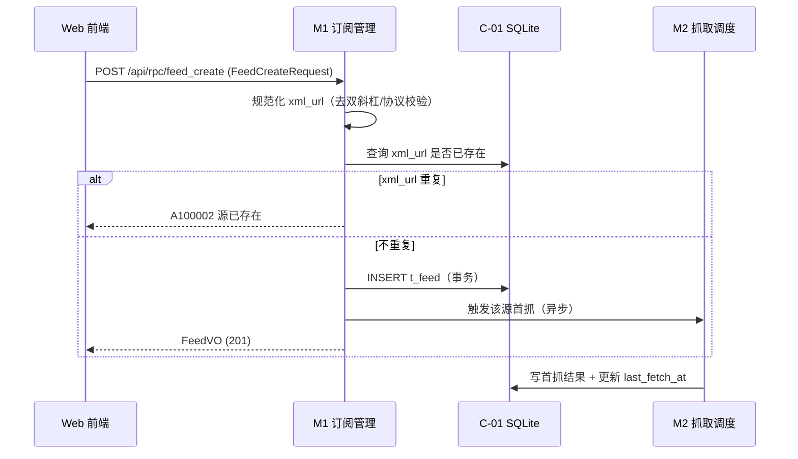

##### §3.2.M1.5 关键流程逻辑

无复杂状态机/跨多步异步；核心业务规则为：`xml_url` 唯一约束（防重复录入）、分组删除时若组内存在源则返回 `A100003 分组非空`（拒绝删除，用户需先移出源）。源删除策略：默认软删除 `deleted=1`，保留其文章与已读记录；物理清理由 §4.2 清理机制定期执行。

#### 3.2.M2 抓取调度

##### §3.2.M2.1 模块概述

抓取调度模块覆盖「定时抓取（F4）」业务流程，是 RSS 管理器的心脏；涉及 `M1 订阅管理`（上游源配置）、`M3 源健康监控`（下游结果）、`M4 阅读中心`（下游 Article 事件）、`C-01 SQLite`、`E-01 feed-rs 防腐层`、`进程内调度器（Tokio）`。属 BC2 内容抓取上下文（核心域）。

**抓取间隔采用 per-feed 模式**：每个订阅源通过 `t_feed.fetch_interval_sec` 单独设置抓取间隔并**覆盖全局默认**；全局默认与单源下限均 ≥ 30 分钟（1800 秒，礼貌抓取约束），对齐上游《高层架构设计》§5.2 / §6.3 F4。

##### §3.2.M2.2 接口清单

| 子领域 | 方法 | 路径 | 用途（≤ 20 字） | 请求 DTO | 响应 VO | 幂等 |
| --- | --- | --- | --- | --- | --- | --- |
| 调度 | POST | `/api/rpc/fetch_now` | 手动触发抓取（全量/单源） | `FetchNowRequest` | `Result` | 是（idempotency_key） |
| 调度 | POST | `/api/rpc/fetch_status` | 调度器状态与队列 | — | `FetchStatusVO` | 天然 |

##### §3.2.M2.3 关键结构定义（DTO）

```rust
pub struct FetchNowRequest {
    pub feed_id: Option(i64),   // 为空=全量；非空=单源
}

pub struct FetchStatusVO {
    pub running: bool,
    pub active_fetches: i32,    // 当前并发抓取数
    pub max_concurrency: i32,   // 并发上限（默认 5）
    pub queue_len: i32,         // 待抓取队列长度
}
```

**关键字段定义表**：

| DTO / VO 名 | 字段名 | 类型 | 必填 | 业务含义 | 约束 / 默认值 |
| --- | --- | --- | --- | --- | --- |
| `FetchNowRequest` | `feed_id` | i64 | 否 | 指定单源抓取 | 空=全量 |
| `FetchStatusVO` | `max_concurrency` | i32 | 是 | 全局并发上限 | 默认 5（礼貌抓取） |

##### §3.2.M2.4 模块逻辑时序图

| 编号 | 标题 | 场景类别 | 是否包含异常分支 |
| --- | --- | --- | --- |
| SQ-M2-01 | 抓取调度 - 单源定时抓取（含失败退避） | 核心动作执行 | 是（超时/HTTP 错误/解析失败） |
| SQ-M2-02 | 抓取调度 - 全局调度与并发控制 | 核心动作调度 | 是（并发打满排队） |

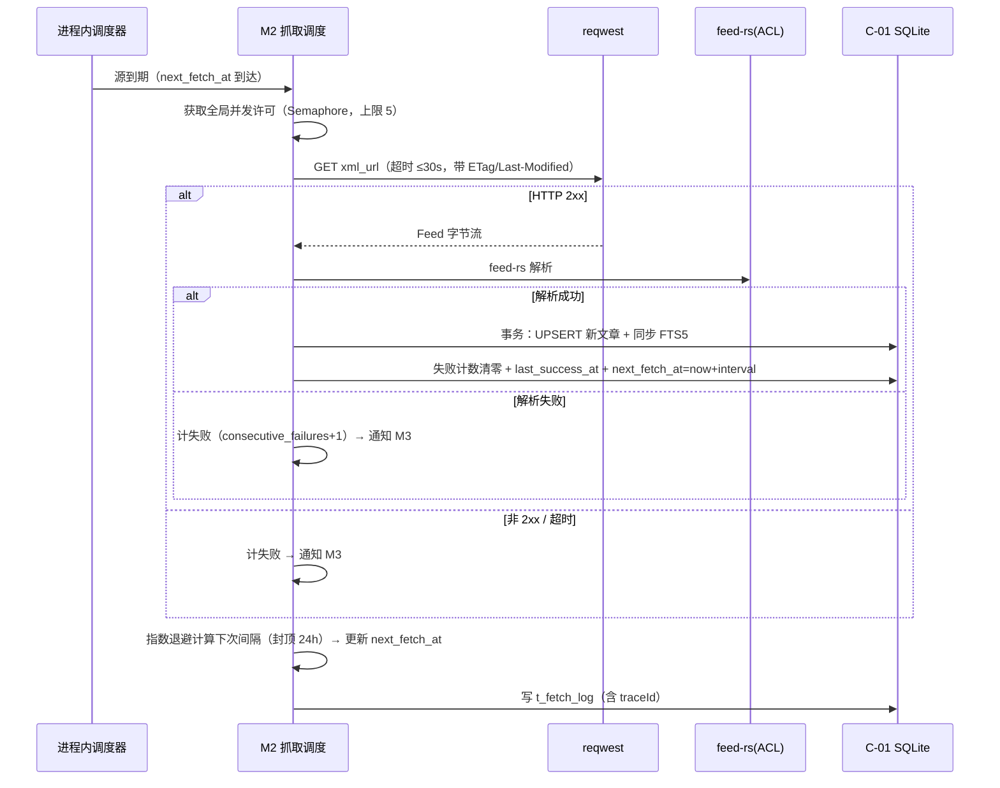

##### §3.2.M2.5 关键流程逻辑

**指数退避状态机**（源健康状态由 M3 维护，此处为调度退避逻辑）：

| 起始状态 | 触发事件 | 终止状态 | 触发条件 / 校验 | 副作用 |
| --- | --- | --- | --- | --- |
| 正常 | fetch_success | 正常 | 解析成功 | 失败计数清零，next_fetch_at=now+interval |
| 正常 | fetch_fail | 退避中 | 第 1 次失败 | 失败计数=1，next_fetch_at=now+2×interval |
| 退避中 | fetch_fail | 退避中 | 第 2~N 次失败 | 失败计数+1，间隔 = min(interval×2^n, 24h) |
| 退避中 | fetch_success | 正常 | 恢复成功 | 计数清零，间隔恢复 interval |
| 退避中 | 3 次连续失败 | 已失效 | 计数 ≥3 | 通知 M3 标记 dead + 隔离分组 |

**调度伪代码**：

```
触发：进程内调度器 tick（每秒）
Step 1: 扫描到期源（next_fetch_at ≤ now 且 health != dead）
Step 2: 对每个到期源入队，Semaphore 限流（并发 ≤5，其余排队）
Step 3: 抓取执行（超时 ≤30s）：
  ├── HTTP GET xmlUrl（携带 ETag/Last-Modified，304 跳过解析）
  ├── feed-rs 解析 → 成功：UPSERT 文章 + FTS 同步
  └── 失败/超时：consecutive_failures+1 → 通知 M3
Step 4: 退避计算（成功重置 interval；失败 min(interval*2^n, 24h)）
Step 5: 更新 next_fetch_at + 写 t_fetch_log
```

#### 3.2.M3 源健康监控

##### §3.2.M3.1 模块概述

源健康监控模块覆盖「源健康标记（F5）」业务流程；涉及 `M2 抓取调度`（上游失败事件）、`Web 前端 SPA`（健康面板）、`C-01 SQLite`。属 BC2 内容抓取上下文（核心域），对齐目标 V2（连续 3 次失败标记，识别周期 ≤7 天）。

##### §3.2.M3.2 接口清单

| 子领域 | 方法 | 路径 | 用途（≤ 20 字） | 请求 DTO | 响应 VO | 幂等 |
| --- | --- | --- | --- | --- | --- | --- |
| 健康 | POST | `/api/rpc/health_overview` | 全量源健康总览 | — | `HealthOverviewVO` | 天然 |
| 健康 | POST | `/api/rpc/feed_health` | 单源健康详情 | `FeedHealthRequest` | `FeedHealthVO` | 天然 |
| 健康 | POST | `/api/rpc/feed_retry` | 重置失败计数并重试 | `FeedRetryRequest` | `Result` | 否（有副作用） |

##### §3.2.M3.3 关键结构定义（DTO）

```rust
pub struct FeedHealthRequest {
    pub id: i64,          // 源 ID（JSON body）
}

pub struct FeedRetryRequest {
    pub id: i64,          // 源 ID（JSON body）
}

pub struct HealthOverviewVO {
    pub total: i32,
    pub healthy: i32,
    pub failing: i32,     // 失败中（1~2 次连续失败）
    pub dead: i32,        // 已失效（≥3 次）
    pub feeds: Vec(FeedHealthVO),
}

pub struct FeedHealthVO {
    pub feed_id: i64,
    pub title: String,
    pub health_status: String,   // healthy/failing/dead
    pub consecutive_failures: i32,
    pub last_fetch_at: Option(String),
    pub last_error: Option(String),
}
```

##### §3.2.M3.4 模块逻辑时序图

| 编号 | 标题 | 场景类别 | 是否包含异常分支 |
| --- | --- | --- | --- |
| SQ-M3-01 | 源健康 - 连续失败标记失效 | 异常/补偿/回滚 | 是（手动重试恢复） |

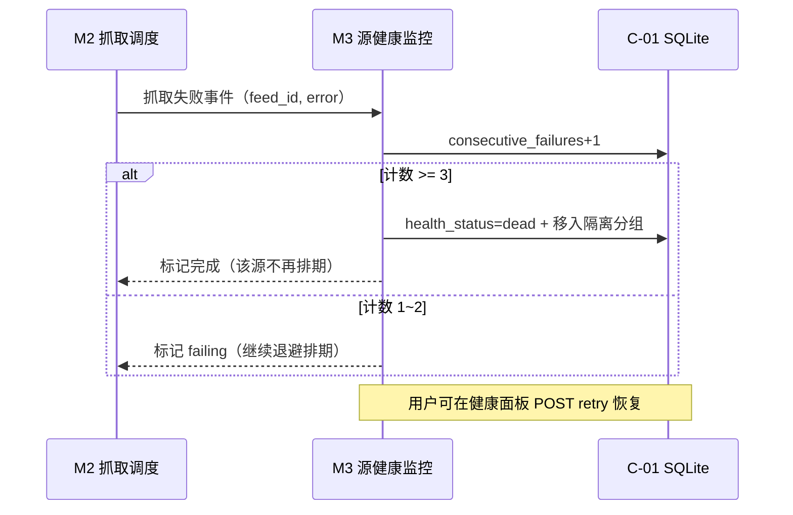

##### §3.2.M3.5 关键流程逻辑

**源健康状态机**：

| 起始状态 | 触发事件 | 终止状态 | 触发条件 / 校验 | 副作用 |
| --- | --- | --- | --- | --- |
| healthy | fetch_fail | failing | 连续失败=1 | 计数 1，UI 黄色标记 |
| failing | fetch_fail | dead | 连续失败 ≥3 | 计数 3，移入「已失效」分组，停止排期 |
| failing | fetch_success | healthy | 恢复成功 | 计数清零 |
| dead | retry（用户手动） | healthy/failing | 重置计数 + 立即抓取 | 计数清零，重新排期 |

#### 3.2.M4 阅读中心

##### §3.2.M4.1 模块概述

阅读中心模块覆盖「文章列表（F6）/详情（F7）/已读未读（F8）/原文跳转（F11）/Readability 全文抓取（F13）/收藏夹（F14）」业务流程；涉及 `M2 抓取调度`（上游 Article 事件）、`E-02 readabilityrs 防腐层`、`M5 全文搜索`（共享 FTS 索引）、`C-01 SQLite`。属 BC3 阅读检索上下文（核心域）。收藏夹子领域（F14）归属本模块：创建/重命名/删除收藏夹 + 文章收藏/取消收藏 + 按收藏夹翻阅，不做收藏夹内排序/嵌套（对齐上游《高层架构设计》§6.3 F14）。

##### §3.2.M4.2 接口清单

| 子领域 | 方法 | 路径 | 用途（≤ 20 字） | 请求 DTO | 响应 VO | 幂等 |
| --- | --- | --- | --- | --- | --- | --- |
| 文章 | POST | `/api/rpc/article_list` | 文章列表（筛选/分页） | `ArticleListRequest` | `ArticleListVO` | 天然 |
| 文章 | POST | `/api/rpc/article_get` | 文章详情 | `ArticleGetRequest` | `ArticleDetailVO` | 天然 |
| 已读 | POST | `/api/rpc/article_mark_read` | 标记已读 | `ArticleReadRequest` | `Result` | 是（user+article 唯一） |
| 已读 | POST | `/api/rpc/article_mark_unread` | 标记未读 | `ArticleReadRequest` | `Result` | 天然 |
| 已读 | POST | `/api/rpc/group_read_all` | 分组全部已读 | `GroupReadAllRequest` | `Result` | 是（幂等键） |
| 已读 | POST | `/api/rpc/unread_count` | 未读计数（按分组） | — | `UnreadCountVO` | 天然 |
| 全文 | POST | `/api/rpc/article_fetch_content` | 触发全文抓取 | `ArticleFetchContentRequest` | `ArticleDetailVO` | 是（幂等键） |
| 收藏夹 | POST | `/api/rpc/folder_list` | 收藏夹列表 | — | `FolderListVO` | 天然 |
| 收藏夹 | POST | `/api/rpc/folder_create` | 创建收藏夹 | `FolderCreateRequest` | `FolderVO` | 是（name 唯一） |
| 收藏夹 | POST | `/api/rpc/folder_rename` | 重命名收藏夹 | `FolderRenameRequest` | `FolderVO` | 天然 |
| 收藏夹 | POST | `/api/rpc/folder_delete` | 删除收藏夹 | `FolderDeleteRequest` | `Result` | 天然 |
| 收藏夹 | POST | `/api/rpc/folder_article_list` | 收藏夹内文章列表 | `FolderArticleListRequest` | `ArticleListVO` | 天然 |
| 收藏 | POST | `/api/rpc/article_favorite` | 收藏文章 | `ArticleFavoriteRequest` | `Result` | 是（唯一约束） |
| 收藏 | POST | `/api/rpc/article_unfavorite` | 取消收藏 | `ArticleFavoriteRequest` | `Result` | 天然 |

##### §3.2.M4.3 关键结构定义（DTO）

```rust
pub struct ArticleListRequest {
    pub group_id: Option(i64),     // 按分组筛选；空=全部
    pub feed_id: Option(i64),      // 按源筛选
    pub unread_only: Option(bool), // 仅未读
    pub page: Option(i32),         // 分页（对齐 PageRequest）
    pub page_size: Option(i32),
}

pub struct ArticleGetRequest {
    pub id: i64,                   // 文章 ID（JSON body）
}

pub struct ArticleReadRequest {
    pub id: i64,                   // 文章 ID（JSON body）
}

pub struct GroupReadAllRequest {
    pub group_id: i64,             // 分组 ID（JSON body）
}

pub struct ArticleFetchContentRequest {
    pub id: i64,                   // 文章 ID（JSON body）
}

pub struct ArticleDetailVO {
    pub id: i64,
    pub feed_id: i64,
    pub title: String,
    pub author: Option(String),
    pub link: String,               // 原文链接
    pub published_at: Option(String),
    pub content: String,            // Feed 摘要/正文
    pub full_content: Option(String), // Readability 内嵌全文（未抓取为 null）
    pub is_read: bool,              // 当前用户已读状态
}

// ===== 收藏夹（F14）=====
pub struct FolderCreateRequest {
    pub name: String,               // 收藏夹名；同用户唯一
}

pub struct FolderRenameRequest {
    pub id: i64,                    // 收藏夹 ID（JSON body）
    pub name: String,               // 新收藏夹名
}

pub struct FolderDeleteRequest {
    pub id: i64,                    // 收藏夹 ID（JSON body）
}

pub struct FolderArticleListRequest {
    pub folder_id: i64,             // 收藏夹 ID（JSON body）
    pub page: Option(i32),
    pub page_size: Option(i32),
}

pub struct ArticleFavoriteRequest {
    pub article_id: i64,            // 文章 ID（JSON body）
    pub folder_id: i64,             // 目标收藏夹 ID（JSON body）
}

pub struct FolderVO {
    pub id: i64,
    pub name: String,
    pub article_count: i32,         // 夹内文章数（未读可另计）
}

pub struct FolderListVO {
    pub items: Vec(FolderVO),
}
```

**关键字段定义表**：

| DTO / VO 名 | 字段名 | 类型 | 必填 | 业务含义 | 约束 / 默认值 |
| --- | --- | --- | --- | --- | --- |
| `ArticleDetailVO` | `content` | String | 是 | Feed 摘要或正文 | 摘要源仅含摘要 |
| `ArticleDetailVO` | `full_content` | String | 否 | Readability 全文 | 未抓取/失败为 null |
| `ArticleDetailVO` | `is_read` | bool | 是 | 当前用户已读 | 按 user_id 隔离 |

##### §3.2.M4.4 模块逻辑时序图

| 编号 | 标题 | 场景类别 | 是否包含异常分支 |
| --- | --- | --- | --- |
| SQ-M4-01 | 阅读中心 - 打开文章并全文抓取 | 核心实体读取 | 是（全文抓取失败降级） |

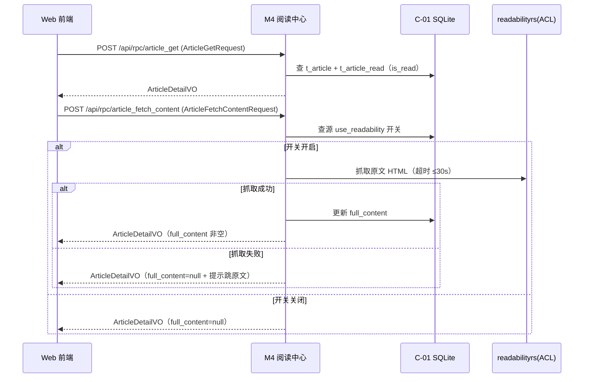

##### §3.2.M4.5 关键流程逻辑

已读状态采用「显式已读记录」模型：`t_article_read(user_id, article_id)` 唯一，标记已读 = INSERT OR IGNORE，标记未读 = DELETE，未读计数 = 分组文章数 − 已读记录数。该模型天然幂等、支持「标记未读」，并按 user_id 隔离（预留多用户）。全文抓取为「失败降级」路径（BD-01）：抓取失败/超时/逐源关闭时返回摘要 + `full_content=null`，前端展示「原文跳转」按钮（F11）。

收藏夹（F14）采用「关联表」模型：`t_article_folder(user_id, article_id, folder_id)` 唯一，收藏 = INSERT OR IGNORE，取消收藏 = DELETE，按收藏夹翻阅 = `t_article_folder JOIN t_article` 按 `folder_id + created_time DESC` 查询；收藏夹名同用户唯一（A400003 防重），删除收藏夹时同步清理其下关联（不做排序/嵌套，对齐 F14）。

#### 3.2.M5 全文搜索

##### §3.2.M5.1 模块概述

全文搜索模块覆盖「简化版全文搜索（F9）」业务流程；涉及 `Web 前端 SPA`、`C-01 SQLite（FTS5）`、`M4 阅读中心`（共享文章数据）。属 BC3 阅读检索上下文（核心域），对齐目标 V4（P95 ≤3s）。

##### §3.2.M5.2 接口清单

| 子领域 | 方法 | 路径 | 用途（≤ 20 字） | 请求 DTO | 响应 VO | 幂等 |
| --- | --- | --- | --- | --- | --- | --- |
| 搜索 | POST | `/api/rpc/search_query` | 全文搜索（关键词+筛选） | `SearchRequest` | `SearchResultVO` | 天然 |

##### §3.2.M5.3 关键结构定义（DTO）

```rust
pub struct SearchRequest {
    pub q: String,               // 搜索关键词
    pub feed_id: Option(i64),    // 按源过滤
    pub group_id: Option(i64),   // 按分组过滤
    pub page: Option(i32),
    pub page_size: Option(i32),
}

pub struct SearchResultVO {
    pub total: i32,
    pub items: Vec(SearchItemVO),
    pub took_ms: i64,     // 耗时（监控 V4）
}

pub struct SearchItemVO {
    pub article_id: i64,
    pub title: String,    // 命中高亮片段
    pub snippet: String,  // 正文高亮片段
    pub feed_title: String,
    pub published_at: Option(String),
    pub rank: f64,        // BM25 相关度
}
```

##### §3.2.M5.4 模块逻辑时序图

| 编号 | 标题 | 场景类别 | 是否包含异常分支 |
| --- | --- | --- | --- |
| SQ-M5-01 | 全文搜索 - FTS5 检索与高亮 | 核心查询 | 是（FTS 不可用降级 LIKE） |

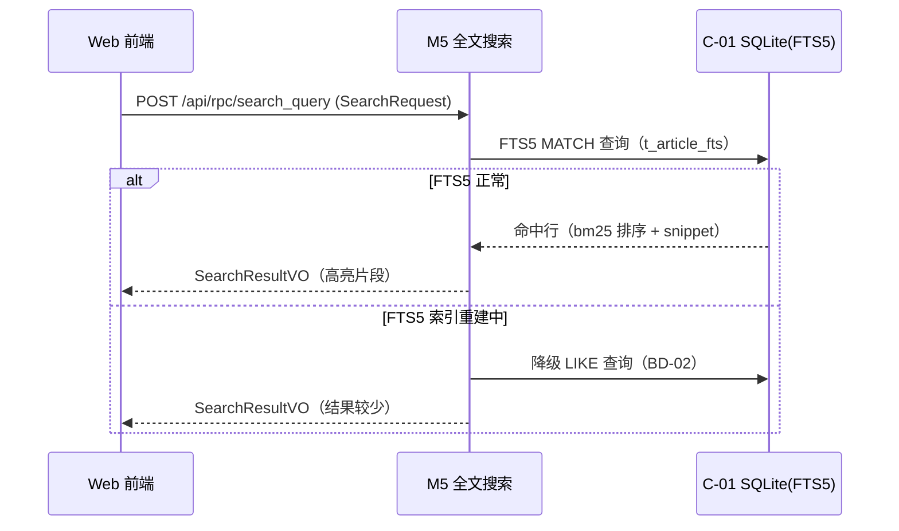

##### §3.2.M5.5 关键流程逻辑

无复杂状态机/事务/跨多步异步，本段省略（FTS5 为同步查询，高亮由 `snippet()` 函数完成）。

#### 3.2.M6 导入导出

##### §3.2.M6.1 模块概述

导入导出模块覆盖「OPML 导入（F1）/导出（F10）」业务流程；涉及 `Web 前端 SPA`、`M1 订阅管理`（导入结果写源/分组）、`C-01 SQLite`。属 BC1 订阅管理上下文（核心域），对齐目标 V1（41/41 解析成功 + ≥95% 首抓）。

##### §3.2.M6.2 接口清单

| 子领域 | 方法 | 路径 | 用途（≤ 20 字） | 请求 DTO | 响应 VO | 幂等 |
| --- | --- | --- | --- | --- | --- | --- |
| 导入 | POST | `/api/rpc/opml_import` | OPML 导入（JSON body） | `OpmlImportRequest` | `OpmlImportResultVO` | 是（idempotency_key） |
| 导出 | POST | `/api/rpc/opml_export` | 导出 OPML（返回 XML 文本） | — | `OpmlExportVO` | 天然 |
| 报告 | POST | `/api/rpc/opml_import_report` | 查询导入报告 | `OpmlImportReportRequest` | `OpmlImportReportVO` | 天然 |

##### §3.2.M6.3 关键结构定义（DTO）

```rust
pub struct OpmlImportRequest {
    pub content: String,          // OPML XML 文本（JSON body，全 JSON 约定，不用 multipart）
    pub idempotency_key: String,  // 幂等键（JSON body）
}

pub struct OpmlExportVO {
    pub content: String,          // 导出 OPML XML 文本（前端触发下载）
}

pub struct OpmlImportReportRequest {
    pub import_id: i64,           // 导入任务 ID（JSON body）
}

pub struct OpmlImportResultVO {
    pub import_id: i64,
    pub parsed: i32,       // 解析成功源数（目标 41/41）
    pub failed: i32,       // 解析失败源数
    pub first_fetch_ok: i32, // 首抓成功数（目标 ≥39）
}

pub struct OpmlImportReportVO {
    pub import_id: i64,
    pub normalized: Vec(NormalizeItem),  // 规范化改动清单
    pub failures: Vec(ImportFailure),    // 失败项（源 + 原因）
}

pub struct NormalizeItem {
    pub feed_title: String,
    pub action: String,   // http->https / 去双斜杠 / text 命名 / 域名不一致提示
    pub before: String,
    pub after: String,
}
```

##### §3.2.M6.4 模块逻辑时序图

| 编号 | 标题 | 场景类别 | 是否包含异常分支 |
| --- | --- | --- | --- |
| SQ-M6-01 | 导入导出 - OPML 导入规范化流水线 | 核心实体批量创建 | 是（部分源解析失败） |

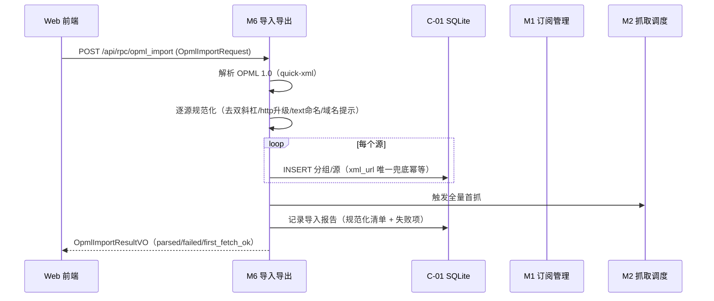

##### §3.2.M6.5 关键流程逻辑

导入幂等策略：以 `xml_url` 唯一约束兜底（重复导入同一 OPML 不产生重复源）；`idempotency_key`（JSON body）防前端重复提交。规范化规则（对齐 material_digest 数据质量）：URL 去双斜杠、`http→https` 升级尝试（失败保留 http 并按 §7 安全基线处理）、`text` 为显示名（`title` 存 feed_title 备选）、`xmlUrl/htmlUrl` 域名不一致仅提示不阻断。OPML 文件以 JSON body 的 `content` 字段（XML 文本）传递，不用 multipart form（对齐全 JSON body 约定）。

#### 3.2.M7 认证与会话

##### §3.2.M7.1 模块概述

认证与会话模块覆盖「单用户登录（F12）」业务流程；涉及 `Web 前端 SPA`、`C-01 SQLite`；作为横切鉴权中间件保护全部业务模块。属 BC4 身份会话上下文（通用域）。

##### §3.2.M7.2 接口清单

| 子领域 | 方法 | 路径 | 用途（≤ 20 字） | 请求 DTO | 响应 VO | 幂等 |
| --- | --- | --- | --- | --- | --- | --- |
| 认证 | POST | `/api/rpc/auth_login` | 登录（账号密码） | `LoginRequest` | `LoginResponse` | 否（重保限流） |
| 认证 | POST | `/api/rpc/auth_logout` | 注销 | — | `Result` | 天然 |
| 认证 | POST | `/api/rpc/auth_me` | 当前用户信息 | — | `MeVO` | 天然 |
| 认证 | POST | `/api/rpc/auth_change_password` | 修改密码 | `ChangePasswordRequest` | `Result` | 是（幂等键） |

##### §3.2.M7.3 关键结构定义（DTO）

```rust
pub struct LoginRequest {
    pub username: String,
    pub password: String,
}

pub struct LoginResponse {
    pub user_id: i64,
    pub username: String,
}

pub struct ChangePasswordRequest {
    pub old_password: String,
    pub new_password: String,
}
```

##### §3.2.M7.4 模块逻辑时序图

| 编号 | 标题 | 场景类别 | 是否包含异常分支 |
| --- | --- | --- | --- |
| SQ-M7-01 | 认证 - 登录签发会话 | 核心动作执行 | 是（密码错误/锁定） |

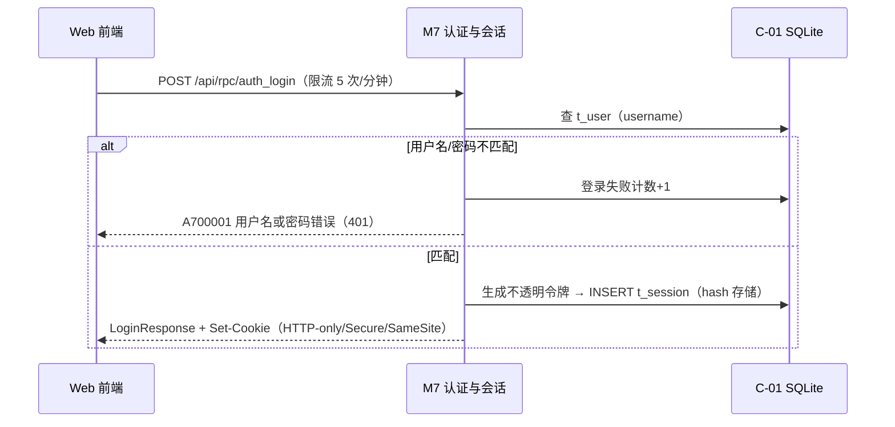

##### §3.2.M7.5 关键流程逻辑

会话生命周期：不透明随机令牌（256bit）以 SHA-256 哈希存 `t_session`，浏览器侧仅存 HTTP-only Cookie；登录失败连续 5 次锁定 15 分钟；修改密码后使该用户全部旧会话失效（删除 t_session 记录）。无复杂状态机，其余安全参数见 §7.2.1。

### 3.3 核心业务对象清单

#### 3.3.1 对象定义

| 编号 | 对象名（代码类名） | 对象类型 | 包路径 | 模块归属 | 被哪些模块复用 | 实例化策略 | 序列化约定 | 持久化策略 |
| --- | --- | --- | --- | --- | --- | --- | --- | --- |
| O-01 | `User` | 聚合根 | `domain::identity::User` | M7 | 全局鉴权 | 构造 + 密码哈希 | JSON | 落表 → `t_user` |
| O-02 | `FeedGroup` | 聚合根 | `domain::subscription::FeedGroup` | M1 | M1/M4/M6 | `FeedGroup::new()` | JSON | 落表 → `t_feed_group` |
| O-03 | `Feed` | 聚合根 | `domain::subscription::Feed` | M1 | M1/M2/M3/M4 | `Feed::new()` | JSON | 落表 → `t_feed` |
| O-04 | `Article` | 聚合根 | `domain::reading::Article` | M4 | M4/M5/M2 | 由抓取结果构造 | JSON | 落表 → `t_article` |
| O-05 | `ArticleRead` | 实体 | `domain::reading::ArticleRead` | M4 | M4 | 由阅读动作创建 | JSON | 落表 → `t_article_read` |
| O-06 | `FetchLog` | 实体 | `domain::fetching::FetchLog` | M2 | M2/M3 | 由抓取结果构造 | JSON | 落表 → `t_fetch_log` |
| O-07 | `Session` | 实体 | `domain::identity::Session` | M7 | M7 | 登录时创建 | JSON | 落表 → `t_session` |
| O-08 | `ArticleFts` | 值对象 | `domain::reading::ArticleFts` | M5 | M4/M5 | 文章写入时同步 | — | FTS5 索引 → `t_article_fts` |
| O-09 | `Folder` | 聚合根 | `domain::reading::Folder` | M4 | M4 | `Folder::new()` | JSON | 落表 → `t_folder` |
| O-10 | `ArticleFolder` | 实体 | `domain::reading::ArticleFolder` | M4 | M4 | 收藏动作创建 | JSON | 落表 → `t_article_folder` |

**对象类型说明**：聚合根（Aggregate Root）/ 实体（Entity）/ 值对象（Value Object）/ 共享 DTO / 共享枚举 / 防腐层 ACL，含义与模版一致。

#### 3.3.2 命名漂移登记表

| 业务实体（§2） | 代码类名（§3.3.1） | 数据表名（§4.2） | 漂移原因 |
| --- | --- | --- | --- |
| 订阅源 | `Feed` | `t_feed` | 业务术语「订阅源」在代码/表层统一为行业通用词 `Feed`（对标 RSS 生态惯例） |
| 全文索引 | `ArticleFts` | `t_article_fts` | 业务「全文索引」映射为 FTS5 虚拟表，非普通实体表 |

### 3.4 跨模块公共能力

> 单进程内横切能力以 **Axum 中间件 / tower Layer / Extractor** 形态提供（对应模版中的 SDK/AOP/共享 Bean，按 Rust 生态术语适配）。

| 公共能力 | 简述 | 提供方（类名/中间件） | 被哪些模块复用 | 接入方式 |
| --- | --- | --- | --- | --- |
| 登录鉴权 | 校验会话令牌 → 注入 user_id | `auth::AuthLayer`（axum middleware） | M1~M6 全部业务模块 | 路由挂载中间件 + `AuthUser` Extractor |
| 结构化日志 | 注入 traceId + tenantId + userId | `TraceLayer`（tower-http + tracing） | 全部模块 | 全局 Layer 挂载 |
| 统一错误处理 | AppError → 错误码/HTTP 映射 | `AppError` + `error::handler` | 全部模块 | `Result(T, AppError)` 统一返回 |
| 幂等 | idempotency_key（JSON body）去重 | `idempotency::IdempotencyLayer` | M1/M2/M4/M6 写入接口 | 中间件/提取器 + 请求体字段 |
| 限流 | 全局/单 IP/单用户/登录重保 | `ratelimit::RateLimitLayer` | M7 及全局入口 | 中间件 + §3.5.3 配置 |

### 3.5 接口契约

#### 3.5.1 全局错误码体系

**错误码格式**：

| 项 | 取值 |
| --- | --- |
| 错误码格式 | 6 位（1 类别 + 2 模块 + 3 序号），例如：`A100002` |
| 分段规则 | 1 位类别 + 2 位模块 + 3 位错误序号 |
| 类别取值 | `A` = 业务错误（HTTP 200，业务语义失败）/ `B` = 系统错误（HTTP 5xx）/ `C` = 客户端错误（HTTP 4xx） |
| 模块取值 | 00=全局 / 10=M1 / 20=M2 / 30=M3 / 40=M4 / 50=M5 / 60=M6 / 70=M7 |

**错误响应统一结构**：

```json
{
  "code": "A100002",
  "msg": "该订阅源已存在",
  "data": null,
  "traceId": "abc123",
  "timestamp": "2026-08-25T10:00:00.000Z"
}
```

**错误码注册表**：

| 错误码 | HTTP 状态 | 所属模块 | 含义 | 重试建议 | 用户文案 |
| --- | --- | --- | --- | --- | --- |
| C400001 | 400 | 全局 | 参数校验失败 | 不重试 | 参数错误 |
| C401001 | 401 | 全局 | 未登录 | 不重试 | 请重新登录 |
| C403001 | 403 | 全局 | 无权限 | 不重试 | 无权访问 |
| C404001 | 404 | 全局 | 资源不存在 | 不重试 | 资源不存在 |
| C429001 | 429 | 全局 | 触发限流 | 退避后重试 | 操作太频繁，请稍后再试 |
| A100001 | 200 | M1 | 分组不存在 | 不重试 | 分组不存在 |
| A100002 | 200 | M1 | 源 xmlUrl 重复 | 不重试 | 该订阅源已存在 |
| A100003 | 200 | M1 | 分组非空无法删除 | 不重试 | 请先移出分组内订阅源 |
| A200001 | 200 | M2 | 抓取任务冲突（已在执行） | 不重试 | 抓取正在进行，请稍后再试 |
| A300001 | 200 | M3 | 源已失效 | 不重试 | 该源已失效，可重试或修复 URL |
| A400001 | 200 | M4 | 文章不存在 | 不重试 | 文章不存在 |
| A400002 | 200 | M4 | 收藏夹不存在 | 不重试 | 收藏夹不存在 |
| A400003 | 200 | M4 | 收藏夹名已存在 | 不重试 | 收藏夹名已存在 |
| A500001 | 200 | M5 | 搜索语法错误 | 不重试 | 搜索关键词格式有误 |
| A600001 | 200 | M6 | OPML 解析失败 | 不重试 | OPML 文件格式无法解析 |
| A600002 | 200 | M6 | OPML 部分导入失败 | 不重试 | 部分订阅源导入失败，详见报告 |
| A700001 | 401 | M7 | 用户名或密码错误 | 不重试 | 用户名或密码错误 |
| A700002 | 401 | M7 | 会话已过期 | 不重试 | 登录已过期，请重新登录 |
| B200001 | 500 | M2 | Feed 抓取超时 | 可重试（调度器退避） | 抓取超时，系统将自动重试 |
| B999001 | 500 | 全局 | 系统内部错误 | 可重试 | 系统繁忙，请稍后再试 |
| B999002 | 500 | 全局 | 数据库错误 | 可重试 | 系统繁忙，请稍后再试 |

#### 3.5.2 幂等性约定

| 接口类型（按业务语义，全 POST） | 是否要求幂等 | 幂等键来源（建议） |
| --- | --- | --- |
| 创建类（feed_create / group_create / folder_create） | 幂等 | `idempotency_key`（JSON body，UUID）+ DB 唯一约束兜底（xml_url / name） |
| 更新类（feed_update / group_update / folder_rename / auth_change_password） | 必须幂等 | 资源 `id`（JSON body，天然幂等） |
| 删除类（feed_delete / group_delete / folder_delete / article_unfavorite） | 天然幂等 | 资源 `id`（JSON body） |
| 查询类（feed_list / article_list / search_query / folder_list） | 天然幂等 | — |
| 批量/重保类（opml_import / fetch_now / group_read_all） | 幂等 | `idempotency_key` + 业务唯一约束（xml_url / user+article 唯一） |

**幂等设计要点**：本项目不涉及资金/扣款，无「强制资金类幂等」；幂等键 `idempotency_key` 走 JSON body（对齐全 POST RPC 风格），生命周期 24h（`ratelimit`/内存去重 + DB 唯一索引兜底）；重复请求返回相同结果而非「重复提交」错误（对导入/已读标记友好）。

#### 3.5.3 限流约定

| 维度 | 默认值 | 触发动作 | 调整方式 |
| --- | --- | --- | --- |
| 全局 QPS | 100 | 返回 C429001 | 配置（环境变量） |
| 单 IP QPS | 50 | 返回 C429001 | 配置 |
| 单用户 QPS | 50 | 返回 C429001 | 配置 |
| 写接口 QPS | 20 | 返回 C429001 | 配置 |
| 重保接口（登录） | 5 次/分钟，锁定 15 分钟 | 返回 C429001 + 锁定 | 配置 |

**降级策略**：触发限流后前端按 `Retry-After` Header 退避重试；后端写入类接口记录限流计数；限流红线值与 §5.5.4 容量水位线「红线」一致。

#### 3.5.4 默认超时与重试基线

| 调用类型 | 默认超时 | 默认重试 | 重试条件 |
| --- | --- | --- | --- |
| 同步 API（前端 → 后端） | 3s | 0 次 | — |
| 外部 Feed 抓取（E-01） | 30s（上游冻结 ≤30s） | 单次 0 次重试（由调度器指数退避下次抓取） | 仅网络错误/非 2xx |
| Readability 全文抓取（E-02） | 30s | 0 次（失败降级跳转原文） | — |
| 定时抓取批次 | 5min 上限 | 3 次（失败告警） | 见 §8.4 |

#### 3.5.5 路由设计规范

**API 路由规范（RPC 风格）**：

| 维度 | 取值 |
| --- | --- |
| 风格 | RPC 风格（显式功能名，全 POST，经 G4 用户反馈锁定） |
| 统一前缀 | `/api/rpc/...`（不引入路径版本号，接口演进以显式功能名 + 契约兼容为准） |
| 命名 | snake_case 显式功能名（`feed_create`、`article_mark_read`、`opml_import`） |
| 动作命名 | `{对象}_{动作}`：create/get/update/delete/list/mark_read/favorite/unfavorite/... |
| 参数传递 | 全部参数走 JSON body（含资源 id、分页、筛选、幂等键），不用 path param / query param / form param |
| 响应 | 统一 `Result` 包裹（code/msg/data/traceId/timestamp，见 §3.5.1） |

> 说明：本系统无强需使用 path/query/form 参数的场景——资源定位改由 JSON body 中的 `id` 字段完成，搜索/分页/筛选改由 JSON body 字段完成，OPML 文件以 JSON body 的 `content`（XML 文本）传递（见 §3.2.M6）。

**前端页面路由清单**：

| 路径 | 页面 / 功能 | 入口角色（§2.3） | 鉴权要求 | 关联模块（§3.2.M{N}） |
| --- | --- | --- | --- | --- |
| `/login` | 登录页 | 全部 | 公开 | M7 |
| `/` | 文章列表（默认未读流） | 最终用户 | 已登录 | M4 |
| `/article/:id` | 文章详情 | 最终用户 | 已登录 | M4 |
| `/feeds` | 源管理页 | 维护者 | 已登录 | M1 |
| `/search` | 搜索页 | 最终用户 | 已登录 | M5 |
| `/health` | 源健康监控页 | 维护者 | 已登录 | M3 |
| `/import-export` | 导入/导出页 | 维护者 | 已登录 | M6 |
| `/settings` | 设置页（间隔/密码/备份） | 维护者 | 已登录 | M7 |

**前端路由约定**：路由模式 History（锁定）；命名小写 + 中划线；动态参数 `/:id`；鉴权用路由元信息 `meta.requireAuth=true` + 全局路由守卫（未登录跳 `/login`）。

---

## 4. 数据库设计

> **本章回答**：每个模块的状态用什么表存、表怎么建、数据怎么清理。
> **组织原则**：数据库按业务域组织（订阅管理域 / 内容抓取域 / 阅读检索域 / 身份与系统域），与 §2.1 / §3 一致。本项目为 SQLite 单文件，无分库分表。

### 4.1 全局数据约定

| 约定项 | 取值 | 说明 |
| --- | --- | --- |
| 命名规范（表名） | `t_{entity}` 业务主表，统一前缀 `t_` | FTS5 虚拟表 `t_article_fts` 例外 |
| 命名规范（字段名） | 小写 + 下划线（snake_case） | 禁止驼峰 |
| 主键类型 | `INTEGER PRIMARY KEY`（SQLite rowid 自增） | 全项目统一 |
| 字符集 / 排序 | UTF-8（SQLite `TEXT` 默认） | 支持多语言/emoji |
| 时间字段类型 | `TEXT`，ISO 8601 UTC + 毫秒（`2026-08-25T10:00:00.000Z`） | 由 Rust chrono 生成，禁止依赖 SQLite `CURRENT_TIMESTAMP` |
| 软删除字段 | `deleted INTEGER NOT NULL DEFAULT 0`（0 存在 / 1 已删） | 全项目统一 |
| 审计字段 | `created_time` / `updated_time` | 单用户省略 created_by/updated_by |
| 隔离字段（预留 user 维度） | `user_id INTEGER NOT NULL` | 查询语句强制带入 |
| 业务唯一标识 | `guid`（文章）、`xml_url`（源）等 UNIQUE 约束 | 防重复录入 |
| 状态枚举 | `TEXT` 字符串 + DDL 注释列出全部取值 | 如 health_status：healthy/failing/dead |
| 全文检索 | SQLite FTS5（external content + 同步触发器） | 41 源个人规模 |

### 4.2 单表设计

> 每张表严格按 5 段编写（库表元信息 / 结构 / 索引 / DDL / 清理机制）。

#### 4.2.1 库表元信息（t_user）

| 字段 | 取值 |
| --- | --- |
| 数据库类型 | SQLite |
| 库名 | rss_manager（单文件，`rss_manager.db`） |
| 表名 | `t_user` |
| 业务含义（≤ 50 字） | 用户账号（单用户，预留多用户维度） |
| 模块归属（§3.2） | M7 认证与会话 |
| 对应核心对象（§3.3） | O-01 `User` |

#### 4.2.2 库表结构定义（t_user）

| 列名 | 数据类型 | 可为空 | 约束 | 默认值 | 备注 |
| --- | --- | --- | --- | --- | --- |
| id | INTEGER | NOT NULL | PRIMARY KEY | — | 主键（rowid 自增） |
| username | TEXT | NOT NULL | UNIQUE | — | 登录名 |
| password_hash | TEXT | NOT NULL | — | — | 密码哈希（argon2，见 §7.2.1） |
| created_time | TEXT | NULL | — | NULL | 创建时间（ISO 8601 UTC） |
| updated_time | TEXT | NULL | — | NULL | 更新时间 |
| deleted | INTEGER | NOT NULL | — | 0 | 删除标志（0 存在 / 1 已删） |

#### 4.2.3 索引设计（t_user）

| 索引名 | 索引类型 | 字段（含顺序） | 设计目的 | 关联查询场景 |
| --- | --- | --- | --- | --- |
| `PRIMARY` | 主键 | `id` | 唯一标识 | 按主键查询 |
| `uk_username` | 唯一索引 | `username` | 登录名唯一 | `POST /api/rpc/auth_login` 按用户名查 |

#### 4.2.4 DDL（t_user）

```sql
CREATE TABLE `t_user` (
  `id` INTEGER PRIMARY KEY,
  `username` TEXT NOT NULL,
  `password_hash` TEXT NOT NULL,
  `created_time` TEXT,
  `updated_time` TEXT,
  `deleted` INTEGER NOT NULL DEFAULT 0,
  UNIQUE (`username`)
);
```

#### 4.2.5 扩展逻辑（数据清理机制）

| 清理机制 | 适用场景 | 配置 |
| --- | --- | --- |
| 无 | 账号永久保留 | — |

#### 4.2.1 库表元信息（t_feed_group）

| 字段 | 取值 |
| --- | --- |
| 数据库类型 | SQLite |
| 库名 | rss_manager |
| 表名 | `t_feed_group` |
| 业务含义（≤ 50 字） | 订阅分组（Blogs/杂志资讯等 4 组） |
| 模块归属（§3.2） | M1 订阅管理 |
| 对应核心对象（§3.3） | O-02 `FeedGroup` |

#### 4.2.2 库表结构定义（t_feed_group）

| 列名 | 数据类型 | 可为空 | 约束 | 默认值 | 备注 |
| --- | --- | --- | --- | --- | --- |
| id | INTEGER | NOT NULL | PRIMARY KEY | — | 主键 |
| user_id | INTEGER | NOT NULL | — | — | 隔离字段（预留 user 维度），查询必带 |
| name | TEXT | NOT NULL | — | — | 分组名 |
| sort_order | INTEGER | NOT NULL | — | 0 | 排序权重 |
| created_time | TEXT | NULL | — | NULL | 创建时间 |
| updated_time | TEXT | NULL | — | NULL | 更新时间 |
| deleted | INTEGER | NOT NULL | — | 0 | 删除标志 |

#### 4.2.3 索引设计（t_feed_group）

| 索引名 | 索引类型 | 字段（含顺序） | 设计目的 | 关联查询场景 |
| --- | --- | --- | --- | --- |
| `PRIMARY` | 主键 | `id` | 唯一标识 | 按主键查询 |
| `uk_user_name` | 唯一索引 | `user_id, name` | 同用户分组名唯一 | `POST /api/rpc/group_create` 防重 |

#### 4.2.4 DDL（t_feed_group）

```sql
CREATE TABLE `t_feed_group` (
  `id` INTEGER PRIMARY KEY,
  `user_id` INTEGER NOT NULL,
  `name` TEXT NOT NULL,
  `sort_order` INTEGER NOT NULL DEFAULT 0,
  `created_time` TEXT,
  `updated_time` TEXT,
  `deleted` INTEGER NOT NULL DEFAULT 0,
  UNIQUE (`user_id`, `name`)
);
```

#### 4.2.5 扩展逻辑（数据清理机制）

| 清理机制 | 适用场景 | 配置 |
| --- | --- | --- |
| 软删 | 业务删除分组 | 置 `deleted=1`，组内源需先移出（A100003 保护） |

#### 4.2.1 库表元信息（t_feed）

| 字段 | 取值 |
| --- | --- |
| 数据库类型 | SQLite |
| 库名 | rss_manager |
| 表名 | `t_feed` |
| 业务含义（≤ 50 字） | 订阅源配置（xmlUrl/htmlUrl/间隔/全文开关/健康状态） |
| 模块归属（§3.2） | M1 订阅管理 |
| 对应核心对象（§3.3） | O-03 `Feed` |

#### 4.2.2 库表结构定义（t_feed）

| 列名 | 数据类型 | 可为空 | 约束 | 默认值 | 备注 |
| --- | --- | --- | --- | --- | --- |
| id | INTEGER | NOT NULL | PRIMARY KEY | — | 主键 |
| user_id | INTEGER | NOT NULL | — | — | 隔离字段，查询必带 |
| group_id | INTEGER | NULL | — | NULL | 分组归属（NULL=未分组） |
| title | TEXT | NOT NULL | — | — | 显示名（text 优先） |
| feed_title | TEXT | NULL | — | NULL | 原始 Feed title |
| xml_url | TEXT | NOT NULL | — | — | 订阅源 URL |
| html_url | TEXT | NULL | — | NULL | 原文站点 |
| fetch_interval_sec | INTEGER | NOT NULL | — | 3600 | 每源抓取间隔，覆盖全局默认；下限 ≥1800（30 分钟，礼貌抓取） |
| use_readability | INTEGER | NOT NULL | — | 0 | 全文抓取开关（0/1，逐源） |
| health_status | TEXT | NOT NULL | — | 'healthy' | 健康状态：healthy/failing/dead |
| consecutive_failures | INTEGER | NOT NULL | — | 0 | 连续失败计数 |
| etag | TEXT | NULL | — | NULL | HTTP 条件请求 ETag |
| last_modified | TEXT | NULL | — | NULL | HTTP 条件请求 Last-Modified |
| last_fetch_at | TEXT | NULL | — | NULL | 最近抓取时间 |
| last_success_at | TEXT | NULL | — | NULL | 最近成功时间 |
| next_fetch_at | TEXT | NULL | — | NULL | 下次抓取时间（调度器扫描） |
| created_time | TEXT | NULL | — | NULL | 创建时间 |
| updated_time | TEXT | NULL | — | NULL | 更新时间 |
| deleted | INTEGER | NOT NULL | — | 0 | 删除标志 |

#### 4.2.3 索引设计（t_feed）

| 索引名 | 索引类型 | 字段（含顺序） | 设计目的 | 关联查询场景 |
| --- | --- | --- | --- | --- |
| `PRIMARY` | 主键 | `id` | 唯一标识 | 按主键查询 |
| `uk_user_xml` | 唯一索引 | `user_id, xml_url` | 同用户源 URL 唯一（导入/添加防重） | `POST /api/rpc/feed_create` |
| `idx_user_group` | 普通索引 | `user_id, group_id` | 按分组列源 | `POST /api/rpc/feed_list` |
| `idx_next_fetch` | 普通索引 | `next_fetch_at, health_status` | 调度器扫描到期源 | 调度器 tick 扫描 |

#### 4.2.4 DDL（t_feed）

```sql
CREATE TABLE `t_feed` (
  `id` INTEGER PRIMARY KEY,
  `user_id` INTEGER NOT NULL,
  `group_id` INTEGER,
  `title` TEXT NOT NULL,
  `feed_title` TEXT,
  `xml_url` TEXT NOT NULL,
  `html_url` TEXT,
  `fetch_interval_sec` INTEGER NOT NULL DEFAULT 3600,
  `use_readability` INTEGER NOT NULL DEFAULT 0,
  `health_status` TEXT NOT NULL DEFAULT 'healthy',
  `consecutive_failures` INTEGER NOT NULL DEFAULT 0,
  `etag` TEXT,
  `last_modified` TEXT,
  `last_fetch_at` TEXT,
  `last_success_at` TEXT,
  `next_fetch_at` TEXT,
  `created_time` TEXT,
  `updated_time` TEXT,
  `deleted` INTEGER NOT NULL DEFAULT 0,
  UNIQUE (`user_id`, `xml_url`),
  KEY `idx_user_group` (`user_id`, `group_id`),
  KEY `idx_next_fetch` (`next_fetch_at`, `health_status`)
);
```

#### 4.2.5 扩展逻辑（数据清理机制）

| 清理机制 | 适用场景 | 配置 |
| --- | --- | --- |
| 软删 | 业务删除源 | 置 `deleted=1`，保留其文章与已读记录 |
| 失效隔离 | 源连续 3 次失败 | `health_status=dead` + 移入「已失效」分组 |

#### 4.2.1 库表元信息（t_article）

| 字段 | 取值 |
| --- | --- |
| 数据库类型 | SQLite |
| 库名 | rss_manager |
| 表名 | `t_article` |
| 业务含义（≤ 50 字） | 文章内容（摘要/正文 + Readability 全文） |
| 模块归属（§3.2） | M4 阅读中心 |
| 对应核心对象（§3.3） | O-04 `Article` |

#### 4.2.2 库表结构定义（t_article）

| 列名 | 数据类型 | 可为空 | 约束 | 默认值 | 备注 |
| --- | --- | --- | --- | --- | --- |
| id | INTEGER | NOT NULL | PRIMARY KEY | — | 主键 |
| feed_id | INTEGER | NOT NULL | — | — | 所属源（→ t_feed.id） |
| guid | TEXT | NOT NULL | — | — | 文章唯一标识（去重） |
| title | TEXT | NOT NULL | — | — | 标题 |
| author | TEXT | NULL | — | NULL | 作者 |
| link | TEXT | NULL | — | NULL | 原文链接（跳转/全文抓取目标） |
| published_at | TEXT | NULL | — | NULL | 发布时间 |
| content | TEXT | NULL | — | NULL | Feed 摘要/正文 |
| full_content | TEXT | NULL | — | NULL | Readability 内嵌全文（未抓取为 NULL） |
| content_hash | TEXT | NULL | — | NULL | 内容哈希（去重） |
| created_time | TEXT | NULL | — | NULL | 创建时间（入库时间） |
| updated_time | TEXT | NULL | — | NULL | 更新时间 |
| deleted | INTEGER | NOT NULL | — | 0 | 删除标志 |

#### 4.2.3 索引设计（t_article）

| 索引名 | 索引类型 | 字段（含顺序） | 设计目的 | 关联查询场景 |
| --- | --- | --- | --- | --- |
| `PRIMARY` | 主键 | `id` | 唯一标识 | 按主键查询 |
| `uk_feed_guid` | 唯一索引 | `feed_id, guid` | 同源文章去重 | 抓取 UPSERT 去重 |
| `idx_feed_published` | 普通索引 | `feed_id, published_at DESC` | 按源时间倒序列表 | `POST /api/rpc/article_list` |
| `idx_published` | 普通索引 | `published_at` | 时间范围/全局排序 | 全部/分组列表倒序 |

#### 4.2.4 DDL（t_article）

```sql
CREATE TABLE `t_article` (
  `id` INTEGER PRIMARY KEY,
  `feed_id` INTEGER NOT NULL,
  `guid` TEXT NOT NULL,
  `title` TEXT NOT NULL,
  `author` TEXT,
  `link` TEXT,
  `published_at` TEXT,
  `content` TEXT,
  `full_content` TEXT,
  `content_hash` TEXT,
  `created_time` TEXT,
  `updated_time` TEXT,
  `deleted` INTEGER NOT NULL DEFAULT 0,
  UNIQUE (`feed_id`, `guid`),
  KEY `idx_feed_published` (`feed_id`, `published_at` DESC),
  KEY `idx_published` (`published_at`)
);
```

#### 4.2.5 扩展逻辑（数据清理机制）

| 清理机制 | 适用场景 | 配置 |
| --- | --- | --- |
| 归档/物理删除 | 历史文章低频访问 | 按 `created_time` 保留 N 天（默认 180 天），由清理任务触发，并同步 FTS 删除 |

#### 4.2.1 库表元信息（t_article_read）

| 字段 | 取值 |
| --- | --- |
| 数据库类型 | SQLite |
| 库名 | rss_manager |
| 表名 | `t_article_read` |
| 业务含义（≤ 50 字） | 已读记录（按 user_id 隔离，显式已读模型） |
| 模块归属（§3.2） | M4 阅读中心 |
| 对应核心对象（§3.3） | O-05 `ArticleRead` |

#### 4.2.2 库表结构定义（t_article_read）

| 列名 | 数据类型 | 可为空 | 约束 | 默认值 | 备注 |
| --- | --- | --- | --- | --- | --- |
| id | INTEGER | NOT NULL | PRIMARY KEY | — | 主键 |
| user_id | INTEGER | NOT NULL | — | — | 隔离字段（已读按 user 隔离） |
| article_id | INTEGER | NOT NULL | — | — | 文章（→ t_article.id） |
| read_at | TEXT | NULL | — | NULL | 标记已读时间 |
| created_time | TEXT | NULL | — | NULL | 创建时间 |

#### 4.2.3 索引设计（t_article_read）

| 索引名 | 索引类型 | 字段（含顺序） | 设计目的 | 关联查询场景 |
| --- | --- | --- | --- | --- |
| `PRIMARY` | 主键 | `id` | 唯一标识 | 按主键查询 |
| `uk_user_article` | 唯一索引 | `user_id, article_id` | 单用户单文章唯一已读 | 标记已读幂等 / 未读计数 |
| `idx_article` | 普通索引 | `article_id` | 文章删除级联清理 | 清理任务 |

#### 4.2.4 DDL（t_article_read）

```sql
CREATE TABLE `t_article_read` (
  `id` INTEGER PRIMARY KEY,
  `user_id` INTEGER NOT NULL,
  `article_id` INTEGER NOT NULL,
  `read_at` TEXT,
  `created_time` TEXT,
  UNIQUE (`user_id`, `article_id`),
  KEY `idx_article` (`article_id`)
);
```

#### 4.2.5 扩展逻辑（数据清理机制）

| 清理机制 | 适用场景 | 配置 |
| --- | --- | --- |
| 级联物理删除 | 文章归档删除 | 随文章删除同步清理已读记录 |

#### 4.2.1 库表元信息（t_folder）

| 字段 | 取值 |
| --- | --- |
| 数据库类型 | SQLite |
| 库名 | rss_manager |
| 表名 | `t_folder` |
| 业务含义（≤ 50 字） | 收藏夹（F14，用户自建收藏分类容器） |
| 模块归属（§3.2） | M4 阅读中心 |
| 对应核心对象（§3.3） | O-09 `Folder` |

#### 4.2.2 库表结构定义（t_folder）

| 列名 | 数据类型 | 可为空 | 约束 | 默认值 | 备注 |
| --- | --- | --- | --- | --- | --- |
| id | INTEGER | NOT NULL | PRIMARY KEY | — | 主键 |
| user_id | INTEGER | NOT NULL | — | — | 隔离字段，查询必带 |
| name | TEXT | NOT NULL | — | — | 收藏夹名 |
| created_time | TEXT | NULL | — | NULL | 创建时间 |
| updated_time | TEXT | NULL | — | NULL | 更新时间 |
| deleted | INTEGER | NOT NULL | — | 0 | 删除标志 |

#### 4.2.3 索引设计（t_folder）

| 索引名 | 索引类型 | 字段（含顺序） | 设计目的 | 关联查询场景 |
| --- | --- | --- | --- | --- |
| `PRIMARY` | 主键 | `id` | 唯一标识 | 按主键查询 |
| `uk_user_name` | 唯一索引 | `user_id, name` | 同用户收藏夹名唯一 | `POST /api/rpc/folder_create` 防重 |

#### 4.2.4 DDL（t_folder）

```sql
CREATE TABLE `t_folder` (
  `id` INTEGER PRIMARY KEY,
  `user_id` INTEGER NOT NULL,
  `name` TEXT NOT NULL,
  `created_time` TEXT,
  `updated_time` TEXT,
  `deleted` INTEGER NOT NULL DEFAULT 0,
  UNIQUE (`user_id`, `name`)
);
```

#### 4.2.5 扩展逻辑（数据清理机制）

| 清理机制 | 适用场景 | 配置 |
| --- | --- | --- |
| 软删 | 业务删除收藏夹 | 置 `deleted=1`，同步清理其下 `t_article_folder` 关联 |

#### 4.2.1 库表元信息（t_article_folder）

| 字段 | 取值 |
| --- | --- |
| 数据库类型 | SQLite |
| 库名 | rss_manager |
| 表名 | `t_article_folder` |
| 业务含义（≤ 50 字） | 文章-收藏夹关联（F14，文章归入收藏夹） |
| 模块归属（§3.2） | M4 阅读中心 |
| 对应核心对象（§3.3） | O-10 `ArticleFolder` |

#### 4.2.2 库表结构定义（t_article_folder）

| 列名 | 数据类型 | 可为空 | 约束 | 默认值 | 备注 |
| --- | --- | --- | --- | --- | --- |
| id | INTEGER | NOT NULL | PRIMARY KEY | — | 主键 |
| user_id | INTEGER | NOT NULL | — | — | 隔离字段（预留 user 维度） |
| article_id | INTEGER | NOT NULL | — | — | 文章（→ t_article.id） |
| folder_id | INTEGER | NOT NULL | — | — | 收藏夹（→ t_folder.id） |
| created_time | TEXT | NULL | — | NULL | 收藏时间 |

#### 4.2.3 索引设计（t_article_folder）

| 索引名 | 索引类型 | 字段（含顺序） | 设计目的 | 关联查询场景 |
| --- | --- | --- | --- | --- |
| `PRIMARY` | 主键 | `id` | 唯一标识 | 按主键查询 |
| `uk_user_article_folder` | 唯一索引 | `user_id, article_id, folder_id` | 同用户同文章同夹唯一 | 收藏幂等 / 取消收藏 |
| `idx_folder_created` | 普通索引 | `folder_id, created_time DESC` | 按收藏夹翻阅 | `POST /api/rpc/folder_article_list` |
| `idx_article` | 普通索引 | `article_id` | 文章删除级联清理 | 清理任务 |

#### 4.2.4 DDL（t_article_folder）

```sql
CREATE TABLE `t_article_folder` (
  `id` INTEGER PRIMARY KEY,
  `user_id` INTEGER NOT NULL,
  `article_id` INTEGER NOT NULL,
  `folder_id` INTEGER NOT NULL,
  `created_time` TEXT,
  UNIQUE (`user_id`, `article_id`, `folder_id`),
  KEY `idx_folder_created` (`folder_id`, `created_time` DESC),
  KEY `idx_article` (`article_id`)
);
```

#### 4.2.5 扩展逻辑（数据清理机制）

| 清理机制 | 适用场景 | 配置 |
| --- | --- | --- |
| 级联物理删除 | 文章归档删除 / 收藏夹删除 | 随文章删除同步清理关联；随收藏夹删除同步清理其下关联 |

#### 4.2.1 库表元信息（t_fetch_log）

| 字段 | 取值 |
| --- | --- |
| 数据库类型 | SQLite |
| 库名 | rss_manager |
| 表名 | `t_fetch_log` |
| 业务含义（≤ 50 字） | 单源单次抓取执行记录与结果 |
| 模块归属（§3.2） | M2 抓取调度 |
| 对应核心对象（§3.3） | O-06 `FetchLog` |

#### 4.2.2 库表结构定义（t_fetch_log）

| 列名 | 数据类型 | 可为空 | 约束 | 默认值 | 备注 |
| --- | --- | --- | --- | --- | --- |
| id | INTEGER | NOT NULL | PRIMARY KEY | — | 主键 |
| feed_id | INTEGER | NOT NULL | — | — | 源（→ t_feed.id） |
| fetch_at | TEXT | NULL | — | NULL | 抓取时间 |
| http_status | INTEGER | NULL | — | NULL | HTTP 状态码 |
| result | TEXT | NOT NULL | — | — | 结果：success/parse_error/http_error/timeout |
| error_message | TEXT | NULL | — | NULL | 错误信息 |
| new_article_count | INTEGER | NOT NULL | — | 0 | 新入库文章数 |
| duration_ms | INTEGER | NULL | — | NULL | 耗时（毫秒） |
| created_time | TEXT | NULL | — | NULL | 创建时间 |

#### 4.2.3 索引设计（t_fetch_log）

| 索引名 | 索引类型 | 字段（含顺序） | 设计目的 | 关联查询场景 |
| --- | --- | --- | --- | --- |
| `PRIMARY` | 主键 | `id` | 唯一标识 | 按主键查询 |
| `idx_feed_fetch` | 普通索引 | `feed_id, fetch_at DESC` | 单源抓取历史倒序 | 源健康面板 / 抓取日志页 |
| `idx_fetch_at` | 普通索引 | `fetch_at` | 按时间清理 | 清理任务 |

#### 4.2.4 DDL（t_fetch_log）

```sql
CREATE TABLE `t_fetch_log` (
  `id` INTEGER PRIMARY KEY,
  `feed_id` INTEGER NOT NULL,
  `fetch_at` TEXT,
  `http_status` INTEGER,
  `result` TEXT NOT NULL,
  `error_message` TEXT,
  `new_article_count` INTEGER NOT NULL DEFAULT 0,
  `duration_ms` INTEGER,
  `created_time` TEXT,
  KEY `idx_feed_fetch` (`feed_id`, `fetch_at` DESC),
  KEY `idx_fetch_at` (`fetch_at`)
);
```

#### 4.2.5 扩展逻辑（数据清理机制）

| 清理机制 | 适用场景 | 配置 |
| --- | --- | --- |
| 物理删除 | 抓取日志滚动 | 按 `fetch_at` 保留 30 天，由清理任务触发 |

#### 4.2.1 库表元信息（t_session）

| 字段 | 取值 |
| --- | --- |
| 数据库类型 | SQLite |
| 库名 | rss_manager |
| 表名 | `t_session` |
| 业务含义（≤ 50 字） | 登录会话（不透明令牌哈希 + 过期） |
| 模块归属（§3.2） | M7 认证与会话 |
| 对应核心对象（§3.3） | O-07 `Session` |

#### 4.2.2 库表结构定义（t_session）

| 列名 | 数据类型 | 可为空 | 约束 | 默认值 | 备注 |
| --- | --- | --- | --- | --- | --- |
| id | INTEGER | NOT NULL | PRIMARY KEY | — | 主键 |
| user_id | INTEGER | NOT NULL | — | — | 所属用户 |
| token_hash | TEXT | NOT NULL | UNIQUE | — | 令牌 SHA-256 哈希（不存明文） |
| expires_at | TEXT | NOT NULL | — | — | 过期时间 |
| created_time | TEXT | NULL | — | NULL | 创建时间 |

#### 4.2.3 索引设计（t_session）

| 索引名 | 索引类型 | 字段（含顺序） | 设计目的 | 关联查询场景 |
| --- | --- | --- | --- | --- |
| `PRIMARY` | 主键 | `id` | 唯一标识 | 按主键查询 |
| `uk_token_hash` | 唯一索引 | `token_hash` | 令牌快速查找 | 鉴权中间件每次请求 |
| `idx_user` | 普通索引 | `user_id` | 按用户失效会话 | 修改密码后批量失效 |

#### 4.2.4 DDL（t_session）

```sql
CREATE TABLE `t_session` (
  `id` INTEGER PRIMARY KEY,
  `user_id` INTEGER NOT NULL,
  `token_hash` TEXT NOT NULL,
  `expires_at` TEXT NOT NULL,
  `created_time` TEXT,
  UNIQUE (`token_hash`),
  KEY `idx_user` (`user_id`)
);
```

#### 4.2.5 扩展逻辑（数据清理机制）

| 清理机制 | 适用场景 | 配置 |
| --- | --- | --- |
| 物理删除 | 过期会话 | 按 `expires_at` 定期清理（清理任务触发） |

#### 4.2.1 库表元信息（t_article_fts）

| 字段 | 取值 |
| --- | --- |
| 数据库类型 | SQLite（FTS5 虚拟表） |
| 库名 | rss_manager |
| 表名 | `t_article_fts` |
| 业务含义（≤ 50 字） | 文章标题+摘要+全文的 FTS5 检索索引 |
| 模块归属（§3.2） | M5 全文搜索 |
| 对应核心对象（§3.3） | O-08 `ArticleFts`（值对象） |

#### 4.2.2 库表结构定义（t_article_fts）

> FTS5 external-content 模式，列定义镜像 `t_article` 的 `title / content / full_content`，`content_rowid='id'`。

| 列名 | 数据类型 | 可为空 | 约束 | 默认值 | 备注 |
| --- | --- | --- | --- | --- | --- |
| title | TEXT | — | FTS5 列 | — | 标题（索引） |
| content | TEXT | — | FTS5 列 | — | Feed 摘要/正文（索引） |
| full_content | TEXT | — | FTS5 列 | — | Readability 全文（索引） |

#### 4.2.3 索引设计（t_article_fts）

| 索引名 | 索引类型 | 字段（含顺序） | 设计目的 | 关联查询场景 |
| --- | --- | --- | --- | --- |
| （FTS5 内部） | FTS5 倒排索引 | title, content, full_content | 全文检索 BM25 | `POST /api/rpc/search_query` |

#### 4.2.4 DDL（t_article_fts）

```sql
CREATE VIRTUAL TABLE `t_article_fts` USING fts5(
  title, content, full_content,
  content='t_article', content_rowid='id'
);

-- 同步触发器：文章增删改同步 FTS 索引
CREATE TRIGGER `trg_article_ai` AFTER INSERT ON `t_article` BEGIN
  INSERT INTO `t_article_fts`(rowid, title, content, full_content)
  VALUES (new.id, new.title, new.content, new.full_content);
END;

CREATE TRIGGER `trg_article_ad` AFTER DELETE ON `t_article` BEGIN
  INSERT INTO `t_article_fts`(`t_article_fts`, rowid, title, content, full_content)
  VALUES ('delete', old.id, old.title, old.content, old.full_content);
END;

CREATE TRIGGER `trg_article_au` AFTER UPDATE ON `t_article` BEGIN
  INSERT INTO `t_article_fts`(`t_article_fts`, rowid, title, content, full_content)
  VALUES ('delete', old.id, old.title, old.content, old.full_content);
  INSERT INTO `t_article_fts`(rowid, title, content, full_content)
  VALUES (new.id, new.title, new.content, new.full_content);
END;
```

#### 4.2.5 扩展逻辑（数据清理机制）

| 清理机制 | 适用场景 | 配置 |
| --- | --- | --- |
| 定期 optimize | 索引碎片合并 | `INSERT INTO t_article_fts(t_article_fts) VALUES('optimize')`，随清理任务触发 |

### 4.3 数据部署与备份

#### 4.3.1 存储清单

| 存储类型 | 用途 | 部署模式 | HA 方案 | 备份策略 | 日志 / 审计去向 |
| --- | --- | --- | --- | --- | --- |
| SQLite（单文件） | 业务主数据 + 全文索引（FTS5） | 单文件（进程内嵌） | 无 HA（单实例自托管；WAL 崩溃恢复兜底） | 在线备份（`.backup` API）每日全量 + 可选每小时，归档至隔离目录/对象存储 | 抓取日志存 `t_fetch_log`；审计日志见 §7.2.4 |

#### 4.3.2 备份与恢复

| 维度 | 取值 |
| --- | --- |
| 备份方式 | 全量（SQLite `.backup` 在线备份，写时快照，不断服务）+ WAL 检查点 |
| 备份位置 | 与生产数据文件**物理隔离**的本地目录（可选同步至对象存储异地） |
| 保留策略 | 全量保留 30 天 |
| RPO（数据丢失容忍） | ≤ 60 分钟（备份频率；WAL 模式下崩溃丢失窗口远小于此） |
| RTO（恢复时间目标） | ≤ 10 分钟（停止进程 → 复制回备份文件 → 重启） |
| 恢复演练 | 频率每月；负责人 维护者（用户本人） |

**填写要求核对**：SQLite 为唯一持久化存储，单实例无主从 HA，以 WAL 崩溃恢复 + 在线备份满足 Q1 数据不丢失；RPO/RTO 已给具体数字，与 §5.3 SLA 自洽。

---

## 5. 部署架构

> **本章定位**：本章只承载**对开发产生约束的部署结论**（容错、降级、连接池、外部访问）。单用户自托管单二进制，部署形态简单，具体节点规格/CICD 见《系统部署文档》（platform-architect）。

### 5.1 环境与集群划分

| 环境名称 | 环境定位 | 集群隔离 | 集群规格 |
| --- | --- | --- | --- |
| dev | 开发自测 | 本地开发机 | 最小规格（单进程 + SQLite） |
| prod | 生产自托管 | 用户自有主机（VPS/家庭服务器） | 单进程 + SQLite 单文件 |

> 说明：个人单实例项目，无 int/uat 环境（不适用）。**配置策略**：

| 配置层级 | 存放位置 | 适用内容 | 变更生效 | 对开发的约束 |
| --- | --- | --- | --- | --- |
| L1 代码内 | 代码仓库 | 默认值、枚举、常量 | 重新部署 | 禁止写入：环境差异、密码、地址 |
| L2 配置中心 | 不适用（单进程） | — | — | 以环境变量替代 |
| L3 环境变量 | 进程环境 | 数据文件路径、监听地址、抓取间隔默认值、日志级别 | 重启进程 | 启动失败 fail-fast，禁止跑默认值 |
| L4 Secret | 环境变量 + 文件权限 | 会话密钥、初始密码哈希 | 重启进程 | 禁止落日志、禁止入代码 |

### 5.2 运行时高可用与弹性

#### 5.2.1 负载均衡

| 维度 | 取值 |
| --- | --- |
| 类型 | 单实例，无 LB（自托管） |
| 健康检查路径 | `/healthz`（Liveness）/ `/readyz`（Readiness） |
| 健康检查频率 | 10s |
| 失败阈值 | 连续 3 次失败标记不健康 |
| 恢复阈值 | 连续 2 次成功标记健康 |
| 会话保持 | 不适用（单实例） |

#### 5.2.2 弹性伸缩

| 维度 | 取值 |
| --- | --- |
| 触发指标 | 不适用（单实例，超出规模再评估多实例化） |
| 副本区间 | 固定 1 |

#### 5.2.3 容灾级别

| 维度 | 取值 |
| --- | --- |
| 容灾级别 | 单机（单主机自托管） |
| 故障切换 RTO | ≤ 10 分钟（备份文件恢复 + 重启，见 §4.3.2） |
| 跨 Region 数据同步策略 | 不适用 |

#### 5.2.4 可用性来源拆分

| 可用性来源 | 范围 | 责任方 |
| --- | --- | --- |
| 云厂商 SLA 兜底 | 不适用（自托管，主机可用性自保障） | 维护者（用户） |
| 本系统自身保障 | WAL 崩溃恢复 / 优雅停机 / 在线备份 / 抓取退避 | 研发团队 |
| 强依赖外部（E-xx）故障策略 | 逐源指数退避 / 全文抓取降级跳转原文 | 研发团队 |

**对开发的约束**：

| 契约项 | 本系统取值 | 开发实现要求 |
| --- | --- | --- |
| 无状态化 | 有状态：SQLite 单文件（本地落盘） | 显式标注有状态；禁止 Pod/进程内缓存业务数据 |
| 优雅停机 | SIGTERM → 停止接入新流量 → 等待在飞抓取任务结束（上限 30s）→ 关闭 SQLite 连接 → 退出 | Axum server 实现 graceful shutdown |
| Liveness | `/healthz`，仅判进程存活 | 失败 → 重启进程 |
| Readiness | `/readyz`，判 SQLite 可读写 | 失败 → 摘流不杀进程 |
| 幂等性范围 | 全部写接口幂等（见 §3.5.2） | 幂等键来源见 §3.5.2 |
| 超时与重试基线 | 默认值见 §3.5.4 | 抓取/全文抓取显式设超时 |

### 5.3 服务级别（SLA）

| SLA 指标项 | 指标定义 | 目标值 | 度量方式 |
| --- | --- | --- | --- |
| 系统开放时间 | 对外提供服务的时间窗口 | 7×24（自托管常驻） | 业务侧约定 |
| 系统可用性 | 月度可用时长 / 月度总时长 | ≥ 99.5%（个人自托管，排除计划维护） | 监控统计 |
| 单接口分位响应时延 | 端到端响应时间 | 列表/详情 P95 ≤ 200ms；搜索 P95 ≤ 3s（V4） | APM/埋点采样 |
| 故障恢复目标（RTO、RPO） | 故障到恢复 / 数据丢失容忍 | RTO ≤ 10min；RPO ≤ 60min | 演练验证（每月） |
| 计划内停机窗口 | 升级 / 维护窗口 | 版本升级替换二进制，停机 ≤ 5min | 公告 |
| 不可用界定 | 何为"不可用" | 健康检查连续 3 次失败，或错误率 > 50% 持续 5min | 告警规则 |

### 5.4 部署拓扑图

#### 5.4.1 物理拓扑图

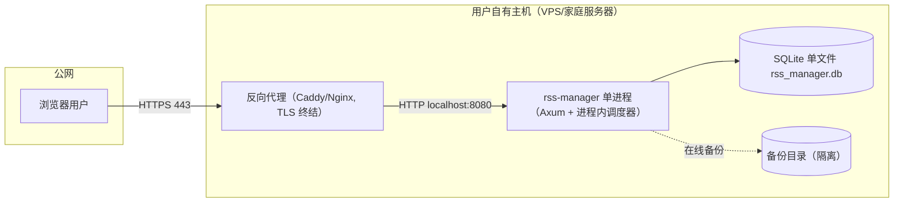

#### 5.4.2 拓扑要素清单

| 要素 | 取值 |
| --- | --- |
| 跨 Region 部署 | 否 |
| 跨 AZ 部署 | 否（单主机） |
| 流量入口路径 | 浏览器 → 反向代理（TLS 终结）→ rss-manager 进程 |
| 内部调用路径 | 单进程内直调（无服务发现） |
| 数据库访问路径 | 进程内 SQLite 连接池（无主从切换） |

#### 5.4.3 故障域划分

| 故障域 | 影响范围 | 容错机制 | 预期 RTO |
| --- | --- | --- | --- |
| 单进程 | 全部功能 | 进程守护/自动重启 + 优雅停机 | 低于 30 秒 |
| 单主机 | 全部功能 | 备份文件恢复（§4.3.2） | ≤ 10min |
| 单磁盘 | 数据 + 进程 | 备份文件异地/隔离目录恢复 | ≤ 10min |

### 5.5 容量规划

#### 5.5.1 业务量预估

| 业务指标 | 当前值 | MVP 阶段值 | 生产阶段值 | 备注 |
| --- | --- | --- | --- | --- |
| 注册用户数 | 1 | 1 | 1（预留扩展） | 单用户（U-01） |
| DAU | 1 | 1 | 1 | 用户本人 |
| 峰值 QPS | — | 低于 10 | 低于 10 | 单人交互，无高并发 |
| 数据写入量 / 天 | — | 41 源 × 平均 5 篇 ≈ 200 篇/天 | ≤ 500 篇/天 | 估算 |
| 数据存量 | — | 200 篇/天 × 180 天 ≈ 3.6 万篇 | 保留 180 天 ≈ 10 万篇 | SQLite 单文件低于 1GB |

#### 5.5.2 资源容量推算

| 资源 | 推算公式 | 当前配置 | 生产阶段配置 |
| --- | --- | --- | --- |
| 应用实例数 | 单实例 | 1 | 1 |
| 内存 | 对标 Miniflux 30–80MB（Rust 同量级） | ≤ 128MB | ≤ 256MB |
| 磁盘 | 单文件 + 备份 ×30 天保留 | ≤ 1GB | ≤ 2GB |
| SQLite 连接池 | 单进程 ≤ 5 并发写 + 读 | 1 池 | 1 池 |

#### 5.5.3 扩容触发与路径

| 资源 | 扩容触发指标 | 扩容方式 | 扩容耗时 |
| --- | --- | --- | --- |
| 磁盘 | SQLite 单文件 > 1GB 或磁盘占用 > 80% | 缩短文章保留天数 / 清理抓取日志 | 低于 10 分钟 |
| 内存 | 内存 > 80% 持续 10min | 排查泄漏 / 升配主机 | 低于 30 分钟 |

#### 5.5.4 容量水位线

| 水位 | 阈值 | 动作 | 对开发的约束 |
| --- | --- | --- | --- |
| 健康水位 | 低于 60% | 无动作 | — |
| 预警水位 | 60–80% | 告警（AL-04/AL-05），启动清理评审 | — |
| 危险水位 | > 80% | 清理日志/归档文章 | — |
| 红线 | > 95% | 触发限流/降级（与 §3.5.3 联动） | 限流红线值与本表一致 |

---

## 6. 网络架构

> **本章定位**：本章只承载**对开发产生约束的网络结论**。单主机自托管，无跨服务东西向流量。

### 6.1 网络环境规划

| 网络环境 | 用途 | 说明 / 访问策略 |
| --- | --- | --- |
| 公网入口 | 反向代理对外 | 仅 443/80 入站，TLS 终结 |
| 本机（localhost） | 应用进程 + SQLite | 应用仅监听 localhost，由反向代理转发 |

### 6.2 流量入口与南北向流量

#### 6.2.1 入口流量链路

| 组件 | 作用 | 部署位置 |
| --- | --- | --- |
| DNS | 域名解析 | 公网 |
| CDN | 不适用（自托管，可选） | — |
| 抗 DDoS / WAF | 不适用（可选 Cloudflare 等，自托管可选） | — |
| 反向代理 | TLS 终结 / 转发 | 用户主机 |
| rss-manager 进程 | 业务逻辑 | 用户主机 |

**入口决策（对开发的约束）**：

| 决策项 | 取值 | 对开发的约束 |
| --- | --- | --- |
| TLS 终结点 | 反向代理（Caddy/Nginx） | 应用层无需自管证书；业务侧信任 `X-Forwarded-For` 头 |
| 限流位置 | 应用内（§3.5.3 中间件） | 业务自实现限流对接 §3.5.3 红线 |
| 鉴权位置 | 应用内（§7.2.1 会话中间件） | 业务自鉴权 |
| 真实客户端 IP 获取 | `X-Forwarded-For` | 业务获取客户端 IP 必须用本字段 |

#### 6.2.2 出口流量

| 决策项 | 取值 | 对开发的约束 |
| --- | --- | --- |
| 出口方式 | 直接出站（主机 NAT） | reqwest 直连 Feed 源/网页 |
| 是否需要固定出口 IP | 否 | 无白名单要求 |
| 出口白名单 | 41 源 + 摘要源网页域名（运行时动态，非静态白名单） | 见 §7.2.2 SSRF 防护 |
| 跨地域 / 跨云出口 | 不适用 | — |

### 6.3 内部互联（东西向流量）

| 决策项 | 取值 | 对开发的约束 |
| --- | --- | --- |
| 服务发现 | 不适用（单进程，无服务间调用） | 模块间进程内直调 |
| 服务间通信协议 | 不适用（单进程） | — |
| 内部 mTLS | 不启用（无跨进程流量） | — |
| 跨服务调用幂等性 | 进程内直调 | 无需 Header 透传 |

---

## 7. 安全设计

> **本章回答**：本系统在安全维度做了哪些选择、关键机制如何落地。更深的威胁模型由 security-architect 在《系统安全设计》产出；本章承载「机制选择 + 关键参数基线」。

### 7.1 架构安全全景

| 能力域 | 选用产品 / 机制 | 作用范围 | 是否启用 |
| --- | --- | --- | --- |
| 抗 DDoS | 不适用（自托管，可选 Cloudflare 兜底） | 公网入口 | 否（可选） |
| WAF | 不适用（自托管，可选反向代理规则） | Web 应用层 | 否（可选） |
| 防火墙 / 安全组 | 主机防火墙（仅放行 80/443，应用仅监听 localhost） | 主机级 | 是 |
| 主机安全 | 用户自维护（SSH 加固、系统补丁） | 主机 | 是（用户自担） |
| 容器安全 | 单二进制/可选单容器，最小权限运行 | 进程 | 是 |
| 数据安全审计 | SQLite + 审计日志（§7.2.4） | 关键数据 | 是 |
| 密钥管理（KMS） | 环境变量 + 文件权限（自托管无云 KMS） | 会话密钥/初始密码 | 是 |
| 安全运营中心（SOC） | 不适用（个人项目） | — | 否 |
| 堡垒机 | 不适用（个人项目） | — | 否 |

### 7.2 业务安全架构

#### 7.2.1 用户认证

| 维度 | 取值 |
| --- | --- |
| 账号体系 | 自建（单用户，预留 user 维度） |
| 登录方式 | 账号密码（无验证码/SSO/扫码） |
| 多因素认证（MFA） | 不启用（单用户自托管，可选 TOTP 为 P2 增强） |
| 密码强度 | 最小长度 12；复杂度（大小写 + 数字 + 符号） |
| 登录失败锁定 | 连续失败 5 次锁定 15 分钟 |
| Token 有效期 | 会话令牌 7 天（滑动过期）；登录态 HTTP-only Cookie |
| 会话管理 | 单点登录；不透明随机令牌（256bit）+ SHA-256 哈希存库；修改密码后全量失效 |

#### 7.2.2 数据安全

| 维度 | 取值 |
| --- | --- |
| 数据分级 | L2（个人订阅/阅读数据，中等敏感）；L3（密码哈希，高敏感） |
| 传输加密 | TLS 强制（反向代理终结）；应用与反向代理间本机回环 |
| 存储加密 | 可选全盘加密（用户自担）；密码字段 argon2id 哈希存储 |
| 敏感字段清单 | `password_hash`（argon2id）、`token_hash`（SHA-256）；禁止明文日志 |
| 数据导出与共享 | OPML 导出（F10）由用户主动触发；无审批流 |

**敏感字段处理策略表**：

| 字段 | 分级 | 存储策略 | 展示策略（脱敏） | 导出策略 |
| --- | --- | --- | --- | --- |
| password_hash | L3 | argon2id 哈希 | 不展示 | 禁止导出 |
| token_hash | L3 | SHA-256 哈希 | 不展示 | 禁止导出 |
| 文章全文/订阅清单 | L2 | 明文（个人数据） | 正常展示 | OPML 导出（用户主动） |

#### 7.2.3 密钥与凭证

| 维度 | 取值 |
| --- | --- |
| 存储方式 | 环境变量 + 文件权限（自托管无云 KMS） |
| 下发方式 | 环境变量注入 / 配置文件（0600 权限） |
| 轮换策略 | 会话密钥建议 90 天轮换；初始密码首次登录后修改 |
| 红线 | 禁止入库/入代码/入日志明文；禁止跨环境共用密钥 |

#### 7.2.4 审计日志

| 维度 | 取值 |
| --- | --- |
| 启用的日志类型 | 业务操作（登录/源管理/导入导出/修改密码） |
| 审计内容 | 谁（user_id）、何时、对什么资源、做了什么、结果如何、来源 IP |
| 不可篡改保障 | 结构化日志独立输出（本地文件/可选远程），与业务库分离 |
| 保留期 | ≥ 1 年（与 §8.2 一致） |

#### 7.2.5 访问控制

| 维度 | 取值 |
| --- | --- |
| 权限模型 | 单用户（无 RBAC）；除 `/api/rpc/auth_login` 与静态资源外，全部接口需登录 |
| 多租户隔离 | 预留 user 维度（隔离字段见 §4.1 user_id） |
| 越权防护 | 单用户无横向越权；查询强制带 user_id（预留扩展） |
| 接口级权限 | 鉴权中间件统一拦截（§3.4 登录鉴权能力） |

---

## 8. 可观测设计

> **本章回答**：系统跑起来之后，怎么知道它健康、出问题怎么定位。自托管场景观测侧自行搭建（可选 Prometheus/Grafana 或本地日志）。

### 8.1 Metrics

#### 8.1.1 指标分层

| 指标层 | 示例 | 工具 |
| --- | --- | --- |
| 业务指标 | 未读文章数 / 每日新增 / 抓取成功率 / 全文抓取成功率 / 失效源数 | 自定义埋点（tracing/metrics） |
| 应用指标 | RED：Rate / Errors / Duration（每接口） | 自定义埋点 + tower 中间件 |
| 中间件指标 | SQLite 慢查询 / FTS 查询耗时 / 调度队列长度 | 埋点 |
| 资源指标 | USE：CPU / 内存 / 磁盘 / 网络 | 系统监控 |

#### 8.1.2 关键指标 Dashboard 清单

| Dashboard 名 | 受众 | 核心指标 | 刷新频率 |
| --- | --- | --- | --- |
| 业务大盘 | 维护者 | 未读数 / 每日新增 / 抓取成功率 / 全文抓取成功率 | 1min |
| 服务健康大盘 | 维护者 | RED（各接口 Rate/Errors/Duration） | 30s |
| 抓取与源健康大盘 | 维护者 | 各源健康状态 / 连续失败 / 退避间隔 / 抓取耗时 | 30s |
| 搜索性能大盘 | 维护者 | 搜索 P95/P99 / FTS 查询耗时（对齐 V4） | 30s |
| 资源与容量大盘 | 维护者 | CPU / 内存 / 磁盘 / SQLite 文件大小（对齐 §5.5） | 1min |
| 活跃告警大盘 | On-call | 当前活跃告警（§8.4） | 实时 |

### 8.2 Logs

#### 8.2.1 日志分级与去向

| 日志类型 | 级别 | 保存时间 | 日志去向 |
| --- | --- | --- | --- |
| 应用日志（业务） | INFO+ | 30 天热 + 180 天冷 | 本地/远程日志组件（结构化 JSON） |
| 应用日志（异常） | ERROR+ | 90 天热 + 1 年冷 | 日志组件 + 实时告警 |
| 抓取日志（结构化） | INFO+ | 30 天（另存 t_fetch_log 表） | 日志组件 + DB 表 |
| 审计日志 | INFO+ | ≥ 1 年 | 独立输出（§7.2.4） |
| 慢查询日志 | — | 30 天 | 日志组件 |

#### 8.2.2 结构化日志规范

```json
{
  "timestamp": "2026-08-25T10:00:00.000Z",
  "level": "INFO",
  "service": "rss-manager",
  "instance": "single",
  "traceId": "4bf92f3577b34da6a3ce929d0e0e4736",
  "spanId": "00f067aa0ba902b7",
  "tenantId": "1",
  "userId": "1",
  "module": "fetching",
  "event": "feed_fetch_success",
  "msg": "feed 12 fetched, 3 new articles",
  "extra": { "feed_id": 12, "http_status": 200, "new_articles": 3 }
}
```

**硬性要求**：所有日志必含 `traceId` + `tenantId`；禁止打印敏感字段明文（password/token，见 §7.2.2）；ERROR 级别含完整堆栈 + 业务上下文（feed_id/article_id/user_id）。

### 8.3 Traces

| 项 | 取值 |
| --- | --- |
| 协议标准 | OpenTelemetry / W3C TraceContext（tracing-opentelemetry） |
| 采样策略 | 默认 1% 采样；错误请求 100% 采样；慢请求（>1s）100% 采样；抓取任务 100% 记录 span |
| 透传方式 | HTTP Header `traceparent`（自托管单进程内 span 父子传递） |
| 关键 Span 命名 | `api.{method}.{path}` / `fetch.feed` / `db.query` / `readability.fetch` |
| 跨外部系统 | 调用 E-01/E-02 时记录 `peer.service`（源域名），并透传 traceId（若对方支持） |

### 8.4 告警体系

#### 8.4.1 告警分级

| 级别 | 适用场景 | 响应时间 | 通知方式 |
| --- | --- | --- | --- |
| P0 紧急 | 业务中断 / 关键指标严重劣化 | ≤ 5 min | 电话 + 短信 + IM |
| P1 高 | 部分功能受影响 | ≤ 15 min | 短信 + IM |
| P2 中 | 单点异常但有冗余 | ≤ 1 h | IM |
| P3 低 | 趋势性预警 | 工作时间 | IM / 邮件 |

#### 8.4.2 告警规则编排

| 编号 | 级别 | 触发条件 | 维度 | Owner | Runbook |
| --- | --- | --- | --- | --- | --- |
| AL-01 | P0 | 进程不可用（healthz 连续 3 次失败）或 SQLite 不可写 | 进程/存储健康 | 维护者 | `runbook/AL-01`：重启进程→检查磁盘→恢复备份 |
| AL-02 | P1 | 搜索 P95 > 3s 持续 5min | 搜索性能（V4） | 维护者 | `runbook/AL-02`：检查 FTS 索引→optimize→检查数据量 |
| AL-03 | P1 | 失效源数 > 5 或连续失败源占比 > 20% | 源健康（V2） | 维护者 | `runbook/AL-03`：查看健康面板→逐源修复/删除 |
| AL-04 | P2 | SQLite 单文件 > 1GB 或磁盘 > 80% | 容量水位（§5.5） | 维护者 | `runbook/AL-04`：清理抓取日志→归档文章→缩保留期 |
| AL-05 | P2 | 内存 > 80% 持续 10min | 资源水位 | 维护者 | `runbook/AL-05`：排查泄漏→升配 |
| AL-06 | P3 | 全文抓取成功率低于 80%（连续 24h） | 全文抓取（V3/R-06） | 维护者 | `runbook/AL-06`：检查 readabilityrs 逐源开关→降级跳原文 |

---

## 附录：中间确认自检报告（协议 §2.4 强制）

> 本报告按公共协议 `intermediate_confirmation.md` §2.1 + §2.3 执行。系统设计阶段共设 4 个自检点（§2/§3/§4/§5 完成后），其中 1 处命中触发标准并已发起 `[中间确认]`（C-06，已回注），其余均未命中。

### 自检点 1（§2 业务架构 / DDD 完成后）

- §2.1 判定：未命中。4 个限界上下文（BC1~BC4）忠实映射上游高层架构 §5.1/§6.2 已冻结的「6 业务模块 + 1 认证模块」，无粒度/边界分歧；5 种上下文映射模式（C-01~C-05）各关系选择有明确依据（外部 Feed=ACL、抓取→阅读=Published Language、身份域=Conformist 等）。
- Q1（返工成本）：若 BC 边界被推翻，返工范围 = §2.1 业务域表 + §2.2 映射表 + §3.2 模块清单 + §4 表归属，约 15% 篇幅，切换低于 1 人日。可控。
- Q2（可感知方）：用户/客户/监管均不可感知——域/上下文为内部建模，不改变功能/交互/SLA/合规属性；感知方为评审与下游开发。
- Q3（与原始诉求一致性）：用户诉求原文「开发一个 rss 的管理器」未显式提及 DDD 边界；映射严格承接上游冻结模块清单，未偏离。

### 自检点 2（§3 应用架构 / 接口契约完成后）

- §2.1 判定：未命中（原判定基于 REST）。**G4 返工更新**：接口契约风格由用户显式决策从 REST 改为 RPC 全 POST（用户原文「不需要使用restful接口风格，都使用post即可」），属用户直接裁决，不重新发起中间确认；数据一致性为单进程单 SQLite 的本地强一致，无「强一致 vs 最终一致」分歧。
- Q1（返工成本）：REST→RPC 返工 = §3.1.5 + §3.2 全部接口 + §3.5 ≈ 30% 篇幅，切换 ≥1 人月；已按用户 G4 反馈完成定点返工（§3.2 各接口清单、§3.5.2/§3.5.5 同步更新）。
- Q2（可感知方）：协议（REST/RPC）用户不可直接感知（返回功能一致）；感知方为开发者。
- Q3（与原始诉求一致性）：用户 G4 反馈原文「不需要使用restful接口风格，都使用post即可」，本次返工与该决策逐字一致。

### 自检点 3（§4 数据库完成后）

- §2.1 判定：未命中。已读状态粒度——上游冻结 F8「单篇已读 + 分组全部已读 + 未读计数」+ U-01「已读按 user_id 隔离」，唯一满足的是「显式已读记录表（t_article_read）」（时间戳/is_read 字段无法同时满足「标记未读 + 多用户隔离」），无方案分歧；数据迁移路径 §4.5 因全新系统按模板约定未启用（已登记 §0）。
- Q1（返工成本）：若改 is_read 字段，返工 = t_article + t_article_read 两表 + M4 已读逻辑 ≈ 10% 篇幅，切换低于 1 人日。可控。
- Q2（可感知方）：用户不可感知（已读行为展示完全一致）；感知方为开发者。
- Q3（与原始诉求一致性）：用户诉求未显式提及已读粒度；与上游 F8/U-01 冻结约束一致。

### 自检点 4（§5 部署架构完成后）

- §2.1 判定：未命中。高可用模式（多活/主备/单活）——上游 G2 冻结「单一可执行文件/单容器 + SQLite 单文件」→ 单实例单活是唯一自洽形态（SQLite 单文件不支持多活写入），无方案分歧。
- Q1（返工成本）：若改主备/多活，返工 = §4.3 + §5 + §6 ≈ 25% 篇幅，且需引入共享存储/复制，切换 ≥1 人月；但该决策已被 G2 冻结，非我单方裁决。
- Q2（可感知方）：用户可感知 SLA 差异（单活 vs 多活可用性），但用户已在 G2 显式选择单文件/单容器，即接受单实例形态，此为冻结决策。
- Q3（与原始诉求一致性）：与 G2 用户「部署需要适配单一可执行文件和单容器」逐字一致。

### 中间确认 C-06（前端框架选型，已回注：用户裁决方案 B React 18）

- §2.1 判定：**命中触发标准 #1**。Vue 3 与 React 18 均为合理方案；属「资源选型」影响下游（platform-architect 构建/部署）；research_report §4.3 显式「Vue 或 React 任选其一」未选择。
- §2.2 判定：未额外命中（不改变用户可见行为、不锁定合规）。
- Q1（返工成本）：若 3 个月后换框架，返工 = 前端工程整体重写，约 0.5–1 人月（本规模 SPA），已通过「发起中间确认」消除该风险。
- Q2（可感知方）：用户本人即开发者（G2 已表现技术栈偏好），可感知框架选择；功能行为不可感知。
- Q3（与原始诉求一致性）：用户 G2 仅说「前后端分离」未指定框架，本决策未偏离；用户诉求未显式提及 Vue/React。
- 状态：**经中间确认**——用户裁决方案 B（React 18）。§3.1.4/§3.1.5 已落地 React 18 + Zustand；替代方案 Vue 3 未采用。

### 其余高危点说明（评估后未触发）

- **抓取调度器并发模型**：未触发。上游冻结「礼貌抓取（单源间隔 ≥30min）+ 进程内调度器」，礼貌性约束**唯一确定**了「错峰初始抓取 + 全局并发上限（默认 5）」，不存在「全量并发 vs 限流」的合理二选一（全量并发直接违反礼貌性承诺）。并发上限数值为技术参数（可配置），非架构分歧。
- **feed-rs/readabilityrs 集成边界**：未触发。U-03 已冻结「readabilityrs 逐源开关 + 失败降级跳转原文」，集成边界（ACL 防腐层 + 降级路径 BD-01）唯一确定。

---

**全文硬指标自查**：业务域 4 个（3~7 达标）；上下文映射 5 种关系模式（达标）；模块五段式 7 个（达标）；技术选型每项含版本+理由（达标）；全局错误码 6 位（达标）；数据库表五段式 10 张（达标）；RPO ≤60min / RTO ≤10min（达标）；Dashboard 6 个（≥5 达标）；日志含 traceId+tenantId（达标）；告警 P0~P3 含 Owner+Runbook（达标）。接口契约已切换为 RPC 全 POST（G4 用户反馈），§3.2/§3.5 接口清单与幂等约定同步更新。


