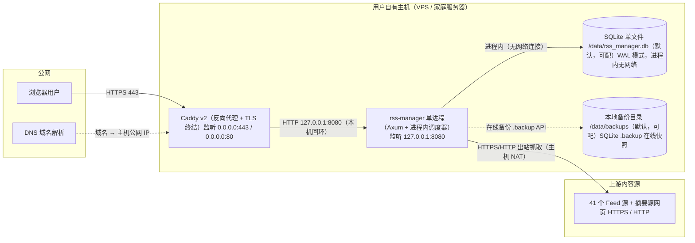

# AICoding 架构设计 · 部署设计

> 本文档为《AICoding 架构设计》核心产物之一，定位为**系统部署设计**。
> 上游输入：《系统设计》（§5 部署架构 / §6 网络架构 / §8 可观测设计 / §4.3 数据部署与备份）、《高层架构设计》（§4.2 部署形态）；
> 下游输出：**开箱即用的配置文件 + 构建镜像脚本交付物清单**（Dockerfile / docker-compose.yml / Caddyfile / .env.example / build.sh / Makefile / 可选 systemd unit / 可选 SQLite 备份脚本），辅以环境资源、部署拓扑、构建说明、监控告警、应急回滚、容量规划等参考说明，由用户自行处理部署。
> 修订日期：2026-08-25。
>
> **裁剪说明（单机自托管 + 交付物定位）**：本系统为单用户自托管、双态部署（二进制自部署 / 单容器，Docker 为推荐一等公民）、SQLite 单文件（进程内，无独立中间件），无 VPC / Region / AZ / 集群 / K8s / 负载均衡 / 多副本。本文档定位由「完整运维部署手册」调整为「交付配置文件 + 构建脚本，由用户自行部署」——不强制用户照做运维 SOP，不替用户做主机选型 / 成本决策，不强制创建专用非特权用户。在保留模板全部一级、二级章节骨架的前提下，将企业级多机条款裁剪为「单机 + 定时备份 + 快速拉起」语义；被裁剪项均以「不适用」或「用户自担」显式登记，不删除表头。

---

## 1. 引言

### 1.1 适用范围与部署形态

| 维度 | 取值 |
| --- | --- |
| 系统名称 | rss-manager（RSS 管理器） |
| 部署形态 | 自托管（私有化单机），非公有云 SaaS、非混合云；双态并列：①二进制自部署 ②Docker 容器部署（推荐一等公民） |
| 运行形态 | ①release 单二进制（前端经 rust-embed 内嵌）；②单容器 Docker 镜像（等价形态，推荐）。二者由同一构建脚本产出，用户自行选择 |
| 持久化 | SQLite 单文件（进程内，WAL 模式），无 MySQL / Redis / MQ / 对象存储 |
| 网络拓扑 | 单机：浏览器 → Caddy v2（TLS 终结，公网 443）→ rss-manager 进程（127.0.0.1:8080）→ SQLite 进程内 |
| 服务对象 | 单用户（用户本人 = 甲方决策者 = 最终用户 = 维护者，三角色合一） |
| 「高可用」定义 | 单机 + 定时备份 SQLite + 快速拉起（RPO ≤ 60min / RTO ≤ 10min），非多 AZ 容灾 |
| 接口风格 | 全 POST + JSON（RPC 风格 `/api/rpc/{功能名}`，参数全走 JSON body） |
| 目标 SLA | 月度可用性 ≥ 99.5%（自托管，排除计划维护）；列表/详情 P95 ≤ 200ms，搜索 P95 ≤ 3s |

### 1.2 名词与缩写

| 缩写 / 名词 | 全称 / 说明 |
| --- | --- |
| rss-manager | 本系统应用（Axum + SQLite + 进程内调度器），以单二进制进程或单容器镜像运行 |
| Caddy v2 | 反向代理与 TLS 终结组件（唯一推荐选型） |
| OPML | Outline Processor Markup Language，订阅清单导入/导出格式 |
| SQLite / FTS5 | 单文件关系库 + 全文检索扩展（进程内，无网络） |
| WAL | Write-Ahead Logging，SQLite 崩溃恢复机制 |
| RPC | 本系统接口风格：全 POST + JSON，显式功能名（snake_case） |
| TLS / ACME | 传输层加密 / 自动证书签发与续期协议 |
| systemd | Linux 进程守护（自动拉起、开机自启），本系统作为可选交付物（D-07），非强制 |
| X-Forwarded-For | 反代注入的真实客户端 IP 头（应用信任该字段） |
| RPO / RTO | 恢复点目标（数据丢失容忍）/ 恢复时间目标 |
| TD-0 ~ TD-3 | 安全侧四信任域：公网 / 反向代理边界 / 应用进程回环 / SQLite 本地文件 |

### 1.3 交付物清单（本文档核心产出）

> 本文档定位为「交付开箱即用的配置文件 + 构建镜像脚本，由用户自行处理部署」，而非一份要求用户照做的运维手册。以下交付物随源码仓库分发，用户拿到即可自行构建与部署。

| 编号 | 交付物 | 仓库内约定路径 | 用途 | 是否必需 |
| --- | --- | --- | --- | --- |
| D-01 | Dockerfile | `deploy/Dockerfile` | 多阶段构建 rss-manager 单容器镜像；镜像内通过 `USER` 指令定义运行用户（非 root 可选），无需用户额外创建系统用户 | 必需（Docker 部署路径） |
| D-02 | docker-compose.yml | `deploy/docker-compose.yml` | 一键编排 Caddy + rss-manager，挂载 `/data` 卷，`restart: always` 守护 | 必需（Docker 部署路径） |
| D-03 | Caddyfile | `deploy/Caddyfile` | TLS 自动签发 + 80→443 + 请求体 10MB + 转发 127.0.0.1:8080 + X-Forwarded-For 注入 + 可选 IP 白名单开关（完整内容见 §3.2.1 / §4.5.2） | 必需 |
| D-04 | .env.example | `deploy/.env.example` | 环境变量模板（RSS_MANAGER_* 全量，含默认值注释，默认数据目录 `/data`），用户复制为 `.env` 或注入守护 unit | 必需 |
| D-05 | build.sh | `deploy/build.sh` | 一键构建脚本：rspack 构建前端 → cargo build 后端 → rust-embed 内嵌 → 产出 release 二进制，或 `docker build` 产出镜像 | 必需 |
| D-06 | Makefile | `Makefile` | 构建 / 测试 / 打包 / 镜像 / 冒烟的 make 目标封装（与 D-05 等价，二选一或并存） | 可选（与 D-05 二选一） |
| D-07 | systemd unit（可选） | `deploy/rss-manager.service.example` | 二进制部署路径的守护模板，用户自行决定是否用 systemd / docker restart / 其他守护 | 可选（仅二进制路径） |
| D-08 | SQLite 备份脚本（可选） | `deploy/backup.sh` | 定时 `sqlite3` 调用 `.backup` 在线快照 → 默认 `/data/backups`，配合 cron / systemd timer，用户自行决定是否启用 | 可选 |

---

## 2. 环境与资源清单

### 2.1 环境矩阵

| 环境 | 用途 | 集群隔离 | 数据 | 网络访问 |
| --- | --- | --- | --- | --- |
| dev | 开发自测（本地开发机） | 本机进程隔离（与 prod 分机 / 分目录） | 模拟 / 测试 OPML 数据 | 仅本机回环 |
| prod | 生产自托管（用户自有主机） | 独立主机（单机） | 真实数据（41 源 + 阅读记录） | 公网 443（仅 Caddy 对外）+ 本机回环 |

> **int / uat 不适用说明**：个人单实例自托管项目，无联调、无预发验收环境（int / uat 裁剪为「不适用」），环境收敛为「本地 dev → 生产单机 prod」两级，与上游《系统设计》§5.1 一致。隔离策略为「分机隔离」（dev 在开发机、prod 在自有主机），数据目录、配置、备份均物理分置。

### 2.2 资源清单

#### 2.2.1 计算资源

| 资源编号 | 类型 | 产品 | 资源 ID | 名称 | 规格 | 数量 | 环境 | 复用 / 新建 | HA 方案 | 用途 |
| --- | --- | --- | --- | --- | --- | --- | --- | --- | --- | --- |
| R-C-001 | 单主机（VPS / 家庭服务器 / 任意支持 docker 的主机） | 自选（二进制：用户自有主机自行部署；Docker：任意支持 docker 的主机，如 VPS / NAS / 树莓派 / 家用服务器） | 待人工确认（主机 ID 由用户提供） | rss-manager-prod-host | 1 vCPU / 1GB RAM / 20GB SSD（最低参考，由用户自担） | 1 | prod | 新建（用户自有，自行部署） | 单机无冗余；守护可选（Docker restart=always 或 systemd unit，均为交付物由用户自行启用） | 运行 rss-manager + Caddy v2 反向代理（二进制双进程 或 docker-compose 双容器） |

> **进程模型（双态，不再强加专用非特权用户）**：
> - **Docker 部署（推荐一等公民）**：Caddy 容器 + rss-manager 容器（docker-compose 编排，`restart: always` 守护）；运行用户由**镜像内定义**（Dockerfile `USER` 指令，非 root 可选），无需用户额外创建系统用户。
> - **二进制部署**：Caddy 进程 + rss-manager 进程，仅监听 127.0.0.1:8080；运行方式**由用户自行决定**（可建议避免 root 但非强制），可选 systemd unit（交付物 D-07）守护。

#### 2.2.2 存储资源

| 资源编号 | 类型 | 产品 | 资源 ID | 名称 | 规格 | 容量 | 环境 | 复用 / 新建 | HA 方案 | 备份策略 |
| --- | --- | --- | --- | --- | --- | --- | --- | --- | --- | --- |
| R-S-001 | 业务数据文件 | SQLite 单文件（含 -wal / -shm） | 默认 /data/rss_manager.db（环境变量可配） | rss_manager.db | 单文件，WAL 模式 | 健康估算约 1GB；容量红线 10GB（10 万篇正文 + FTS5 索引） | prod | 新建 | 无主从；WAL 崩溃恢复 + 在线备份兜底 | 每日全量 + 每小时快照，全量保留 30 天（RPO ≤ 60min） |
| R-S-002 | 备份目录 | 本地文件系统（与数据目录物理隔离，可选独立挂载 / 对象存储异地） | 默认 /data/backups（环境变量可配） | rss-manager-backups | 隔离目录，权限由用户按需设置 | 约 30 天 × 1GB ≈ 30GB（可选异地） | prod | 新建 | 与数据目录物理隔离（单磁盘故障不连带数据+备份） | SQLite `.backup` 在线快照归档（交付物 D-08）；可选 rsync / 对象存储异地同步 |

> **数据目录约定（默认 /data，用户可配置）**：生产数据默认 `/data/rss_manager.db`（环境变量 `RSS_MANAGER_DB_PATH` 可配）；备份目录默认 `/data/backups`（环境变量 `RSS_MANAGER_BACKUP_DIR` 可配）；数据目录权限由用户按需设置——Docker 部署由容器卷与镜像用户控制，二进制部署由用户自行决定（建议数据文件 0600，避免 root 非强制）。

#### 2.2.3 网络资源

| 资源编号 | 类型 | 产品 | 资源 ID | 名称 | 规格 | 环境 | 复用 / 新建 | 用途 |
| --- | --- | --- | --- | --- | --- | --- | --- | --- |
| R-N-001 | 公网入口 | 公网 IPv4（VPS 自带或家庭宽带动态 IP + DDNS） | 待人工确认（公网 IP） | rss-manager-public-ip | 1 个公网 IPv4 | prod | 新建 / 复用（视用户主机） | 域名解析目标，Caddy 对外监听 443/80 |
| R-N-002 | 域名 + DNS | 自选域名注册商 / DNS 服务商 | 待人工确认（域名） | rss.example.com（占位域名，实际由用户提供） | 1 个 A 记录指向 R-N-001 | prod | 新建 / 复用（可复用用户已有域名） | 公网访问入口域名；ACME 签发证书所需 |
| R-N-003 | TLS 证书 | ACME（Caddy 内建，Let's Encrypt / ZeroSSL） | 待人工确认（证书路径） | rss-manager-tls-cert | RSA 2048 或 ECDSA P-256，自动签发 / 续期 | prod | 新建 | Caddy 443 TLS 终结（TLS 1.2 最低） |

#### 2.2.4 中间件与平台服务

| 资源编号 | 类型 | 产品 | 资源 ID | 名称 | 规格 | 环境 | 复用 / 新建 | HA 方案 | 用途 |
| --- | --- | --- | --- | --- | --- | --- | --- | --- | --- |
| R-M-001 | 反向代理 | Caddy v2（最新稳定 2.x） | 待人工确认（进程 / 容器实例） | caddy-reverse-proxy | 单实例，内存占用与 Nginx 同量级 | prod | 新建 | 单机无冗余；守护可选（Docker restart=always / systemd） | TLS 终结 + 转发 127.0.0.1:8080 + 注入 X-Forwarded-For + 请求体 10MB 限制 |

> **中间件裁剪说明**：除 Caddy v2 反向代理外，本系统无独立中间件——SQLite、进程内调度器（Tokio）、reqwest HTTP 客户端、feed-rs、readabilityrs、rust-embed 均为**进程内底座**（《系统设计》§3.1.3），不列为独立资源。无 MySQL / Redis / MQ / 服务发现 / 配置中心。

#### 2.2.5 可观测资源

| 资源编号 | 类型 | 产品 | 资源 ID | 名称 | 规格 | 环境 | 复用 / 新建 | 承载可观测维度 |
| --- | --- | --- | --- | --- | --- | --- | --- | --- |
| R-O-001 | 应用内置 Dashboard | rss-manager 内建（前端页面 + 埋点） | 待人工确认（前端路由） | rss-manager-dashboards | 6 个大盘（见 §5.2） | prod | 新建 | 业务 / 服务健康（RED）/ 抓取与源健康 / 搜索性能 / 资源容量 / 活跃告警 |
| R-O-002 | 日志文件 | 本地结构化 JSON 日志（滚动轮转） | 待人工确认（日志路径） | rss-manager-logs | 应用日志 / 抓取日志 / 慢查询日志，含 traceId + tenantId | prod | 新建 | Logs（INFO+ / ERROR+ 分级，轮转保留） |
| R-O-003 | 审计日志 | 独立输出（本地文件 / 可选远程） | 待人工确认（审计路径） | rss-manager-audit-log | 结构化审计，与业务库分离 | prod | 新建 | 审计维度（保留期 ≥ 1 年，对齐 security） |

> **可观测裁剪说明**：自托管单机不强制引入 Prometheus / Grafana / CLS / APM 等云监控组件；以「应用内 Dashboard + 本地结构化日志 + 应用内告警」满足个人自托管观测需求（可选演进为 Prometheus / Grafana，见 §5.1）。

#### 2.2.6 安全资源

| 资源编号 | 类型 | 产品 | 资源 ID | 名称 | 规格 | 环境 | 复用 / 新建 | HA 方案 | 用途 |
| --- | --- | --- | --- | --- | --- | --- | --- | --- | --- |
| R-Sec-001 | 主机防火墙 | ufw / firewalld | 待人工确认（防火墙规则集） | rss-manager-host-fw | 默认拒绝入站，仅放行 443 / 80；SSH 22 仅限可信 IP；8080 不对公网放行 | prod | 新建 | 单机（无安全组） | 公网暴露面收敛（对齐 security 边界 A） |
| R-Sec-002 | 可选边缘防护 | Cloudflare（免费层） | 待人工确认（是否启用，用户自担） | rss-manager-cf | 可选 CDN / 抗 DDoS / 基础 WAF | prod | 新建（可选，默认不启用） | 单机（用户自担） | 抗 DDoS / 隐藏源站 IP（可选兜底） |
| R-Sec-003 | 密钥与凭证 | 环境变量 + 文件权限（无云 KMS） | 待人工确认（密钥文件路径） | rss-manager-secrets | 会话密钥 / 初始密码哈希，文件权限 0600 | prod | 新建 | 单机（无 KMS / Vault） | 会话密钥 + 初始密码哈希 + 数据库连接配置 |

### 2.3 复用资源清单

| 复用资源 ID | 原业务方 | 余量评估 | 隔离方式 |
| --- | --- | --- | --- |
| 无 | 无（全新项目，全部新建） | — | — |

> **说明**：本项目为从零自建的独立自托管实例，不运行在既有业务主机之上，无跨业务复用资源；主机为用户新购或既有闲置自有主机，属「用户自有一体化主机」而非「共享业务资源复用」。若用户复用既有主机同时承载其他自托管服务，建议以「独立 docker compose 项目（或独立 systemd unit）+ 独立数据目录 + 独立端口」隔离（进程级 + 目录级隔离，不共享端口与数据）；是否使用非特权用户由用户自行决定，非强制。

---

## 3. 部署拓扑与高可用设计

### 3.1 物理拓扑

#### 3.1.1 物理拓扑图



#### 3.1.2 拓扑要素清单

| 要素 | 取值 |
| --- | --- |
| 跨 Region / Region 数量 | 否 / 0（单主机自托管，无云 Region） |
| 跨 AZ / AZ 数量 | 否 / 0（单主机） |
| 流量入口路径 | 浏览器 → DNS → Caddy（公网 443，TLS 终结）→ rss-manager（127.0.0.1:8080，HTTP 本机回环） |
| 内部调用路径 | 单进程内模块直调（Axum 路由 → 业务模块 → 进程内调度器，无跨进程网络调用） |
| 数据库访问路径 | 进程内 SQLite 连接池（rusqlite，WAL），无网络、无主从、无 ProxySQL |
| 数据文件路径 | 默认 `/data/rss_manager.db`（环境变量 `RSS_MANAGER_DB_PATH` 可配）；备份默认 `/data/backups`（`RSS_MANAGER_BACKUP_DIR` 可配） |
| 信任域映射 | 公网=TD-0；Caddy=TD-1；rss-manager 进程=TD-2；SQLite 文件=TD-3（对齐 security 四信任域） |

**关键决策固化**（延续第一阶段骨架结论，反代选型 Caddy v2 为平台侧专业裁决）：

| 决策项 | 唯一结论 |
| --- | --- |
| 反向代理选型 | Caddy v2（最新稳定 2.x），唯一推荐 |
| 反向代理监听 | 公网 0.0.0.0:443（TLS）+ 0.0.0.0:80（HTTP→HTTPS 301） |
| 应用进程监听 | 127.0.0.1:8080（仅回环，环境变量 RSS_MANAGER_LISTEN_ADDR 可配） |
| TLS 终结位置 | 反向代理 Caddy 443；应用与反代间本机回环明文 http |
| SQLite 访问路径 | 进程内（rusqlite 连接池，WAL），无网络 |
| 健康检查 | /healthz（Liveness）+ /readyz（Readiness），监听 127.0.0.1:8080，不对公网开放 |
| 备份路径 | 应用调度器调用 SQLite `.backup` API（在线快照，非裸 cp）→ 本地备份目录（与数据目录物理隔离）→ 可选异地同步 |

> 反向代理选型理由（Caddy v2）：①内建 ACME 自动 HTTPS 零运维；②单一二进制与「单文件运维」哲学同构；③默认 HTTP/2 + TLS1.3 + 80→443 重定向，`reverse_proxy` 自动注入 X-Forwarded-For；④单用户场景内存占用与 Nginx 同量级。Nginx 的成熟度 / 并发 / 模块优势在本单用户自托管场景无收益。

### 3.2 流量与网络链路（连通视图）

#### 3.2.1 流量入口链路

| 组件 (R-xx) | 协议 - 端口 | TLS 终结 | 作用 |
| --- | --- | --- | --- |
| DNS (R-N-002) | DNS - 53（UDP/TCP） | — | 域名 → 主机公网 IP |
| 浏览器用户 | HTTPS - 443 | 客户端发起 TLS，对端 Caddy | 访问 SPA 静态资源（rust-embed 内嵌）+ 调用全 POST RPC `/api/rpc/*` |
| Caddy v2（反向代理）(R-M-001) | HTTPS 443（0.0.0.0）+ HTTP 80（0.0.0.0，301→443） | ✅ Caddy 终结 TLS（ACME 自动签发/续期；TLS 1.2 最低，禁用 TLS1.0/1.1/SSLv3） | TLS 终结 + 转发 + 自动注入 X-Forwarded-For/Proto/Host + 请求体 10MB 限制 |
| rss-manager 进程 (R-C-001) | HTTP 127.0.0.1:8080（仅回环，环境变量可配） | ❌ 不终结 | 业务逻辑 / `/api/rpc/*` / `/healthz` / `/readyz` / 静态资源 |

**入口安全职责落地（按 security 权威项配置）**：

| security 职责项 | 落地取值（对齐交叉转交材料 §三/§四） |
| --- | --- |
| ② 请求体大小限制 | 10 MB（Caddy `request_body max_size 10MB`，对齐应用层 OPML/JSON body ≤ 10MB） |
| ④ 基本访问控制 | 方案 A（经中间确认，用户裁决）：仅应用层登录 + 可选 IP 白名单开关；反代层不默认叠加 basic_auth / 不默认强制 IP 白名单，仅预留可选开关位 |
| ⑤ 可选基础 WAF 规则 | 默认不强制（系统设计 §7.1 已冻结）；可选：拒绝恶意 UA（sqlmap/nikto）、单 IP 连接数上限、单 IP 请求速率上限 |
| ⑥ 真实客户端 IP 透传 | Caddy `reverse_proxy` 自动注入 X-Forwarded-For/Proto/Host；应用信任 X-Forwarded-For |
| ⑦ 不引入云安全产品 | 不引入云 WAF / DDoS / 云防火墙；Cloudflare（R-Sec-002）兜底为用户自担可选项 |

**交付物 D-03：Caddyfile（完整可用，直接使用）**

```caddyfile
# rss-manager Caddyfile（Caddy v2，交付物 D-03，随仓库 deploy/Caddyfile 分发）
# 用法：caddy run --config Caddyfile
# 1) 将下方 rss.example.com 替换为你的真实域名；
# 2) 确保 DNS A/AAAA 记录指向本机公网 IP，且 80/443 已放行；
# 3) Caddy 自动完成 ACME 证书签发/续期，并自动将 80 重定向到 443（无需额外配置）。

rss.example.com {
    # ---- 可选：IP 白名单开关（方案 A，默认关闭；取消注释并替换为可信 IP 即启用）----
    # @denied not remote_ip 1.2.3.4 5.6.7.8
    # respond @denied 403

    # ---- 请求体大小限制 10MB（对齐应用层 OPML/JSON body，上限 10MB）----
    request_body {
        max_size 10MB
    }

    # ---- 反向代理到 rss-manager（仅本机回环）----
    # reverse_proxy 默认自动注入 X-Forwarded-For / X-Forwarded-Proto / X-Forwarded-Host，
    # 应用信任 X-Forwarded-For 作为真实客户端 IP（对齐 security 权威项 ⑥）。
    reverse_proxy 127.0.0.1:8080

    # ---- 可选：访问日志（如启用，保留期建议 ≥ 1 年，对齐安全侧审计保留期）----
    # log {
    #     output file /data/logs/caddy-access.log {
    #         roll_size 10MB
    #         roll_keep 20
    #     }
    # }

    # ---- 可选：基础防护规则（默认不强制，方案 A 预留开关位）----
    # @badua header_regexp User-Agent (sqlmap|nikto)
    # respond @badua 403
}
```

> 说明：Caddy v2 以站点地址 `rss.example.com` 声明即自动启用 HTTPS（ACME 自动签发/续期）+ HTTP→HTTPS 301；TLS 1.2 最低、禁用 TLS1.0/1.1/SSLv3 由 Caddy 默认安全基线满足。IP 白名单 / 基础防护 / 访问日志均为注释态可选开关，默认仅「登录 + 请求体 10MB + 反代转发」。

#### 3.2.2 内部互联链路

| 项 | 说明 |
| --- | --- |
| 服务发现 | 不适用（单进程模块间直调） |
| 服务间协议 | 不适用（单进程函数调用） |
| mTLS | 不启用（反代→应用为本机回环明文 http） |
| 数据库连接 | 进程内 SQLite 连接池（rusqlite，WAL），无网络 |
| 缓存连接 | 不适用（无 Redis） |
| MQ 连接 | 不适用（进程内异步任务） |

#### 3.2.3 跨网络互联

| 互联类型 | 通道 | 带宽 | 加密 | 用途 |
| --- | --- | --- | --- | --- |
| 跨 VPC / 跨账号 / 跨 Region | 不适用（单主机） | — | — | — |
| 出站到上游 Feed 源 | 主机 NAT 直接出站（reqwest 直连） | 主机公网带宽 | 源站 HTTPS 用 HTTPS；HTTP 明文源按安全基线处理（升级 https 优先） | 定时抓取 / Readability 全文抓取（SSRF 防护：动态出口白名单） |
| 备份异地同步（可选） | rsync/scp（SSH）或对象存储 API | 主机公网带宽 | SSH / TLS | SQLite 备份异地归档 |

### 3.3 高可用与故障容错

> **定位说明**：自托管单机无多副本 / 多 AZ 容灾，「高可用」= 单机 + 定时备份 SQLite + 快速拉起。可用性来源拆分：无云厂商 SLA 兜底（主机可用性由维护者用户自保障）；本系统自身保障 = WAL 崩溃恢复 / 优雅停机 / 在线备份 / 抓取退避。

#### 3.3.1 故障域划分

| 故障域 | 影响范围 | 容错机制 | 预期 RTO |
| --- | --- | --- | --- |
| 单进程（rss-manager 崩溃） | 全部功能 | 守护自动拉起（Docker restart=always 或 systemd Restart=on-failure，均为可选交付物由用户自行启用）+ 优雅停机（SIGTERM → 等在飞抓取 ≤30s → 关 SQLite 连接） | 不超过 30 秒（瞬时不可用） |
| 单主机（主机宕机） | 全部功能 | 备份异地 / 隔离目录恢复 + 在新主机重启（§6.1.3 回滚 SOP） | ≤ 10 分钟 |
| SQLite 损坏 | 数据不可读写 | 从备份目录回滚最近备份（`.backup` 快照）+ 重启进程 | ≤ 10 分钟 |
| 单磁盘故障 | 数据 + 进程 | 备份目录物理隔离（独立挂载），从隔离备份恢复 | ≤ 10 分钟 |

#### 3.3.2 负载均衡

| 维度 | 取值 |
| --- | --- |
| 类型 | 单实例，无 LB（自托管）；Caddy 仅单后端 `reverse_proxy 127.0.0.1:8080` |
| 会话保持 | 不适用（单实例） |

#### 3.3.3 健康检查配置

| 维度 | 取值 |
| --- | --- |
| Liveness 路径 | `/healthz`（仅判进程存活，失败 → 重启进程） |
| Readiness 路径 | `/readyz`（判 SQLite 可读写，失败 → 摘流不杀进程） |
| 检查频率 | 10s |
| 失败阈值 | 连续 3 次失败标记不健康 |
| 恢复阈值 | 连续 2 次成功标记健康 |
| 暴露面 | 仅监听 127.0.0.1:8080，不对公网开放 |

#### 3.3.4 弹性伸缩配置

| 维度 | 取值 |
| --- | --- |
| 触发指标 | 不适用（单实例，超出规模再评估多实例化） |
| 副本区间 | 固定 1 |

#### 3.3.5 容灾切换配置

| 维度 | 取值 |
| --- | --- |
| 容灾级别 | 单机（单主机自托管） |
| 故障切换 RTO | ≤ 10 分钟（备份文件恢复 + 重启，见 §6.1.3） |
| 跨 Region / 跨 AZ 切换 | 不适用 |

---

## 4. 部署流程（构建脚本说明）

> 本章定位为「构建脚本说明」——用户拿到交付物（D-01 ~ D-08）即可自行构建与部署，不写强制照做的运维 SOP。构建与部署由 `build.sh` / `Makefile` / `docker-compose.yml` 一键完成，用户自行决定部署主机与运行方式。

### 4.1 代码仓库与分支

| 项 | 规范 / 值 | 说明 |
| --- | --- | --- |
| 代码仓库地址 | GitHub（或用户自建 Gitea，地址待人工确认） | 单仓库 monorepo（后端 Rust + 前端 React 18 同仓） |
| 分支管理 | `main`（受保护，仅 PR 合并）+ `feature/{name}`（功能分支） | 单人项目，主干开发 + 特性分支 |
| 合并规范 | 仅 squash merge / rebase merge，PR 需通过 CI 检查 | 保持主干线性可回溯 |
| 标签规范 | `v{major}.{minor}.{patch}`（语义化版本，如 v1.0.0） | 每次生产发布打 Tag，对应可复现产物 |

### 4.2 流水线（CI / CD）

> 交付物定位裁剪：本项目交付「构建脚本」而非「托管 CI/CD 平台」——用户拿到 build.sh / Makefile / docker-compose.yml 即可本地构建与部署，无强制 CI/CD SOP。下表 8 阶段骨架保留，内容映射到「build.sh / Makefile 一键执行 + 可选 GitHub Actions」语义。

| 阶段 | 触发条件 | 关键动作 | 失败处理 |
| --- | --- | --- | --- |
| 构建 | 本地手动 / GitHub Actions push | `deploy/build.sh`（或 `make build`）：rspack 构建前端 → cargo build --release 后端 → rust-embed 内嵌 → 产 release 二进制 / docker build 镜像 | 阻断后续阶段 |
| 代码扫描 | 构建后 | `cargo fmt --check` + `cargo clippy -D warnings`（代码规范 / 复杂度） | 不达标阻断 |
| 安全扫描 | 构建后 | `cargo audit` + `cargo deny`（依赖漏洞 SCA）+ SAST 可选 | 高危阻断 |
| 集成测试 | 合并到 main | `cargo test`（单元测试）+ 接口冒烟测试（41 源 OPML 解析） | 阻断后续阶段 |
| 制品打包构建 | 构建 / 测试通过 | 产出 release 二进制（rust-embed 内嵌前端）+ 打 Git Tag + 计算 sha256 | 失败重试 |
| 部署 dev 环境 | 制品完成 | 本地运行二进制 / 容器 + 冒烟测试 | 修复重发 |
| 部署 prod 环境 | 用户自行触发 | `docker compose up -d`（Docker）或替换二进制 + 守护重启（二进制）+ 冒烟测试 | 回滚上一版本镜像 / 二进制 |
| 发布 | 部署 prod 后 | 首次 OPML 导入验收 + 观察窗口（≥15min）+ 备份确认 | 按 §6.1 回滚 + 备份恢复 |

### 4.3 构建产物与制品管理

| 配置项 | 配置值 / 规则 | 说明 |
| --- | --- | --- |
| 产物类型 | 单一 release 二进制（前端 rust-embed 内嵌）；单容器 Docker 镜像（推荐一等公民） | 二者由 build.sh 统一产出，用户自行选择 |
| 制品仓库 | GitHub Releases（二进制 + sha256）+ 可选 Docker Hub / GHCR（镜像） | 地址待人工确认 |
| 产物命名 | 二进制 `rss-manager-{version}-{target}`；镜像 `rss-manager:{version}` | `{version}`=语义化版本，`{target}`=编译目标三元组 |
| 制品保留期 | Releases 永久保留；本地备份最近 3 个版本二进制 | 便于快速回滚 |
| 制品溯源 | 二进制内嵌 `git-commit` / `build-time` / `version`（`--version` 可查）；镜像 Label 含 git-commit / build-time | 便于反查源码 |
| 签名与校验 | 二进制发布附 sha256 checksum；镜像可选 cosign 签名 | 单机以 sha256 校验为主 |

### 4.4 配置管理

> 配置中心选型：单进程无配置中心（L2 不适用），以环境变量（L3）+ Secret 环境变量/文件（L4）替代。四层级沿用《系统设计》§5.1，全部变更需重启进程生效（启动 fail-fast，禁止跑默认值）。环境变量以交付物 `.env.example`（D-04）为模板：Docker 由 `docker-compose.yml` 的 `env_file` 注入，二进制由守护 unit 的 `Environment=` 注入。

| 配置层级 | 存放位置 | 适用内容 | 变更生效 | 对部署的约束 |
| --- | --- | --- | --- | --- |
| L1 代码内 | 代码仓库 | 默认值、枚举、常量 | 重新部署 | 禁止写入环境差异、密码、地址 |
| L2 配置中心 | 不适用（单进程） | — | — | 以环境变量替代 |
| L3 环境变量 | `.env`（Docker `env_file`）或守护 unit 的 `Environment=`（二进制） | 数据文件路径、监听地址、抓取间隔默认值、日志级别 | 重启进程 | 启动失败 fail-fast，禁止跑默认值 |
| L4 Secret | 环境变量 + 文件权限 0600 | 会话密钥、初始密码哈希 | 重启进程 | 禁止落日志、禁止入代码、禁止入 Git |

**关键环境变量清单**（L3 / L4）：

| 环境变量 | 层级 | 默认值 | 说明 |
| --- | --- | --- | --- |
| RSS_MANAGER_LISTEN_ADDR | L3 | 127.0.0.1:8080 | 应用监听地址（仅回环） |
| RSS_MANAGER_DB_PATH | L3 | /data/rss_manager.db | SQLite 数据文件路径（用户可配置） |
| RSS_MANAGER_BACKUP_DIR | L3 | /data/backups | 备份目录（用户可配置，物理隔离） |
| RSS_MANAGER_LOG_LEVEL | L3 | INFO | 日志级别 |
| RSS_MANAGER_FETCH_INTERVAL | L3 | 3600（秒，即 60min） | 全局默认抓取间隔（单源下限 ≥ 30min） |
| RSS_MANAGER_SESSION_SECRET | L4 | 无默认（必须显式提供） | 会话签名密钥（256bit 随机） |
| RSS_MANAGER_INITIAL_PASSWORD_HASH | L4 | 无默认（首次启动初始化） | 初始密码 argon2id 哈希 |

### 4.5 发布策略

#### 4.5.1 发布方式

> 单实例无副本，滚动 / 蓝绿 / 金丝雀 / 特性开关均不适用；双态发布方式由用户自选——Docker 用「镜像替换 + compose 重启」，二进制用「二进制替换 + 守护重启」。

| 模块 | 发布方式 | 说明 |
| --- | --- | --- |
| rss-manager（全系统） | 镜像替换 / 二进制替换（双态，用户自选） | Docker：`docker compose pull && docker compose up -d`；二进制：替换 release 二进制 → 守护重启 → 冒烟；停机 ≤ 5min |
| Caddy v2（反向代理） | 独立版本升级 | 与业务解耦，Docker 下随 compose 升级镜像，二进制下独立重启 caddy 进程 |

#### 4.5.2 发布标准流程

- **首次部署（Docker 推荐路径）**：
  1. `cp deploy/.env.example .env`，按需修改域名 / 数据目录 / 密钥等变量（默认数据目录 `/data`）。
  2. 配置 DNS A 记录指向主机公网 IP，编辑 `deploy/Caddyfile` 将 `rss.example.com` 替换为真实域名（TLS 自动签发 + 请求体 10MB + 转发 127.0.0.1:8080 + X-Forwarded-For 注入已内置，见 §3.2.1）。
  3. `docker compose up -d` 拉起 Caddy + rss-manager（`restart: always` 守护），挂载 `/data` 卷。
  4. 校验 `/healthz` / `/readyz`（连续 2 次成功）。
  5. 首次 OPML 导入验收（41 源解析成功，≥39 源首抓成功，对齐 V1）。
  6. 确认每日全量 + 每小时快照备份任务（交付物 D-08）生效，记录首次备份。
- **首次部署（二进制路径，可选）**：`./deploy/build.sh`（rspack 构建前端 → cargo build 后端 → rust-embed 内嵌 → 产出 release 二进制）→ 放置到用户目录 → 用 `.env.example` 注入环境变量（默认数据 `/data`）→ 可选安装 systemd unit（D-07）或自选守护 → 启动并校验 `/healthz` / `/readyz`。
- **常规迭代发布流程**：`./deploy/build.sh`（或 `make build`）构建 → 校验 sha256 → 备份当前二进制 / 镜像与 SQLite → 替换（`docker compose pull && docker compose up -d` 或 替换二进制 + 守护重启）→ 冒烟（登录 + 列表 + 搜索 + 抓取）→ 观察 ≥15min。
- **资源变更流程**：环境变量变更 = 改 `.env`（Docker）或守护 unit（二进制）→ 重启；数据目录 / 备份目录迁移 = 停机 → 移动目录 → 更新 `RSS_MANAGER_DB_PATH` / `RSS_MANAGER_BACKUP_DIR` → 重启。

#### 4.5.3 灰度路径与观测窗口

> 单用户自托管无灰度批次（无多副本 / 多用户分桶）。以「dev 自测 → prod 单机发布 → 15min 观测窗口」替代灰度：发布后观测错误率、搜索 P95、抓取成功率、进程存活，任一异常立即回滚（§6.1）。

#### 4.5.4 发布门禁

| 门禁项 | 拦截条件 | 检查时机 |
| --- | --- | --- |
| 单元测试通过率 | 100% | Build / Test 阶段 |
| 代码规范 | `cargo fmt --check` 通过；`clippy -D warnings` 0 告警 | Code Quality 阶段 |
| 静态扫描严重问题数 | 0（高危）；中危需评审 | Code Quality 阶段 |
| 安全扫描高危漏洞 | 0（cargo audit / cargo deny） | Security Scan 阶段 |
| 二进制校验 | sha256 与发布清单一致 | 制品阶段 |
| 健康检查 | `/healthz` / `/readyz` 连续 2 次成功 | 部署后 |
| 冒烟测试 | 登录 / 列表 / 搜索 / 抓取核心路径通过 | 部署后 |
| 人工审批 | 维护者（用户本人）确认 | 生产发布前 |

---

## 5. 监控告警接入

### 5.1 监控架构与数据流

```text
rss-manager 单进程（含 Caddy 反代） ──┬─► 应用内 Dashboard（R-O001，6 个大盘）
                                      ├─► 结构化日志文件（R-O002，JSON，含 traceId+tenantId）
                                      └─► 审计日志（R-O003，独立输出，保留 ≥ 1 年）
                                                    ▼
                                          应用内告警 + 日志轮转
                                                    ▼
                                     IM Webhook / 邮件 / 可选 ntfy（§5.4）
```

> 自托管单机不强制引入 Prometheus / Grafana / 云监控；可选演进路径：导出 OpenMetrics 端点 + 自建 Prometheus/Grafana（P2 增强，非 MVP 必需）。

### 5.2 关键 Dashboard 清单

> 对齐《系统设计》§8.1.2 六个大盘，全部由应用内建（前端页面 + 埋点）承载。

| 大盘 | 用户 | 指标 |
| --- | --- | --- |
| 业务大盘 | 维护者（用户本人） | 未读数 / 每日新增 / 抓取成功率 / 全文抓取成功率 |
| 服务健康大盘 | 维护者 | RED（各接口 Rate / Errors / Duration） |
| 抓取与源健康大盘 | 维护者 | 各源健康状态 / 连续失败次数 / 退避间隔 / 抓取耗时 |
| 搜索性能大盘 | 维护者 | 搜索 P95 / P99 / FTS 查询耗时（对齐 V4） |
| 资源与容量大盘 | 维护者 | CPU / 内存 / 磁盘 / SQLite 文件大小（对齐 §8.1） |
| 活跃告警大盘 | 维护者（On-call） | 当前活跃告警（§5.3） |

### 5.3 告警规则清单

> 告警编号沿用《系统设计》§8.4.2（AL-01 ~ AL-06），Owner 统一为「维护者（用户本人）」，Runbook 索引对齐 §6.2。自托管场景告警由应用内告警引擎 + 日志轮转触发，无云监控必需。

| 编号 | 级别 | 触发条件 | 关联资源 (R-xx) | Owner | Runbook |
| --- | --- | --- | --- | --- | --- |
| AL-01 | P0 | 进程不可用（/healthz 连续 3 次失败）或 SQLite 不可写 | R-C-001 / R-S-001 | 维护者 | RB-01 / RB-02 |
| AL-02 | P1 | 搜索 P95 超过 3s 持续 5min | R-O-001 / R-S-001 | 维护者 | RB-05 |
| AL-03 | P1 | 失效源数超过 5 或连续失败源占比超过 20% | R-C-001（出站抓取） | 维护者 | RB-03 |
| AL-04 | P2 | SQLite 单文件超过 1GB 或磁盘占用超过 80% | R-S-001 / R-S-002 | 维护者 | RB-04 |
| AL-05 | P2 | 内存占用超过 80% 持续 10min | R-C-001 | 维护者 | RB-04 |
| AL-06 | P3 | 全文抓取成功率低于 80%（连续 24h） | R-C-001（readabilityrs） | 维护者 | RB-06 |

### 5.4 告警通道

| 级别 | 响应时间 | 通知方式 | 上升机制 |
| --- | --- | --- | --- |
| P0 | ≤ 5 min | IM Webhook（Telegram / ServerChan / ntfy）+ 邮件 | 15min 未响应升级至用户手动处置 |
| P1 | ≤ 15 min | IM Webhook + 邮件 | 1h 未响应升级 |
| P2 | ≤ 1 h | IM / 邮件 | — |
| P3 | 工作时间 | 邮件 / 应用内提示 | — |

> 自托管裁剪说明：个人项目无电话 / 短信通道，以「IM Webhook + 邮件 + 应用内提示」覆盖 P0~P3；P0/P1 通知依赖用户自配 Webhook（ntfy / ServerChan / Telegram Bot），可选。

---

## 6. 应急与回滚

### 6.1 回滚机制

#### 6.1.1 回滚触发条件

- 生产错误率：5xx 错误率超过 50% 持续 5min（对齐《系统设计》§5.3 不可用界定）。
- 搜索 P95 超过 3s 持续 5min（AL-02 触发）。
- 关键告警触发：AL-01（进程不可用）/ AL-03（抓取源大面积失败）达到 P0/P1。
- 发布后冒烟失败或 15min 观测窗口内核心路径异常。

#### 6.1.2 回滚决策人

- 单用户自托管：维护者（用户本人）为唯一决策人与执行人。
- P0 级（进程崩溃 / 数据不可用）：可由守护自动拉起兜底（Docker restart=always / systemd，均为可选交付物），无需人工决策；数据级回滚（SQLite 损坏）由维护者立即执行。
- 版本回滚：维护者确认发布异常后，按 §6.1.3 执行，无需额外审批流。

#### 6.1.3 回滚执行 SOP

| 对象 | 回滚方式 | 预计耗时 | 有损风险 / 数据丢失 |
| --- | --- | --- | --- |
| 应用版本 | 替换为上一版本镜像（`docker compose pull && docker compose up -d`）或二进制（本地保留最近 3 个版本）→ 守护重启 | ≤ 5 min | 无 |
| 配置 | 回退 `.env` / 守护 unit 环境变量（备份上一版配置文件） | ≤ 1 min | 无 |
| SQLite 数据 | 停止进程 → 从备份目录回滚最近 `.backup` 快照 → 重启（§4.3.2 RTO） | ≤ 10 min | 有（回滚点之后的增量丢失，RPO ≤ 60min） |
| 数据库结构变更 | 本项目 SQLite schema 演进须「备份先行 + 可回滚」；不可回滚的破坏性变更（如 DROP COLUMN / 数据清空）禁止与代码同发布，须前置备份并演练恢复 | ≤ 10 min | 有（须演练验证） |

### 6.2 故障应急 Runbook

#### 6.2.1 Runbook 索引

| Runbook 编号 | 关联告警 | 故障场景 | Owner |
| --- | --- | --- | --- |
| RB-01 | AL-01 | rss-manager 进程崩溃 / 无法启动 | 维护者 |
| RB-02 | AL-01 | SQLite 损坏 / 不可写 | 维护者 |
| RB-03 | AL-03 | 抓取源大面积失败 | 维护者 |
| RB-04 | AL-04 / AL-05 | 磁盘 / 内存容量告警 | 维护者 |
| RB-05 | AL-02 | 搜索性能劣化 | 维护者 |
| RB-06 | AL-06 | 全文抓取成功率低 | 维护者 |

#### 6.2.2 Runbook 编写规范

每条 Runbook 按以下结构编写：

- **症状**：触发该 Runbook 的可观测特征（大盘指标 / 告警内容 / 用户反馈）
- **诊断（按顺序执行）**：定位根因的诊断步骤，明确使用的可观测工具与查询路径
- **缓解**：分场景的处置动作（与回滚 §6.1、降级、限流等机制衔接）
- **升级**：缓解未生效的升级条件、升级路径与对外通告机制

#### 6.2.3 RB-01：进程崩溃 / 无法启动

- **症状**：`/healthz` 连续 3 次失败触发 AL-01（P0）；浏览器无法访问；进程守护（Docker `docker compose ps` / 二进制 `systemctl status rss-manager`）显示 failed / restarting（auto-restart）。
- **诊断（按顺序执行）**：
  1. Docker：`docker compose ps` / `docker compose logs rss-manager`；二进制：`systemctl status rss-manager` 查看进程状态与最近退出码。
  2. 查看崩溃前日志（ERROR 级含堆栈 + 业务上下文）：Docker `docker compose logs rss-manager`；二进制 `journalctl -u rss-manager -n 100`。
  3. 校验产物完整性：二进制 `sha256sum 二进制路径` 或镜像 digest 与发布清单比对（判断是否替换损坏）。
  4. 校验配置：`.env` / 守护 unit 的 `Environment=` 是否缺必填项（SESSION_SECRET 等，启动 fail-fast）。
- **缓解**：
  - 场景 A（进程被 kill / panic）：守护已自动拉起（Docker restart=always / systemd Restart=on-failure），确认重启后 `/readyz` 恢复。
  - 场景 B（启动即失败，配置错误）：修复 `.env` / 环境变量 → 重启（`docker compose up -d` 或 `systemctl restart`）。
  - 场景 C（产物损坏）：回滚上一版本镜像 / 二进制（§6.1.3）→ 重启。
- **升级**：重启 3 次仍失败且非配置/二进制问题，按 RB-02 排查 SQLite；仍无解则联系上游（自研无外部支持，用户自查源码 / issue）。

#### 6.2.4 RB-02：SQLite 损坏 / 不可写

- **症状**：`/readyz` 失败触发 AL-01；接口返回 B999002（数据库错误）；`journalctl` 出现 `database disk image is malformed` / `readonly database` / `disk I/O error`。
- **诊断（按顺序执行）**：
  1. `journalctl -u rss-manager -n 100 | grep -i sqlite` 查看 SQLite 错误类型。
  2. 检查磁盘：`df -h /data` 与 `ls -l /data`（确认文件权限未被改坏；权限由用户按需设置，Docker 由容器卷与镜像用户控制）。
  3. 校验文件完整性：`sqlite3 /data/rss_manager.db "PRAGMA integrity_check;"`（返回 ok 则文件未损坏，问题在权限/磁盘）。
- **缓解**：
  - 场景 A（权限被改坏）：由用户按需恢复数据目录权限（Docker 由容器卷与镜像用户控制，二进制建议文件 0600）→ 重启。
  - 场景 B（磁盘满）：按 RB-04 清理 → restart。
  - 场景 C（文件真损坏）：停止进程 → 从备份目录回滚最近 `.backup` 快照（§6.1.3，RTO ≤ 10min，RPO ≤ 60min）→ restart。
- **升级**：备份目录亦损坏 → 启用异地备份（若已配置）恢复；无异地备份则数据损失为最近备份点之后内容，需重导 OPML 重建订阅。

#### 6.2.5 RB-03：抓取源大面积失败

- **症状**：AL-03 触发（失效源数超过 5 或连续失败源占比超过 20%）；抓取与源健康大盘出现批量失败；未读新增趋近 0。
- **诊断（按顺序执行）**：
  1. 查看抓取与源健康大盘，确认失败是「全网性」还是「单源性」。
  2. `journalctl -u rss-manager | grep fetching` 抽样失败日志（HTTP 状态 / 超时 / 解析失败）。
  3. 从主机外网测试连通性：`curl -I 某失效源 URL`（判断主机网络 / DNS / 出口是否异常）。
- **缓解**：
  - 场景 A（主机网络 / DNS 故障）：修复主机网络 / DNS → 手动触发抓取。
  - 场景 B（被源站限流 / 封禁）：调大抓取间隔（≥30min 约束内）或暂停高频源，等指数退避恢复。
  - 场景 C（源站本身失效）：按源健康面板逐源修复 URL / 删除，失效源自动隔离分组。
- **升级**：单源连续失败被自动标记失效（连续 3 次），已隔离；若失败扩散且确认是出口 IP 被封，评估启用可选出口代理或更换主机 IP。

#### 6.2.6 RB-04：磁盘 / 内存容量告警

- **症状**：AL-04（SQLite 超过 1GB 或磁盘超过 80%）/ AL-05（内存超过 80%）触发。
- **诊断（按顺序执行）**：
  1. `df -h` 与 `du -sh /data/*` 定位占用（数据 vs 备份 vs 日志）。
  2. `free -h` / `ps aux --sort=-%mem | head` 定位内存占用进程。
  3. 查看资源与容量大盘（SQLite 文件大小 / 内存曲线）。
- **缓解**：
  - 场景 A（磁盘-数据增长）：缩短文章保留天数 / 清理 `t_fetch_log` 抓取日志（§8.1.3 扩容路径）。
  - 场景 B（磁盘-备份堆积）：清理超 30 天旧备份快照。
  - 场景 C（磁盘-日志堆积）：执行日志轮转（R-O-002，应用日志 30 天热 + 180 天冷）。
  - 场景 D（内存升高）：排查泄漏 → 重启进程 → 升配主机（≤256MB 预算内）。
- **升级**：清理后仍逼近红线（§8.1.4 危险水位 95%）→ 升配主机（垂直扩容），或缩短保留期至 90 天。

#### 6.2.7 RB-05：搜索性能劣化

- **症状**：AL-02 触发（搜索 P95 超过 3s 持续 5min）；搜索性能大盘 P95/P99 升高。
- **诊断（按顺序执行）**：
  1. 查看搜索性能大盘（FTS 查询耗时）与慢查询日志。
  2. `EXPLAIN QUERY PLAN` 确认是否命中 FTS5 索引（《系统设计》§3.1.3 降级 LIKE 为兜底）。
  3. 检查 SQLite 文件大小（数据增长导致索引膨胀）。
- **缓解**：
  - 场景 A（FTS 索引碎片化）：执行 `INSERT INTO t_article_fts(t_article_fts) VALUES('optimize');` 优化索引。
  - 场景 B（数据量增长）：清理 / 归档旧文章，缩小检索范围。
  - 场景 C（降级到 LIKE）：恢复 FTS5 索引（重建索引）。
- **升级**：优化后仍超过 3s → 升配主机 CPU / 内存，或缩短文章保留期。

#### 6.2.8 RB-06：全文抓取成功率低

- **症状**：AL-06 触发（全文抓取成功率低于 80% 连续 24h）；摘要源阅读需频繁跳转原文。
- **诊断（按顺序执行）**：
  1. 查看业务大盘（全文抓取成功率）与抓取日志（readability.fetch 失败原因）。
  2. 抽样失败源，手动 `curl` 验证源站网页可访问性（区分源站反爬 vs readabilityrs 解析失败）。
- **缓解**：
  - 场景 A（源站反爬 / 不可达）：该源关闭全文抓取开关，降级跳转原文（≤1 次点击，对齐 V3）。
  - 场景 B（readabilityrs 解析失败）：逐源关闭开关，待上游库升级（0.1.x 年轻库，R-06）。
  - 场景 C（超时）：调大全文抓取超时（≤30s 基线内）或逐源调整。
- **升级**：整体成功率持续低于 80% → 评估升级 readabilityrs 版本或更换全文抓取方案（P2 持续优化，非 MVP 阻塞）。

---

## 7. 安全合规

### 7.1 上线前安全自检

| 编号 | 检查项 | 检查内容 / 标准 | 责任人 | 检查时机 | 是否通过 |
| --- | --- | --- | --- | --- | --- |
| 7.1.1 | 安全设计清单自检 | 逐项核对《安全设计》信任域 / 边界穿越规则（对齐交叉转交材料 §三） | 维护者 | 上线前 | 待人工确认 |
| 7.1.2 | 公网暴露面评估 | 仅 Caddy 443 对外（80 可选 301）；应用仅 127.0.0.1:8080；主机防火墙默认拒绝、仅放行 443/80、SSH 仅限可信 IP | 维护者 | 上线前 | 待人工确认 |
| 7.1.3 | 防火墙开放性检查 | `ufw status` 确认无多余放行；8080 不对公网放行 | 维护者 | 上线前 | 待人工确认 |
| 7.1.4 | 安全组件接入（可选 WAF） | 可选基础规则（拒恶意 UA / 单 IP 连接数 / 速率上限）按需启用；Cloudflare 用户自担可选 | 维护者 | 上线前 | 待人工确认 |
| 7.1.5 | 密钥 / 凭证管理 | 会话密钥 / 初始密码哈希仅环境变量 + 文件 0600；无明文入库 / 入代码 / 入日志；无云 KMS | 维护者 | 上线前 | 待人工确认 |
| 7.1.6 | 代码漏洞扫描 | `cargo audit` / `cargo deny` 高危 0 | 维护者 | 发布前 | 待人工确认 |
| 7.1.7 | 二进制完整性 | sha256 与发布清单一致 | 维护者 | 发布前 | 待人工确认 |
| 7.1.8 | 数据目录权限 | 数据目录权限由用户按需设置（Docker 由容器卷与镜像用户控制，二进制由用户自行决定，建议数据文件 0600） | 维护者 | 上线前 | 待人工确认 |
| 7.1.9 | TLS 基线 | TLS 1.2 最低，禁用 TLS1.0/1.1/SSLv3；80 强制 301 | 维护者 | 上线前 | 待人工确认 |

### 7.2 凭证与密钥清单

| 凭证编号 | 类型 | 存储方式 | 所有人 | 用途 |
| --- | --- | --- | --- | --- |
| CRED-001 | 单用户登录密码 | argon2id 哈希存 `t_user.password_hash`（L3 分级） | 维护者（用户本人） | 应用层登录认证（方案 A 唯一认证层） |
| CRED-002 | 会话签名密钥（256bit 随机） | 环境变量 RSS_MANAGER_SESSION_SECRET（文件 0600） | 维护者 | 会话令牌签名 / 校验 |
| CRED-003 | 初始密码哈希 | 环境变量 RSS_MANAGER_INITIAL_PASSWORD_HASH（文件 0600） | 维护者 | 首次启动初始化管理员密码（首次登录后修改） |
| CRED-004 | TLS 证书 + 私钥 | Caddy 数据目录（ACME 自动签发，权限 0600） | 维护者 | Caddy 443 TLS 终结 |
| CRED-005 | SSH 密钥（主机运维） | 用户本地密钥对，禁 root 密码登录 | 维护者 | 主机远程运维（仅限可信 IP） |

> 密钥轮换策略（对齐《系统设计》§7.2.3）：会话密钥建议 90 天轮换；初始密码首次登录后修改；TLS 证书由 ACME 自动续期（Caddy 内建，无需人工）；禁止跨环境共用密钥、禁止明文落日志。

### 7.3 访问审计接入

| 审计源 | 去向 | 保留期 | 是否启用 |
| --- | --- | --- | --- |
| 业务操作审计日志（登录 / 源管理 / 导入导出 / 修改密码） | 审计日志独立输出（R-O-003，与业务库分离） | ≥ 1 年（对齐 security 权威项） | 是 |
| Caddy 访问日志（access log） | 本地日志文件（R-O-002 通道，可选） | ≥ 1 年（如启用，对齐审计保留期） | 可选 |
| 抓取日志（结构化） | 日志文件 + `t_fetch_log` 表（R-O-002） | 30 天热 + 180 天冷 | 是 |

> **审计内容**（对齐《系统设计》§7.2.4）：谁（user_id）、何时、对什么资源、做了什么、结果如何、来源 IP（X-Forwarded-For）。审计日志含 traceId + tenantId，与业务库分离以保证不可篡改。

---

## 8. 容量与成本

### 8.1 容量规划

> 本节保留作为用户选主机的参考（数据规模 / 磁盘 / 内存估算），非强制配置约束；具体主机选型与成本由用户按自有硬件自行决定（见 §8.2）。

#### 8.1.1 业务量预估

| 业务指标 | 当前值 | MVP 阶段值 | 生产阶段值 | 备注 |
| --- | --- | --- | --- | --- |
| 注册用户数 | 1 | 1 | 1（预留扩展） | 单用户（U-01） |
| DAU | 1 | 1 | 1 | 用户本人 |
| 峰值 QPS | — | ≤ 5 | ≤ 5 | 单人交互，上游预算上限 10，实际远低于 |
| 数据写入量 / 天 | — | 41 源 × 平均 5 篇 ≈ 200 篇/天 | ≤ 500 篇/天 | 估算 |
| 数据存量 | — | 200 篇/天 × 180 天 ≈ 3.6 万篇 | 保留 180 天 ≈ 10 万篇 | SQLite 单文件健康估算约 1GB，容量上限（红线）10GB |

#### 8.1.2 资源容量推算

| 资源 | 推算公式 | 当前配置 | 生产阶段配置 |
| --- | --- | --- | --- |
| 应用实例数 | 单实例（峰值 QPS ≤ 5，单实例承载远超） | 1 | 1 |
| 内存 | 对标 Miniflux 30–80MB（Rust 同量级） | ≤ 128MB | ≤ 256MB |
| 磁盘（数据） | 10 万篇正文 + FTS5 索引，单文件健康估算约 1GB | ≤ 1GB | ≤ 2GB（含 WAL / 临时空间） |
| 磁盘（备份） | 全量 × 30 天保留 | 30 × 1GB ≈ 30GB | 30 × 2GB ≈ 60GB（可选异地） |
| 主机总磁盘 | 数据 + 备份 + 日志 + 二进制 | ≥ 20GB | ≥ 50GB（含备份保留） |
| SQLite 连接池 | 单进程 ≤ 5 并发写 + 读 | 1 池 | 1 池 |
| 公网带宽 | 峰值 QPS × 单次报文 + 抓取出站（41 源轮询） | 低（VPS 1TB 月流量足够） | 低 |

#### 8.1.3 扩容触发与路径

| 资源 | 扩容触发指标 | 扩容方式 | 扩容耗时 |
| --- | --- | --- | --- |
| 磁盘（数据） | SQLite 单文件超过 1GB 或磁盘占用超过 80% | 缩短文章保留天数 / 清理 `t_fetch_log` 抓取日志 / 归档旧文章 | 不超过 10 分钟 |
| 磁盘（备份） | 备份目录堆积超 30 天 | 清理超期快照 / 迁移异地存储 | 不超过 30 分钟 |
| 内存 | 内存超过 80% 持续 10min | 排查泄漏 / 升配主机（垂直扩容） | 不超过 30 分钟 |
| 主机整体 | 单机无法满足（QPS 持续接近上限 / 存储逼近红线） | 垂直扩容（升配 VPS）→ 架构演进（多实例 + 外置数据库，P2 后评估） | 垂直扩容 ≤ 30 分钟；架构演进为月级 |

#### 8.1.4 容量水位线

**水位分层定义（标准）**

| 水位 | 含义 | 动作 |
| --- | --- | --- |
| 健康水位 | 正常运行区间 | 无动作 |
| 预警水位 | 接近瓶颈，需关注 | 告警，启动扩容 / 清理评审 |
| 危险水位 | 即将超载 | 紧急清理 / 归档，评估升配 |
| 红线水位 | 必须保护 | 触发清理 / 降级 / 缩短保留期 |

**各资源水位阈值（按系统资源填写）**

| 资源 | 监控指标 | 健康 | 预警 | 危险 | 红线 |
| --- | --- | --- | --- | --- | --- |
| SQLite 单文件 | 文件大小 | 不超过 1GB | 1–6GB | 6–9.5GB | 接近 10GB（上限） |
| 磁盘占用率 | 已用 / 总量 | 不超过 60% | 60–80% | 80–95% | 超过 95% |
| 内存占用率 | 已用 / 总量 | 不超过 60% | 60–80% | 80–95% | 超过 95% |
| 抓取队列 | 待抓取任务堆积 | 0–正常 | 堆积但不超时 | 持续堆积 | 触发限流（单源退避） |

> 红线动作（对齐《系统设计》§5.5.4）：SQLite 逼近 10GB 或磁盘超过 95% 时触发「缩短保留期 / 清理日志 / 归档文章」降级动作，与 §3.5.3 限流红线值一致。

### 8.2 成本计算

> 本项目由用户自行处理部署、自行选型主机，部署与成本由用户按自有硬件自行决定，本阶段不提供主机选型 / 月度成本测算（「VPS vs 家庭服务器」二选一方案不再由本项目代做决策）。仅保留一句结论：单用户自托管无订阅费（对齐《高层架构设计》§1.3 成本目标：订阅费 $0），主机运行成本随用户所选主机 / 电费 / 域名而异，由用户自担。

---

## 附录：配套工具

### MCP

- `tencent-cloud-portal`：腾讯云文档查询工具（本项目为自托管单机，仅在用户选用腾讯云轻量 VPS 时用于查询轻量应用服务器 / 安全组文档；非必需）。

### Skill

- `CloudQ`：腾讯云 CLI 技能（本项目无云资源需核对，仅在用户选用腾讯云主机时用于查询实例规格 / 当前水位；本阶段无需调用）。
- `tcloud-arch-diagram` / `diagrams-generator`：架构图绘制（本阶段单机拓扑已用 mermaid 内嵌表达，无需独立 SVG；如需对外汇报图可后续生成）。

---

## 附录 B：部署阶段中间确认自检报告（协议 §2.4 强制）

> 本报告按公共协议 `intermediate_confirmation.md` §2.1 + §2.3 执行。部署设计阶段共设 5 个自检点（§2 / §3 / §4 / §6 / §8 完成后）。经判定，本阶段无新增需发起 `[中间确认]` 的决策点——所有关键决策均在上游（Phase 0 / G2 / G3 / G4）或本阶段交叉转交（反向代理 Caddy 选型 / 访问控制方案 A）已冻结或经用户裁决。逐点反向验证 3 问证据如下。
>
> **G5 返工轮说明**：本轮为落实用户 G5 审核 4 条反馈（去非特权用户 / 数据默认 /data / Caddyfile 直给 / 交付物聚焦配置文件+脚本并删成本测算）的定点返工，全部为「原样落实用户原文」，不构成新的方案分歧或不可逆决策，故不重复发起 `[中间确认]`（协议 §6：禁止就已明确诉求事项重复打扰）。

### B.1 自检点 1（§2 环境矩阵与资源清单完成后）——未命中

- §2.1 判定：**未命中触发标准 #1**。环境收敛为「dev → prod 单机」无方案分歧——部署形态「单一可执行文件 / 单容器」已由 G2 用户显式决策冻结（用户原文「部署需要适配单一可执行文件和单容器」）。
- §2.2 判定：**未命中触发标准 #2**。继承而非新决策。
- Q1（返工成本）：若 3 个月后从「单机」改为「多机 / 多实例」，返工范围 = §2 资源清单 + §3 拓扑 + §4 发布 + §6 回滚 + §8 容量共 5 章表格，工程切换成本约 0.5–1 人月（需引入 LB / 外置数据库 / 服务发现）；但本决策是继承上游已冻结形态，非本阶段新引入，可控。
- Q2（可感知方）：用户本人可感知——感知点为「是否可多人同时访问 / 数据是否集中托管」；但单机形态与用户 G2 显式诉求一致，非新增感知。
- Q3（与原始诉求一致性）：用户 G2 原文「数据库使用sqlite，前后端分离，部署需要适配单一可执行文件和单容器」逐字一致。

### B.2 自检点 2（§3 物理拓扑与高可用设计完成后）——未命中

- §2.1 判定：**未命中**。反向代理选型 Caddy v2 为本角色第一阶段专业裁决并经交叉转交固化；应用监听 127.0.0.1:8080、443 TLS 终结、SQLite 进程内均无第二合理方案（单机自托管唯一解）。
- Q1（返工成本）：若更换反代（Caddy→Nginx），返工范围 = §3.2 流量表 + §4.2 部署流程 + §7 自检共 3 处，文档层面低于 0.5 人日，可控。
- Q2（可感知方）：用户本人对反代选型无直接感知（感知点为「HTTPS 是否可用」而非具体组件），判断依据：反代对用户透明。
- Q3（与原始诉求一致性）：用户诉求未显式提及反代选型；本决策不改变已确认的产品形态与对外承诺。

### B.3 自检点 3（§4 CI/CD 与发布策略完成后）——未命中

- §2.1 判定：**未命中**。单实例无副本，「单机替换二进制」是唯一发布方式，滚动 / 蓝绿 / 金丝雀在单实例下无意义（无方案分歧）。
- Q1（返工成本）：若未来引入多实例，返工范围 = §4.5 发布策略 + §3.3 高可用 + §6 回滚共 3 章，约 0.5 人月；但属「未来架构演进」而非「本决策被推翻」，可控。
- Q2（可感知方）：用户本人可感知——感知点为「发布期间是否停机（≤5min）」；此为计划内维护窗口，已在 SLA 定义（《系统设计》§5.3）。
- Q3（与原始诉求一致性）：用户诉求未显式提及发布策略；单机停机替换与「单一可执行文件」形态自洽。

### B.4 自检点 4（§6 应急回滚机制完成后）——未命中

- §2.1 判定：**未命中**。单机回滚 = 替换二进制 + 回滚 SQLite 备份，无第二合理方案。
- Q1（返工成本）：回滚机制与单机形态强绑定，若未来多机化需重写 §6，约 0.5 人月；属架构演进范畴，可控。
- Q2（可感知方）：用户本人可感知——感知点为「故障恢复时长（RTO ≤ 10min）」；此为对外可用性承诺，已在 SLA 与备份设计（《系统设计》§4.3.2）固化。
- Q3（与原始诉求一致性）：用户诉求「自托管」隐含数据自控，RPO ≤ 60min / RTO ≤ 10min 与「备份 = 复制 SQLite 单文件」诉求一致。

### B.5 自检点 5（§8 容量与成本处理后）——未命中

- §2.1 判定：**未命中**。§8.2 成本测算已按用户 G5 反馈删除（「部署与成本由用户自行处理、自担」），不再存在「VPS vs 家庭服务器」二选一方案分歧；§8.1 容量规划保留作为用户选主机参考。
- Q1（返工成本）：§8.1 容量表为参考值，若实际数据增长超预期，返工范围 = §8.1 容量表，低于 0.5 人日，可控。
- Q2（可感知方）：用户本人可感知——感知点为「数据目录 /data 默认值、交付物清单、Caddyfile」；此为用户 G5 反馈原样落实项，非新增感知。
- Q3（与原始诉求一致性）：用户 G5 反馈原文「部署方面，只需要提供各配置文件和构建镜像的脚本，由用户自行处理部署，故而也不用担心成本方案」逐字一致。

### B.6 已冻结决策的合规性说明（不重复发起）

- 部署形态（单机自托管 / 单一可执行文件 / 单容器）：G2 用户显式决策，视同冻结，本阶段按冻结执行。
- 反向代理选型（Caddy v2）：本角色第一阶段专业裁决 + 交叉转交固化，不重复发起。
- 访问控制（方案 A：仅应用层登录 + 可选 IP 白名单开关）：已在交叉转交阶段经 `[中间确认]` 用户裁决，本阶段直接采用（协议 §6：禁止就已裁决论题重复发起）。
- 请求体 10MB / 可选 WAF / 日志保留 ≥1 年：security 权威项，本角色按权威项配置，不越权裁决。
