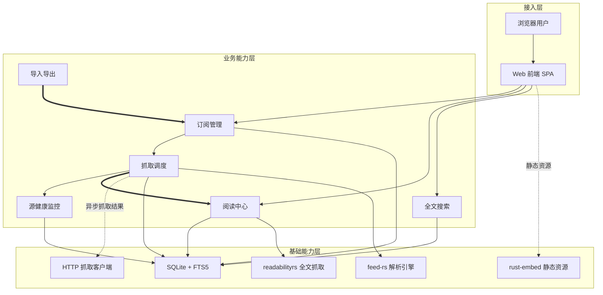
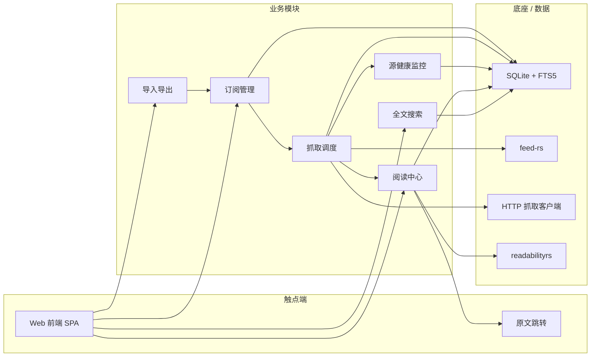

# AICoding 架构设计 · 高层架构设计

> 本文档为《AICoding 架构设计》核心产物之一，对应**高层架构设计**。
> 上游输入：用户原始诉求 + 《material_digest.md》（G1 已通过）+ 《research_report.md》v0.2（G2 已通过）；
> 下游输出：驱动《系统设计》《部署设计》《安全设计》《UserStory》四份文档的撰写。
> 本文档由 business-architect（许边界）产出，经 G3 人工审核通过后由主理人归档。

---

## 0. 元信息：修订记录

> 记录文档版本、变更内容、修订人、修订时间，确保设计文档的可追溯。

```yaml
标题: RSS 管理器（自托管 Web 应用）- 高层架构设计 v0.2
版本: v0.2
状态: Draft   # Draft | Reviewing | Approved | Deprecated
创建日期: 2026-08-25
最后更新: 2026-08-25
作者: business-architect（许边界）
评审人:
  - team-lead（主理人）
  - 用户（G3 人工审核）
  - 用户（G4 人工审核反馈）

关联文档:
  上游输入:
    - 用户原始诉求: "我需要开发一个rss的管理器，目前我有一个opml的文件，如文件夹中所示。我们需要从零开始，搭建这样一个管理器。先开始探讨是什么/为什么/怎么做吧"
    - 资料摘要: .workbuddy/output/material_digest.md（G1 已通过，4 分组 41 源逐条解析）
    - 行业调研报告: .workbuddy/output/research_report.md（G2 已通过，v0.2）
  下游产出:
    - 系统设计: AICoding架构设计-2-系统设计.md
    - 部署设计: AICoding架构设计-3-部署设计.md
    - 安全设计: AICoding架构设计-4-安全设计.md
    - UserStory: AICoding架构设计-5-UserStory.md
```

| 版本 | 日期 | 作者 | 变更内容 | 评审状态 |
| --- | --- | --- | --- | --- |
| v0.1 | 2026-08-25 | business-architect（许边界） | 初稿：冻结业务边界、MVP 范围、业务闭环，整合行业调研结论 | Draft |
| v0.2 | 2026-08-25 | business-architect（许边界） | 经 G4 用户反馈：①新增收藏夹功能（F14，阅读中心，P0/MVP ✅，对齐 V3），原 F14–F17 顺延为 F15–F18；②强化 F4 定时抓取为 per-feed 间隔（覆盖全局默认，全局默认与单源下限均 ≥ 30 分钟） | Draft（待 G4 复审） |

> **版本管理纪律**：破坏性变更（章节结构调整 / 关键决策反转）升 MAJOR；新增章节、扩充内容升 MINOR。

---

## 1. 需求概要

### 1.1 需求概要说明

用户当前使用浏览器插件 Feedbro 管理 RSS 订阅，已积累一份 4 分组 41 源的 OPML 订阅清单（2026-08-10 导出，见 material_digest D1），订阅数据仅存于浏览器、无服务端、无统一管理入口。本期由"从零搭建一个 RSS 管理器"诉求驱动启动（用户原文："我们需要从零开始，搭建这样一个管理器。先开始探讨是什么/为什么/怎么做吧"），Phase 0 已确认产品形态为**自托管 Web 应用**，G2 已确认技术栈为 **Rust + SQLite + 前后端分离 + 单一可执行文件/单容器**。

**系统定位一句话**：rss-manager 是面向个人用户的轻量自托管 RSS 阅读与管理中心，覆盖"OPML 导入 → 分组订阅 → 定时抓取 → 阅读/已读 → 全文搜索 → OPML 导出备份"的完整链路，对标 Miniflux（架构理念）与 FreshRSS（功能基线）。

### 1.2 关键决策摘要

| 编号 | 决策类别 | 决策内容 | 关联章节 |
| --- | --- | --- | --- |
| D1 | 范围决策 | MVP 覆盖 R1–R6 + 全文抓取（OPML 导入、分组管理、定时抓取+源健康、阅读/已读、全文搜索简化版、OPML 导出、Readability 全文抓取）；P2 过滤规则/WebSub | §6.1 需求边界 / §4.3 |
| D2 | 技术选型决策 | Rust 后端 + SQLite（FTS5 全文搜索）+ 前后端分离 SPA + 单一可执行文件/单容器；经 G2 用户显式确认冻结 | §3.2 / §4.2 / §4.3 |
| D3 | MVP / 完整版边界 | MVP 是完整版子集，架构骨架可继承；MVP 即含 Readability 全文抓取（逐源开关，失败源降级跳转原文），完整版持续优化全文抓取覆盖率 | §4.3 |
| D4 | 复用 vs 新建 | 核心能力从零自研（用户明确"从零开始"），复用 Rust 开源库：feed-rs（Feed 解析）、SQLite FTS5（搜索）、readabilityrs（MVP 全文抓取，0.1.x 年轻库风险见 R-06）、rust-embed（前端嵌入） | §5.2 |
| D5 | 部署形态 | 单用户自托管、单一可执行文件 / 单容器（经 G2 用户确认）；数据模型预留 user 维度以降低未来扩展成本 | §4.2 / §5.2 |
| D6 | 范围决策 | 新增收藏夹功能（F14，阅读中心，P0/MVP ✅，对齐 V3）：创建/重命名/删除收藏夹 + 文章收藏/取消收藏 + 按收藏夹翻阅；不做收藏夹内排序/嵌套等高级能力（经 G4 用户反馈新增） | §6.1 / §6.3 |
| D7 | 抓取策略决策 | per-feed 抓取间隔：每个订阅源可单独设置抓取间隔并覆盖全局默认，全局默认与单源下限均 ≥ 30 分钟（礼貌抓取约束）（经 G4 用户反馈新增） | §5.2 / §6.3 F4 |

### 1.3 价值主张

| 价值维度 | 量化目标 | 度量指标 | 当前值 | 目标值 | 截止时间 |
| --- | --- | --- | --- | --- | --- |
| 效率 | 订阅冷启动从"手动逐源添加"降至"一次 OPML 导入" | 41 源导入耗时 / 一次导入成功率 | 手动逐源录入约 120 分钟（估算），无批量能力 | 单次 OPML 导入 ≤ 5 分钟，41/41 源解析成功（成功率 100%），≥ 39 源首次抓取成功（≥ 95%） | MVP 上线 |
| 效率 | 新文章触达时效从"依赖手动刷新"变为"定时自动抓取" | 文章发布到可读的端到端延迟 P50 | Feedbro 手动刷新，无时效保证 | 定时抓取间隔 ≤ 60 分钟，端到端延迟 P50 ≤ 60 分钟 | MVP 上线 |
| 成本 | 运行成本从"SaaS 订阅费"降至"自托管零订阅费" | 月度运行成本（订阅费 + 主机费） | Feedly Pro $6.99/月起 / Inoreader Pro $7.50/月起（research_report §2.2） | 订阅费 $0，主机成本 ≤ $5/月（低配 VPS 或家庭服务器） | MVP 上线 |
| 体验 | 失效源识别从"人工发现"变为"自动标记" | 失效源识别周期 | 41 源中已有 1 源失效（linux.cn）且长期未被系统识别（material_digest D1 §6） | 连续 3 次抓取失败自动标记，识别周期 ≤ 7 天 | MVP 上线 |
| 体验 | 摘要源阅读完整：内嵌全文，无需跳出 | 摘要源全文内嵌展示比例 / 失败源降级跳转步数 | 无系统，摘要源需跳出阅读器读原文 | MVP 摘要源内嵌全文阅读（readabilityrs 逐源开关）；全文抓取失败源降级跳转原文 ≤ 1 次点击 | MVP 上线 |

---

## 2. 需求分析 & 痛点解构

### 2.1 核心角色关注点

按"甲方决策者 / 最终用户 / 受影响方"维度盘点角色诉求。本项目为个人项目，甲方决策者、最终用户、维护者三重身份集中于用户本人，但关注点各不相同，角色拆分如下。

| 角色 | 业务身份 | 主要操作 | Top1 关心点 | 来源 |
| --- | --- | --- | --- | --- |
| 甲方决策者 | 用户本人（项目 Owner） | 技术选型、部署、验收、后续演进决策 | 数据自控与零订阅成本：订阅清单、阅读历史、搜索索引全部保存在自有实例，不依赖第三方 SaaS | 用户诉求 / Phase 0 / G2 决策 |
| 最终用户 | 用户本人（日常阅读者） | 订阅管理、按分组阅读、标记已读、全文搜索 | 41 源信息每天读得完：按分组高效浏览、未读不遗漏、搜索能召回历史文章 | 用户诉求 |
| 受影响方：订阅源站点 | 上游内容提供方（36kr、阮一峰、个人博客等 41 源） | 被动接收抓取请求 | 抓取频率礼貌：不被高频轮询触发封禁或限流（research_report R-01 记录反爬风险） | material_digest D1 |
| 受影响方：维护者/安全 | 用户本人（自托管维护者） | 部署升级、备份恢复、安全加固 | 单文件运维与安全基线：升级 = 替换单个二进制，备份 = 复制单个 SQLite 文件，公网暴露不被入侵 | G2 决策 / research_report §4.3 |

**硬指标**：≥ 3 类（甲方决策者 / 最终用户 / 受影响方各至少一行）；每行必须有"Top1 关心点"，禁止笼统写"使用方便"。

### 2.2 核心痛点

| 编号 | 痛点描述 | 现象 / 数据 | 影响角色 | 影响程度 | 优先级 |
| --- | --- | --- | --- | --- | --- |
| P1 | OPML 数据质量问题导致直接导入后源不可用或显示混乱 | material_digest 逐条记录：http 明文 5 处、双斜杠 URL 1 处、xmlUrl/htmlUrl 域名不一致 4 处、缺 htmlUrl 4 源、text/title 不一致多处；41 源中受影响源 ≥ 14 个（占比 ≥ 34%） | 最终用户 | 高（冷启动路径受阻） | P1 |
| P2 | 源失效无法及时发现，内容断供不可见 | 用户 OPML 已存在"已失效"分组（linux.cn，1 源）；该源未被任何系统自动识别，长期停留在订阅列表 | 最终用户 | 中 | P1 |
| P3 | 摘要源阅读体验不完整，需频繁跳出阅读器 | 36kr、部分 WordPress 站常只输出摘要（material_digest D1 §4）；41 源中摘要源实际比例需运行时确认（U-03） | 最终用户 | 中 | P2 |
| P4 | 订阅数据仅存于浏览器，无服务端、无备份、不可迁移 | Feedbro 数据存于浏览器扩展（material_digest D1 §14 无任何运行时数据）；浏览器重置或插件停用即丢失全部订阅与阅读记录 | 最终用户 | 高（数据资产风险） | P1 |

**优先级标准**：
- **P1**：直接影响业务核心流程或合规底线，不解决无法上线。
- **P2**：影响用户体验或运营效率，可在 MVP 后迭代。
- **P3**：体验型 / 长尾问题，列入完整版或后续版本。

**硬指标**：每条痛点必须有"现象 / 数据"佐证；P1 ≥ 1 条且必须在 §2.3 有对应目标。

### 2.3 期待目标

| 编号 | 目标描述 | 对齐痛点 | 度量指标 | 当前值 | 目标值 | 截止时间 |
| --- | --- | --- | --- | --- | --- | --- |
| V1 | OPML 导入规范化，冷启动无数据质量障碍 | P1 | 一次导入解析成功率 / 首抓成功率 | 无系统（手动逐源录入约 120 分钟） | 41/41 解析成功，≥ 39 源首抓成功（≥ 95%） | MVP 上线 |
| V2 | 失效源自动识别与隔离 | P2 | 失效识别周期 | 无系统（linux.cn 失效源长期滞留） | 连续 3 次抓取失败自动标记，识别周期 ≤ 7 天 | MVP 上线 |
| V3 | 阅读链路完整：未读不遗漏、摘要源内嵌全文 | P3 | 阅读操作步数 / 摘要源全文内嵌比例 | 无统一阅读器 | 未读文章 ≤ 3 步读完并标记；摘要源内嵌全文展示（readabilityrs 逐源开关），失败源降级跳转原文 ≤ 1 次点击 | MVP 上线 |
| V4 | 历史文章可检索 | P4 | 搜索响应时间 P95 | 无系统 | 41 源全量文章搜索响应 P95 ≤ 3 秒 | MVP 上线 |

**硬指标**：每条目标必须**有数字 + 对齐至少 1 条痛点**；P1 痛点必须有对应 V 级目标。

### 2.4 基线复用

| 复用类别 | 现有能力 | 复用方式 | 来源系统 | 备注 |
| --- | --- | --- | --- | --- |
| 数据资产 | 用户 OPML 订阅清单（4 分组 41 源，含 text/title/htmlUrl/xmlUrl） | 作为导入源直接解析 | 用户（Feedbro 导出，material_digest D1） | 需做数据质量规范化（§2.5 缺口 1） |
| Feed 解析 | feed-rs（Rust crate，MIT，RSS 0.x/1.0/2.0 + Atom + JSON Feed 统一模型） | 进程内库调用 | 开源社区（research_report §4.3 / SR-11） | 宽松解析对非规范 Feed 容错好，覆盖 feedburner 等全部路径形态 |
| 全文搜索 | SQLite FTS5（数据库内建能力） | 进程内库调用 | SQLite（G2 已确认数据库） | 41 源个人规模无需独立搜索引擎（research_report §4.1） |
| 全文抓取 | readabilityrs（Mozilla Readability.js 的 Rust 移植，Apache-2.0） | 进程内库调用（MVP） | 开源社区（research_report §4.3 / SR-12） | 0.1.x 年轻库，逐源开关 + 失败降级（R-06） |
| 前端嵌入 | rust-embed（编译期静态资源嵌入） | 编译期嵌入 | 开源社区（research_report §4.3 / SR-13） | 同时满足"前后端分离"与"单一可执行文件" |

**硬指标**：必须先盘点再决定新建；凡列入"功能缺口"的能力，必须先在本节确认基线无法覆盖。

### 2.5 功能缺口

| 阶段 | 功能缺口 | 必要性 | 优先级 | 对齐目标 |
| --- | --- | --- | --- | --- |
| 冷启动阶段 | OPML 导入 + 数据质量规范化（URL 去双斜杠、http→https 升级尝试、text 为显示名、导入报告） | 必须 | MVP | V1 |
| 订阅管理阶段 | 分组管理 + 订阅源增删改查（4 分组 41 源结构） | 必须 | MVP | V1 |
| 抓取阶段 | 定时抓取调度（逐源间隔 + 指数退避）+ 源健康检查/失效标记 | 必须 | MVP | V2 |
| 阅读阶段 | 文章列表 / 详情阅读 / 已读未读 / 原文跳转 / 收藏夹（收藏到夹、按夹翻阅） | 必须 | MVP | V3 |
| 检索阶段 | 全文搜索（SQLite FTS5 简化版，不做高级查询语法） | 必须 | MVP | V4 |
| 备份阶段 | OPML 导出（备份/迁移，防锁定） | 必须 | MVP | V1 |
| 全文阶段 | 摘要源全文抓取（Readability 逐源开关，失败降级跳转原文） | 必须 | MVP | V3 |
| 进阶阶段 | 过滤规则/用户查询、WebSub 实时推送、发布频率统计、自动 OPML 备份 | 重要 | P2 | — |

**硬指标**：每条缺口必须对齐 §2.3 至少一条目标；MVP 缺口必须在 §6.3 功能清单中对应有 MVP 范围标记。

---

## 3. 行业调研

> 本章为对《research_report.md》v0.2（G2 已通过）结论的整合引用，未重新调研。事实、对比、建议均可在该报告对应章节回溯；标注出处的结论不得在本章被改写。

### 3.1 行业标杆系统分析

**硬指标**：≥ 3 家；至少包含 1 家头部 SaaS + 1 家开源/自研代表。本系统对标 5 家（SaaS ×2 + 开源 ×3），达标。来源：research_report §2.1 / §2.2。

| 标杆系统 | 厂商 / 来源 | 场景覆盖 | 技术亮点 | 商业模式 | 适用度 |
| --- | --- | --- | --- | --- | --- |
| Feedly | Feedly Inc.（SaaS） | RSS 聚合 + AI 内容情报 + 团队看板 | Leo AI 优先排序/去重/摘要；Zapier/IFTTT 集成 | 免费增值订阅（Pro $6.99/月，Pro+ $12.99/月） | 低 |
| Inoreader | Innologica Ltd.（SaaS） | RSS 聚合 + 监控源 + 自动化规则 | 规则引擎（30 规则/50 过滤）；Intelligence AI；Web feeds | 免费增值订阅（Free 150 源；Pro $7.50/月年付） | 中（规则模型借鉴） |
| Miniflux | 开源社区（Frédéric Guillot） | 极简个人/小团队 RSS 阅读 | Go 静态单二进制；仅 PostgreSQL；Fever/Google Reader/REST API；内置 Readability | 开源免费（Apache-2.0） | 高（架构理念参照） |
| FreshRSS | 开源社区（100+ 贡献者） | 功能完整的多用户 RSS 聚合器 | SQLite 起步；WebSub；XPath 网页抓取；50+ 扩展；Google Reader API 生态最完整 | 开源免费（AGPL-3.0） | 高（功能基线参照） |
| Tiny Tiny RSS | 开源社区（2005 年起） | 老牌全功能 RSS 阅读器 | 插件/主题；文章过滤/去重/标签；Readability 嵌入 | 开源免费（GPL） | 中（过滤模型借鉴） |

### 3.2 方案对标及优先级打分

**对比矩阵**（每行权重之和 = 1.00，评估语境：41 源、个人单用户或极少用户、从零自研自托管 Web，打分衡量"该标杆作为本项目参照系的契合程度"）。来源：research_report §3.1。

| 评估维度 | 权重 | B1 Feedly 得分 | B2 Inoreader 得分 | B3 Miniflux 得分 | B4 FreshRSS 得分 | B5 TT-RSS 得分 |
| --- | --- | --- | --- | --- | --- | --- |
| 场景契合度 | 0.30 | 2 | 2 | 5 | 5 | 3 |
| 技术成熟度 | 0.20 | 5 | 5 | 5 | 5 | 4 |
| 集成难度（反向） | 0.15 | 2 | 2 | 5 | 4 | 3 |
| 成本（反向） | 0.15 | 2 | 3 | 5 | 5 | 4 |
| 合规可控性 | 0.20 | 2 | 2 | 5 | 4 | 4 |
| **加权总分** | **1.00** | **2.60** | **2.75** | **5.00** | **4.65** | **3.55** |

**结论摘要**（来源：research_report §3.2）：
- **优先借鉴**：Miniflux（5.00）—— 架构理念（单二进制分发、单一数据库、进程内调度、环境变量配置、功能克制）；FreshRSS（4.65）—— 功能基线（发布频率统计、死源检测、WebSub、OPML 分组保留），直接回应"已失效"源痛点。
- **部分借鉴**：TT-RSS（3.55）—— 文章过滤/去重/标签功能模型、独立 updater 进程的调度设计；Inoreader（2.75）—— 规则引擎（条件→动作）与过滤器模型（P2 功能参照）、自动 OPML 备份。
- **不借鉴（否决）**：Feedly（2.60）—— 纯 SaaS 与自托管诉求根本冲突，核心差异化（Leo AI）锁定付费档且依赖云端内容图谱，技术上不可迁移。

### 3.3 完整报告参考

- 完整报告：`.workbuddy/output/research_report.md`（v0.2，G2 已通过）
- 调研工具：`tech-research-advisor`（见附录 B）
- 调研日期：2026-08-25
- 关键来源：Miniflux 官方功能页、FreshRSS GitHub/DeepWiki、Feedly/Inoreader 官方定价页、社区对比评测（research_report §6 SR-01~SR-14）

---

## 4. 方案决策

### 4.1 价值定位澄清

**定位三段式**（`对外 / 对内 / 差异化` 三段为固定结构）：

```
对外价值（内容获取侧）: 个人 41 源信息流统一汇聚——一次导入、定时抓取、全文搜索，阅读触达时效从"手动刷新无保证"变为"≤60 分钟自动可读"
对内价值（自托管运营侧）: 数据完全自控（订阅清单+阅读历史+搜索索引存于自有实例）+ 零订阅费（主机成本 ≤$5/月）+ 单文件运维（升级=替换二进制，备份=复制 SQLite 文件）
差异化价值        : 相对 SaaS（Feedly/Inoreader）——数据不出自有实例、无算法干预、无持续订阅费；相对自托管标杆（Miniflux/FreshRSS）——采用 Rust + SQLite + 前后端分离 + 单一可执行文件的轻量组合（经 G2 用户确认），在个人规模下保持极低资源占用
```

**与产品矩阵的关系**：本系统作为用户个人内容基础设施中的独立自托管组件，承担"订阅管理 + 阅读 + 检索"核心职责；对外无下游系统，移动端以响应式 Web 覆盖（经中间确认 U-02：不做移动 App 同步 API），形成"单实例自托管 + 浏览器多端访问"闭环（见 §5.2、§5.3）。

### 4.2 系统定位澄清

| 维度 | 内容 |
| --- | --- |
| 系统名称 | rss-manager（RSS 管理器） |
| 系统类型 | 新建（从零搭建，用户明确"从零开始"） |
| 部署形态 | 自托管：单一可执行文件 / 单容器 Docker（含 SQLite 数据文件）（经 G2 用户确认冻结） |
| 多租户 | 否——单用户实现（经中间确认 U-01：用户裁决方案 A）；数据模型预留 user 维度以降低未来扩展成本 |
| 服务对象 | 用户本人（甲方决策者 = 最终用户 = 维护者，三角色合一）；对齐 §2.1 |
| 上游依赖 | 41 个外部 Feed 源（HTTPS/HTTP 定时抓取）；OPML 文件（导入）；详见 §5.2 |
| 下游消费者 | 无外部系统（经中间确认 U-02：仅响应式 Web，不做移动 App 同步 API；架构层面预留 API 扩展点但不实现） |
| 边界（不做） | 不做 AI 摘要/降噪、不做社交/分享/团队协作、不做多租户 UI、不做原生移动 App 及移动 App 同步 API（Fever/Google Reader）、不做无 RSS 站点监控（Web feeds） |

### 4.3 MVP 与完整版决策

| 阶段 | 时间窗 | 范围（功能编号） | 架构差异点 | 退出标准 | 不做（延后） |
| --- | --- | --- | --- | --- | --- |
| MVP | 开发期目标 ≤ 8 周 | F1–F14（OPML 导入、分组管理、源增删改查、定时抓取、源健康标记、文章列表/详情、已读未读、全文搜索、OPML 导出、原文跳转、单用户登录、Readability 全文抓取、收藏夹） | 单用户；SQLite 单文件；前端经 rust-embed 嵌入二进制；Readability 全文抓取（逐源开关，失败源降级跳转原文）；HTTP 定时抓取（轮询，per-feed 间隔覆盖全局默认） | 41 源全部导入成功且 ≥ 95% 首抓成功；定时抓取连续运行 7 天无崩溃；搜索响应 P95 ≤ 3 秒；41 源全文抓取冒烟测试通过（失败源降级跳转原文）；OPML 导出可被 Feedbro/FreshRSS 重新导入 | F15–F18 |
| 完整版 | MVP 后迭代 | + F15–F18（过滤规则、WebSub、发布频率统计、自动 OPML 备份） | + WebSub 推送通道（保留轮询兜底）；数据模型维持单库，无分库分表 | 全文抓取覆盖率持续优化（逐源调参提升内嵌成功率）；WebSub 源实时性 ≤ 1 分钟 | — |

**演进纪律**（重要）：
- ✅ MVP 的架构骨架必须是完整版的**子集**：单 SQLite 库、单进程调度、REST API 边界在 MVP 即确定，完整版仅增加能力端点，不允许 MVP 上线后推倒重来。
- ✅ MVP 中可 Mock / 兜底的能力（WebSub 实时推送），完整版替换计划：WebSub 推送通道保留轮询兜底（F16）。Readability 全文抓取已在 MVP 交付（F13），完整版持续优化覆盖率，不做"推倒重来"式替换。
- ❌ 禁止：MVP 为了赶工而引入"完整版无法继承"的临时架构（本项目不存在分库分表、多实例等复杂演进路径，单库单进程架构天然可继承）。

---

## 5. 业务架构设计

### 5.1 业务架构图

**绘制规范**：至少 3 层（接入层 → 业务能力层 → 基础能力层）；模块标准名与 §4.2 / 术语一致；实线 = 同步调用、虚线 = 异步事件、粗线 = 主链路。



### 5.2 系统依赖架构

| 依赖类型 | 系统 / 模块 | 提供方 | 依赖能力 | 接入方式 | 同步/异步 | 关键约束 |
| --- | --- | --- | --- | --- | --- | --- |
| 上游 | 41 个外部 Feed 源（36kr、阮一峰、个人博客等） | 各源站点 | 定时抓取 Feed 内容（RSS/Atom） | HTTPS/HTTP GET（reqwest） | 异步（调度器触发） | 礼貌抓取：每源可单独设置抓取间隔（覆盖全局默认），全局默认与单源下限均 ≥ 30 分钟；请求超时 ≤ 30 秒；连续失败指数退避；http 明文源按安全基线处理（D-02） |
| 上游 | OPML 文件（feedbro-subscriptions-20260810-170604.opml） | 用户（Feedbro 导出） | 订阅清单导入（4 分组 41 源） | 文件上传 / 服务器路径读取 | 同步 | OPML 1.0 解析；必须过数据质量规范化流水线（§2.5 缺口 1）；导入后输出逐源报告 |
| 复用底座 | feed-rs | 开源社区（crates.io） | Feed 解析（RSS/Atom/JSON Feed 统一模型） | 进程内库调用 | 同步 | 宽松解析策略；锁定版本并跟踪演进（R-06）；覆盖 feedburner/S3 托管等全部路径形态 |
| 复用底座 | SQLite + FTS5 | SQLite（G2 确认数据库） | 数据存储 + 全文搜索 | 进程内库调用 | 同步 | 单文件数据库；WAL 模式；备份 = 复制文件；41 源规模无分库需求 |
| 复用底座 | readabilityrs | 开源社区（crates.io） | 摘要源全文抓取（MVP，F13） | 进程内库调用 | 同步 | 0.1.x 年轻库（R-06）；逐源开关；MVP 上线前须对 41 源完成全文抓取冒烟测试，失败源降级"跳转原文"（经中间确认 U-03：MVP 即含） |
| 复用底座 | rust-embed | 开源社区 | 前端构建产物编译期嵌入二进制 | 编译期嵌入 | — | 满足"前后端分离 + 单一可执行文件"双约束（G2 决策） |
| 下游 | 浏览器（用户访问 Web UI） | 用户 | 阅读 / 管理界面 | HTTPS | 同步 | 响应式布局适配移动端浏览器（经中间确认 U-02：仅响应式 Web） |

**硬指标**：
- 每条依赖必须明确"接入方式 + 同步/异步 + 关键约束"。
- 所有 P1 痛点对应的核心能力，必须能在本表中找到依赖来源（自建/复用/采购）：P1 导入规范化 → 上游 OPML + 自研规范化流水线；P1 失效识别 → 自研源健康监控（M3）+ feed-rs 解析 + HTTP 抓取；P1 数据资产备份 → OPML 导出（M6）+ SQLite 单文件。

### 5.3 业务闭环

**业务主链路**（端到端）：

```
OPML 导入（冷启动） → 订阅源管理（分组/源 CRUD） → 定时抓取调度（逐源间隔+退避） → Feed 解析入库 → 文章列表/详情阅读 → 标记已读 → 全文搜索召回 → OPML 导出备份（防锁定）
```

**关键反馈回路**：

| 回路 | 触发点 | 反馈对象 | 反馈机制 | 价值 |
| --- | --- | --- | --- | --- |
| 源健康回路 | 单源连续 3 次抓取失败（HTTP 错误/解析失败/超时） | 源健康监控（M3）→ 用户 | 指数退避 + 失效标记 + 失效隔离分组；用户可重试/修复 URL/删除 | 内容断供可发现、可处置（对齐 V2） |
| 数据质量回路 | OPML 导入完成 / 逐源首抓完成 | 导入导出（M6）→ 用户 | 导入报告（规范化改动逐条列出：http 升级、双斜杠修复、text 命名）；用户确认后生效 | 冷启动数据质量透明可控（对齐 V1） |
| 阅读运营回路 | 每日新增文章数 / 未读数 / 抓取成功率 | 维护者（用户本人） | 源健康监控面板查看抓取成功率与失败源，调整单源间隔或处置失效源 | 保持订阅源长期健康（对齐 V2） |

**运营主线**：个人自托管场景下运营主体即用户本人——每日：阅读未读文章并标记；每周：查看源健康面板，处置失效/低质源（重试、修复、删除）；每月：OPML 导出备份一次 + 检查 SQLite 文件备份策略（与 §6.5 管理端原型呼应）。

---

## 6. 产品需求及原型

### 6.1 需求边界

**In-Scope**（本期必做）：

```
F1. OPML 导入（4 分组 41 源，含数据质量规范化）
F2. 分组管理（4 分组增删改、源分组归属调整）
F3. 订阅源增删改查（含手动添加源、编辑 xmlUrl/htmlUrl）
F4. 定时抓取调度（逐源间隔 + 指数退避）
F5. 源健康检查 / 失效标记（连续失败计数、失效隔离）
F6. 文章列表（按分组 / 未读 / 全部筛选）
F7. 文章详情（标题、正文（摘要源内嵌全文）、原文链接、发布时间）
F8. 已读 / 未读管理（单篇标记、分组全部已读）
F9. 全文搜索（SQLite FTS5 简化版）
F10. OPML 导出（备份 / 迁移，保留分组）
F11. 原文跳转（新窗口打开 htmlUrl，全文抓取失败源降级兜底）
F12. 单用户登录与会话（自托管安全基线）
F13. 摘要源全文抓取（Readability 逐源开关，失败源降级跳转原文）
F14. 收藏夹（创建/重命名/删除收藏夹 + 文章收藏/取消收藏 + 按收藏夹翻阅；经 G4 用户反馈新增）
N1. 非功能基线（体验/运维）：响应式 Web 适配移动端浏览器 + 数据备份 = 复制 SQLite 单文件（原 N1/N2 合并为一条，为容纳新增 F14 收藏夹保持 In-Scope ≤ 15）
```

**Out-of-Scope：MVP 阶段不做（延后 P2）**：
| 编号 | 不做的事 | 原因 | 后续计划 |
| --- | --- | --- | --- |
| O1 | 过滤规则 / 用户查询 | 41 源规模信息密度低，过滤收益小（research_report §4.2 R8） | P2（F15） |
| O2 | WebSub 实时推送 | 支持 WebSub 的源比例未知；轮询对 41 源完全够用（research_report §4.2 R11） | P2（F16） |

**Out-of-Scope：完整版规划（P2 延后能力）**：
| 编号 | 不做的事 | 原因 | 后续计划 |
| --- | --- | --- | --- |
| O3 | 发布频率统计 / 自动 OPML 备份 | 属增强型运营能力，MVP 先以手动导出（F10）+ 手动查看（M3）覆盖 | P2（F17/F18） |

**Out-of-Scope：本期及完整版均不做**：
| 编号 | 不做的事 | 原因 | 后续计划 |
| --- | --- | --- | --- |
| O4 | 移动客户端同步 API（Fever / Google Reader 兼容层） | 经中间确认 U-02：仅响应式 Web，不做移动 App 同步 API；若未来确需可增量叠加（架构预留 API 扩展点） | 不做（未来可增量叠加） |
| O5 | 多用户 / 共享实例 | 用户诉求为个人 RSS 管理器；41 源规模无共享价值；数据模型预留 user 维度以保留扩展可能（经中间确认 U-01：MVP 不做多用户） | 数据模型预留，不做 UI |
| O6 | 原生移动 App（iOS/Android 独立应用） | 自托管单文件形态与移动商店分发冲突；响应式 Web 已覆盖移动阅读 | 不做 |
| O7 | AI 摘要 / 降噪 | SaaS 独有能力，依赖云端内容图谱或本地 LLM，成本远超 41 源规模收益（research_report §4.1） | 远期评估 BYO API key |
| O8 | 无 RSS 站点监控（Web feeds）、社交/分享、团队协作 | 偏离个人 RSS 管理器核心诉求 | 不做 |

**硬指标**：In-Scope ≤ 15 条（F1–F14 共 14 条功能 + N1 共 1 条非功能，合计 15 条，达标；原 N1/N2 合并为一条以容纳新增 F14 收藏夹，见 §0 v0.2）；Out-of-Scope ≥ 3 条（8 条）。

### 6.2 产品模块全景图

**模块卡片**（每个模块必填字段）：

| 字段 | 说明 |
| --- | --- |
| 模块名称 | 标准名（与 §5.1 一致） |
| 一级归属 | 接入层 / 业务能力层 / 基础能力层 |
| 责任团队 | rss-manager 自研（个人项目，单团队） |
| 上游 | 模块/系统列表 |
| 下游 | 模块/系统列表 |
| MVP 是否包含 | 是 / 否 |

| 模块名称 | 一级归属 | 责任团队 | 上游 | 下游 | MVP |
| --- | --- | --- | --- | --- | --- |
| Web 前端（SPA） | 接入层 | rss-manager 自研 | 用户浏览器 | 订阅管理、阅读中心、全文搜索 | 是 |
| 订阅管理 | 业务能力层 | rss-manager 自研 | Web 前端、导入导出 | 抓取调度、SQLite | 是 |
| 抓取调度 | 业务能力层 | rss-manager 自研 | 订阅管理 | 源健康监控、阅读中心、feed-rs、HTTP 抓取 | 是 |
| 源健康监控 | 业务能力层 | rss-manager 自研 | 抓取调度 | Web 前端、SQLite | 是 |
| 阅读中心 | 业务能力层 | rss-manager 自研 | 抓取调度、Web 前端 | SQLite、原文跳转（浏览器） | 是 |
| 全文搜索 | 业务能力层 | rss-manager 自研 | Web 前端 | SQLite FTS5 | 是 |
| 导入导出 | 业务能力层 | rss-manager 自研 | Web 前端 | 订阅管理 | 是 |
| SQLite + FTS5 | 基础能力层 | 内建 | 订阅管理、抓取调度、阅读中心、全文搜索 | — | 是 |
| feed-rs 解析引擎 | 基础能力层 | 复用（crates.io） | 抓取调度 | 阅读中心 | 是 |
| readabilityrs 全文抓取 | 基础能力层 | 复用（crates.io，MVP） | 阅读中心 | 阅读中心 | 是 |



### 6.3 功能清单

| 编号 | 一级模块 | 二级功能 | 功能描述 | 优先级 | MVP 范围 | 完整版范围 | 对齐目标 |
| --- | --- | --- | --- | --- | --- | --- | --- |
| F1 | 导入导出 | OPML 导入 | 解析 OPML 1.0（4 分组 41 源），执行数据质量规范化（http→https 升级尝试、双斜杠修复、text 为显示名、域名不一致提示），输出逐源导入报告 | P0 | ✅ | ✅ | V1 |
| F2 | 订阅管理 | 分组管理 | 4 分组增删改、源分组归属调整 | P0 | ✅ | ✅ | V1 |
| F3 | 订阅管理 | 订阅源增删改查 | 源列表、手动添加源、编辑 xmlUrl/htmlUrl/显示名、删除源 | P0 | ✅ | ✅ | V1 |
| F4 | 抓取调度 | 定时抓取 | 进程内调度器，每个订阅源可单独设置抓取间隔并覆盖全局默认，全局默认与单源下限均 ≥ 30 分钟（礼貌抓取约束）+ 连续失败指数退避 | P0 | ✅ | ✅ | V2 |
| F5 | 抓取调度 | 源健康标记 | 连续 3 次抓取失败自动标记失效并隔离分组，抓取错误在 UI 展示 | P0 | ✅ | ✅ | V2 |
| F6 | 阅读中心 | 文章列表 | 按分组 / 未读 / 全部筛选，列表展示标题、源、发布时间 | P0 | ✅ | ✅ | V3 |
| F7 | 阅读中心 | 文章详情 | 标题、正文（摘要源经 Readability 内嵌全文）、原文链接、发布时间；全文抓取失败源提供"原文跳转"按钮 | P0 | ✅ | ✅ | V3 |
| F8 | 阅读中心 | 已读/未读管理 | 单篇标记已读、分组全部已读、未读计数 | P0 | ✅ | ✅ | V3 |
| F9 | 全文搜索 | 简化版搜索 | SQLite FTS5 全文检索标题+正文，关键词高亮，结果按相关度/时间排序 | P0 | ✅ | ✅ | V4 |
| F10 | 导入导出 | OPML 导出 | 按当前分组结构导出 OPML，可被 Feedbro/FreshRSS 重新导入 | P0 | ✅ | ✅ | V1 |
| F11 | 阅读中心 | 原文跳转 | 全文抓取失败源一键新窗口打开 htmlUrl（降级兜底路径） | P0 | ✅ | ✅ | V3 |
| F12 | 系统 | 单用户登录 | 简单账号密码登录 + 会话管理（自托管公网暴露安全基线）；数据模型预留 user 维度（经中间确认 U-01：单用户） | P1 | ✅ | ✅ | — |
| F13 | 阅读中心 | Readability 全文抓取 | 摘要源自动抓取正文并内嵌展示，逐源开关，失败降级跳转原文（经中间确认 U-03：MVP 即含） | P0 | ✅ | ✅ | V3 |
| F14 | 阅读中心 | 收藏夹 | 创建/重命名/删除收藏夹、文章收藏/取消收藏、按收藏夹翻阅（一个收藏夹可含多篇文章，一篇文章可归入收藏夹）；不做收藏夹内排序/嵌套等高级能力（经 G4 用户反馈新增） | P0 | ✅ | ✅ | V3 |
| F15 | 订阅管理 | 过滤规则 | 条件（来源/关键词/标签）→ 动作（标记/忽略/分组）规则引擎 | P2 | ❌ | ✅ | — |
| F16 | 抓取调度 | WebSub 实时推送 | 订阅支持 WebSub 的源，实时接收推送（保留轮询兜底） | P2 | ❌ | ✅ | V3 |
| F17 | 源健康监控 | 发布频率统计 | 逐源发布频率统计，辅助识别低质/失效源 | P2 | ❌ | ✅ | V2 |
| F18 | 导入导出 | 自动 OPML 备份 | 周期自动备份 OPML 到服务器本地目录 | P2 | ❌ | ✅ | V1 |

**硬指标**：
- 每个 P0 功能必须在 MVP 范围内为 ✅（F1–F11、F13、F14 均 P0 且 MVP ✅）。
- 每个功能必须能反向映射到 §2.5 功能缺口 + §2.3 期待目标（F1/F2/F3/F10/F18→V1，F4/F5/F17→V2，F6/F7/F8/F11/F13/F14/F16→V3，F9→V4）。

### 6.4 产品原型 - Web 阅读端（核心触点）

**核心页面清单**：

| 页面 | 用途 | 关键交互 | MVP |
| --- | --- | --- | --- |
| 订阅列表页（侧边栏） | 展示 4 分组（Blogs/杂志资讯/计算机发展资讯/已失效）+ 未读计数 | 分组折叠/展开、未读角标、失效源红色标识 | ✅ |
| 文章列表页 | 当前分组/全部文章流，未读加粗 | 分组/未读/全部筛选、单篇标记已读（点击即读）、分页或滚动加载 | ✅ |
| 文章详情页 | 阅读正文 | 已读自动标记、收藏到收藏夹、上一篇/下一篇切换、摘要源内嵌全文展示（Readability）、失败源原文跳转按钮、键盘快捷键（j/k 上下篇、m 标记已读） | ✅ |
| 收藏夹页 | 按收藏夹快速翻阅收藏文章 | 收藏夹列表（创建/重命名/删除）、文章收藏/取消收藏、按收藏夹翻阅 | ✅ |
| 搜索页 | 全文搜索入口与结果 | 关键词输入、结果列表（高亮关键词）、按源/时间筛选 | ✅ |
| 源管理页 | 订阅源增删改查 | 表格展示源（显示名/xmlUrl/htmlUrl/状态）、编辑弹窗、手动添加、测试抓取 | ✅ |
| 导入/导出页 | OPML 导入与导出 | 文件上传 + 导入报告展示（规范化改动逐条列出）、一键导出下载 | ✅ |
| 设置页 | 抓取间隔、登录、备份说明 | 全局抓取间隔配置、修改密码、备份指引 | ✅ |

**关键交互约束**：
- 阅读核心路径（列表 → 打开 → 标记已读）≤ 3 步；摘要源内嵌全文阅读无跳转；全文抓取失败源降级跳转原文 ≤ 1 次点击（对齐 V3）。
- 搜索响应：输入到结果 P95 ≤ 3 秒（对齐 V4）。
- 移动端浏览器（宽度 ≤ 480px）下订阅列表折叠为抽屉，文章流保持可读（对齐 N1）。

**原型链接**：MVP 阶段以功能清单 + 页面清单为准，视觉稿由 product-story-designer 在 Phase 5 细化。

### 6.5 产品原型 - 管理/维护端（自托管运营视角）

**核心页面清单**：

| 页面 | 用途 | 关键交互 | MVP |
| --- | --- | --- | --- |
| 源健康监控页 | 全量源抓取状态总览 | 逐源状态（正常/失败中/已失效）、连续失败次数、最近抓取时间、抓取错误信息 | ✅ |
| 抓取日志页 | 最近抓取任务明细 | 按源/时间筛选、查看单次抓取错误详情（超时/HTTP 状态/解析失败） | ✅ |
| 数据备份页 | 备份与恢复指引 | SQLite 文件下载、OPML 导出按钮、备份清单说明 | ✅ |
| 趋势/频率页 | 逐源发布频率统计（辅助清理低质源） | 按源查看近 30 天发布频率、排序 | ❌（P2，F17） |

**原型链接**：MVP 阶段以功能清单 + 页面清单为准，视觉稿由 product-story-designer 在 Phase 5 细化。

---

## 附录 A：生成流程方法论

> 本附录为高层架构设计的**生成方法论**，描述每一步的目标、工具与产物形态，作为正文章节的产出依据。

### A.0 生成流程总览

> 高层架构设计采用 **Step0 → Step5** 六步法，逐步从「业务背景」推导至「系统高层架构 + 产品需求原型」。

| 步骤 | 名称 | 核心产出 | 落入正文章节 |
| --- | --- | --- | --- |
| Step0 | 业务基础知识库构建 | 关联文档结构化知识库 | （为全文提供输入） |
| Step1 | 行业调研分析 | 行业标杆 / 方案对比 / MVP 决策 | §3 行业调研 |
| Step2 | 需求分析 / 痛点解构 | 需求画像卡 | §2 需求分析 & 痛点解构 |
| Step3 | 能力盘点，系统定位 | 价值定位 + 系统定位 | §4 方案决策 / §5.2 系统依赖架构 |
| Step4 | 生成系统高层架构设计 | 本文档主文档 | §1 ~ §5 |
| Step5 | 产品需求及原型 | 需求边界 + 全景图 + 原型 | §6 产品需求及原型 |


### A.1 Step0：业务基础知识库构建

#### A.1.1 目标

构建业务系统关联信息知识库，为后续步骤提供「现有架构、外部依赖文档」等业务背景。

#### A.1.2 工具（Skill）

- `docx`：解析 Word 类业务/产品文档
- `pdf`：解析 PDF 类规范、API 手册等
- `pptx`：解析方案 / 汇报型 PPT
- `xlsx`：解析数据表、清单类文件

#### A.1.3 能力效果展示

> 本项目原始资料为 OPML（XML）与 Markdown 纯文本，由 knowledge-ingest-engineer 直接解析产出《material_digest.md》（G1 已通过），未调用上述二进制文档 Skill。

### A.2 Step1：行业调研分析

#### A.2.1 目标

基于当前需求，调研行业标杆系统及对应解决方案，**对标行业标杆的优秀方案**，结合当前系统背景及基础组件能力，**综合打分决策 MVP 功能和落地路径**。

#### A.2.2 工具（Skill）

- `tech-research-advisor`

#### A.2.3 完整报告参考

- 完整报告：`.workbuddy/output/research_report.md`（v0.2，G2 已通过）

### A.3 Step2：需求分析 / 痛点解构

#### A.3.1 目标

构建**需求画像卡**，深入解构需求要点及目标。

#### A.3.2 能力效果展示

> 本项目需求画像卡落入正文 §2：核心角色关注点（§2.1）/ 核心痛点（§2.2）/ 期待目标（§2.3）/ 基线复用（§2.4）/ 功能缺口（§2.5）五段式。

### A.4 Step3：能力盘点，系统定位

#### A.4.1 目标

- 从能力知识库中召回现有系统架构，与当前问题相关的已有能力，并完成**分层与去重**
- **系统价值及能力嵌入**：明确需求 / 系统在当前架构中的价值定位
- **系统架构定位、上下游推导**：让目标系统在图中"被看见"，并自动生成上下游关系说明

#### A.4.2 产物形态

- 价值定位澄清（对应正文 §4.1）
- 系统定位澄清（对应正文 §4.2）
- 系统依赖架构图（对应正文 §5.2）

### A.5 Step4：生成系统高层架构设计

#### A.5.1 目标

整合行业分析、需求结构、现有项目背景知识库，输出**系统高层设计**（即本文档正文 §1 ~ §5）。

#### A.5.2 产物形态

- 需求概要（§1）
- 需求分析 & 痛点解构（§2）
- 行业调研（§3）
- 方案决策（§4）
- 业务架构设计（§5）

### A.6 Step5：产品需求及原型

#### A.6.1 目标

在系统高层设计的基础上，输出可被产品/研发直接消费的需求边界、功能清单与产品原型（即本文档正文 §6）。

#### A.6.2 产物形态

- 需求边界（§6.1）
- 产品模块全景图（§6.2）
- 功能清单（§6.3）
- 产品原型 - Web 阅读端（§6.4）
- 产品原型 - 管理/维护端（§6.5）

---

## 附录 B：配套工具清单

### B.1 知识库 Skill

> 用途：解析存量知识库内容。

- `docx`
- `pdf`
- `pptx`
- `xlsx`

### B.2 行业调研

> 用途：基于核心痛点与客户诉求，调研行业标杆项目及解决方案。

- `tech-research-advisor`

---

## 附录 C：中间确认自检报告（协议 §2.4 强制）

> 本报告按公共协议 `intermediate_confirmation.md` §2.1 + §2.3 执行。业务架构阶段共识别 3 个高危待确认项（来自 research_report §5.2 U-01/U-02/U-03 移交），均命中触发标准，已按协议发起 `[中间确认]`（一题一弹窗，分 3 次）。

### C.1 U-01 多用户需求范围（已回注：用户裁决方案 A）

- §2.1 判定：**命中触发标准 #1**。方案 A（单用户 + 预留 user 维度）与方案 B（MVP 即多用户）均为合理方案；影响下游 system-architect（数据模型/认证）、product-story-designer（用户故事）；用户诉求未对该决策点显式选择。
- §2.2 判定：**命中触发标准 #2 (2)**。是否提供注册/登录/多用户界面是用户可见行为，跨感知边界。
- Q1（返工成本）：若当前按方案 A 推进、6 个月后改为方案 B，返工范围 = 数据模型（users 表补齐 + 外键启用）+ 认证模块 + §6.3 F12 功能行 + UserStory 相关故事；因已预留 user 维度，返工 < 30% 阶段产物，估计 < 0.5 人月（research_report R-04 已验证）。可控但涉及数据模型，仍属跨界感知，故发起确认。
- Q2（可感知方）：用户本人可感知——感知点为是否出现注册/登录/多用户管理界面；若未来共享实例，感知点为"家人/朋友能否登录"。
- Q3（与原始诉求一致性）：用户诉求原文"我需要开发一个rss的管理器"——单数个人语义，未显式提及多用户；material_digest 亦无多用户记录。本决策不改变已确认的产品形态，但涉及用户可见功能，按协议必须确认。
- 状态：**经中间确认**——用户裁决方案 A（单用户实现 + 数据模型预留 user 维度）。§4.2 多租户、§6.1 O5、§6.3 F12 已由"降级假设"替换为冻结决策；system-architect 后续按"单用户 + 预留 user 维度"设计数据模型，product-story-designer 不写多用户/注册故事。

### C.2 U-02 移动端 App 需求（已回注：用户裁决方案 A）

- §2.1 判定：**命中触发标准 #1**。方案 A（仅响应式 Web）与方案 B（P2 增加 Fever/Google Reader API 兼容层）均为合理方案；影响下游 system-architect（API 边界）、product-story-designer（用户故事）；用户诉求未显式提及移动端。
- §2.2 判定：**命中触发标准 #2 (2)**。用户能否在移动 App 阅读/同步是用户可见行为。
- Q1（返工成本）：若先不做 API、后补，返工范围 = API 层新增 + §6.3 移动 API 功能行（原 F15，现按 U-02 裁决已移除）+ §5.2 下游行；因数据模型已含已读状态按用户隔离，返工 < 30% 阶段产物，估计 < 0.5 人月。可控但跨界感知，必须确认。
- Q2（可感知方）：用户本人可感知——感知点为是否可用第三方移动 App（Reeder/NetNewsWire 等）同步阅读。
- Q3（与原始诉求一致性）：用户诉求未显式提及移动端；用户当前使用 Feedbro（浏览器扩展），无移动端使用证据（material_digest D1 §14）。
- 状态：**经中间确认**——用户裁决方案 A（仅响应式 Web，不做移动 App 同步 API）。§4.2 下游消费者、§6.1 O4、§6.3（F15 移动 API 功能行已移除）、§5.2 下游行已由"降级假设"替换为冻结决策；约束 system-architect 不设计 Fever/Google Reader API 兼容层（可架构预留 API 扩展点但不实现），product-story-designer 不写移动同步故事。

### C.3 U-03 摘要源全文抓取需求比例（已回注：用户裁决方案 B）

- §2.1 判定：**命中触发标准 #1**。方案 A（MVP 跳转原文兜底 + P1 Readability）与方案 B（MVP 即含 Readability）均为合理方案；影响 MVP 功能范围与阅读交互路径；用户诉求未显式提及全文抓取。
- §2.2 判定：**命中触发标准 #2 (2)**。MVP 阅读摘要源是内嵌全文还是跳转原文，是用户可见交互路径差异。
- Q1（返工成本）：若 MVP 先跳转原文、后补 Readability，返工范围 = 阅读中心渲染层 + readabilityrs 集成（F13）+ 逐源开关配置；架构为增量叠加，返工 < 30% 阶段产物，估计 < 0.5 人月。可控但跨界感知，必须确认。
- Q2（可感知方）：用户本人可感知——感知点为阅读摘要源文章时是"页面内全文"还是"跳出到源站"。
- Q3（与原始诉求一致性）：用户诉求未显式提及全文抓取；material_digest 记录 36kr 等摘要源事实，但实际比例需运行时确认。
- 状态：**经中间确认**——用户裁决方案 B（MVP 即含 Readability 全文抓取，逐源开关、失败降级跳转原文），与我的推荐项方案 A 不同，以用户裁决为准。§1.3 体验目标、§2.3 V3、§2.5 全文阶段、§4.3 MVP 范围（F1–F14）、§6.1 In-Scope F13、§6.3 F13（P0/MVP ✅）、§5.2 readabilityrs 依赖行已由"降级假设"替换为冻结决策；明确缓解措施——MVP 上线前须对 41 源完成全文抓取冒烟测试，失败源降级跳转原文，由 system-architect 承接为验收标准（readabilityrs 0.1.x 年轻库风险 R-06 显式写入 §1.2 D4 与 §5.2 约束）。

### C.4 已冻结决策的合规性说明（不重复发起）

- 产品形态（自托管 Web 应用）：Phase 0 用户确认，视同冻结。
- 技术栈（Rust + SQLite + 前后端分离 + 单一可执行文件/单容器）：G2 用户显式决策，视同冻结（用户原文："技术栈方面，我希望使用rust作为后端语言，数据库使用sqlite，前后端分离，部署需要适配单一可执行文件和单容器"）。本阶段按冻结执行，不发起同论题确认。
- 反向验证 3 问（技术栈）：Q1 若推翻返工范围 = §4.3 + §5.2 相关行，文档层面 < 0.5 人日、工程层面尚无代码，可控；Q2 感知方为裁决方用户本人，已直接确认；Q3 与用户 G2 反馈原文逐字一致。
